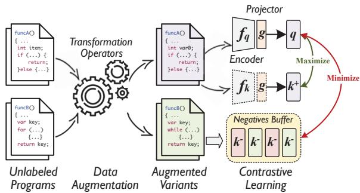
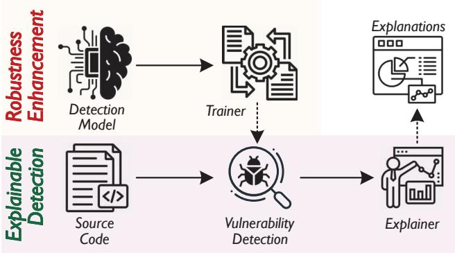
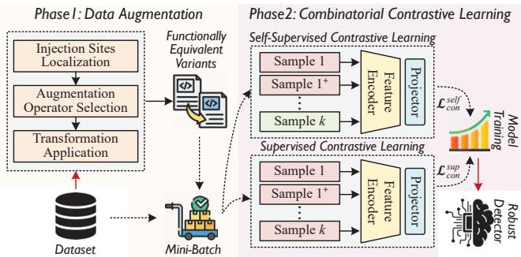
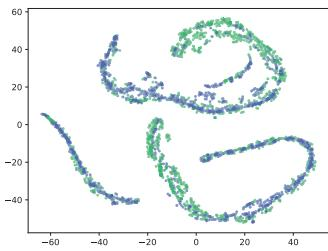
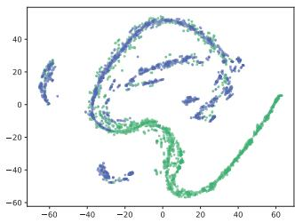
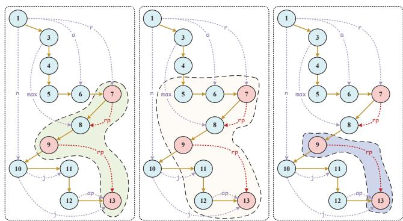

# CocA: Improving and Explaining Graph Neural Network-Based Vulnerability Detection Systems

Sicong Cao   
Yangzhou University   
Yangzhou, China   
DX120210088@yzu.edu.cn

David Lo Singapore Management University Singapore davidlo@smu.edu.sg

Xiaobing Sun\* Yangzhou University Yangzhou, China xbsun@yzu.edu.cn

Lili Bo   
Yangzhou University   
Yangzhou, China   
Yunnan Key Laboratory of Software   
Engineering   
Yunnan, China   
lilibo@yzu.edu.cn   
Xiaoxue Wu   
Yangzhou University   
Yangzhou, China   
xiaoxuewu@yzu.edu.cn   
Bin Li   
Yangzhou University   
Yangzhou, China   
lb@yzu.edu.cn

Wei Liu Yangzhou University Yangzhou, China weiliu@yzu.edu.cn

## ABSTRACT

Recently, Graph Neural Network (GNN)-based vulnerability detection systems have achieved remarkable success. However, the lack of explainability poses a critical challenge to deploy blackbox models in security-related domains. For this reason, several approaches have been proposed to explain the decision logic of the detection model by providing a set of crucial statements positively contributing to its predictions. Unfortunately, due to the weaklyrobust detection models and suboptimal explanation strategy, they have the danger of revealing spurious correlations and redundancy issue.

In this paper, we propose CocA, a general framework aiming to 1) enhance the robustness of existing GNN-based vulnerability detection models to avoid spurious explanations; and 2) provide both concise and effective explanations to reason about the detected vulnerabilities. CocA consists of two core parts referred to as Trainer and Explainer. The former aims to train a detection model which is robust to random perturbation based on combinatorial contrastive learning, while the latter builds an explainer to derive crucial code statements that are most decisive to the detected vulnerability via dual-view causal inference as explanations. We

apply CocA over three typical GNN-based vulnerability detectors. Experimental results show that CocA can effectively mitigate the spurious correlation issue, and provide more useful high-quality explanations.

## CCS CONCEPTS

•Security and privacy → Software security engineering;   
Software and its engineering → Software maintenance tools.

## KEYWORDS

Contrastive Learning, Causal Inference, Explainability

Sicong Cao, Xiaobing Sun, Xiaoxue Wu, David Lo, Lili Bo, Bin Li, and Wei Liu. 2024. CocA: Improving and Explaining Graph Neural Network-Based Vulnerability Detection Systems. In 2024 IEEE/ACM 46th International Conference on Software Engineering (ICSE '24), April 1420, 2024, Lisbon, Portugal. ACM, New York, NY, USA, 13 pages. https://doi.org/10.1145/3597503.3639168

## 1 INTRODUCTION

Software vulnerabilities, sometimes called security bugs, are weaknesses in an information system, security procedures, internal controls, or implementations that could be exploited by a threat actor for a variety of malicious ends [36]. As such weaknesses are unavoidable during the design and implementation of the software, and detecting vulnerabilities in the early stages of the software life cycle is critically important [60, 70].

patterns from source code without human intervention. Recently, inspired by the ability to effectively capture structured semantic information (e.g., control- and data-flow) of source code, Graph Neural Networks (GNN) have been widely adopted by state-of-the-art neural vulnerability detectors [11, 40, 67, 80]

While demonstrated superior performance, due to the black-box nature of NN models, GNN-based approaches fall short in the capability to explain why a given code is predicted as vulnerable [11, 59]. Such a lack of explainability could hinder their adoption when applied to real-world usage as substitutes for traditional source code analyzers [20]. To reveal the decision logic behind the binary detection results (vulnerable or not), several approaches have been proposed to provide additional explanatory information. These efforts can be broadly cast into two categories, namely Global Explainability and Local Explainability. Global explanation approaches leverage the explainability built in specific architectures to understand what features that influence the predictions of the models. A common self-explaining approach is attention mechanism [66], which uses weights of attention layers inside the network to determine the importance of each input token. For example, LineVul [28] leverages the self-attention mechanism inside the Transformer architecture to locate vulnerable statements for explanation. However, the global explanation is derived from the training data and thus it may not be accurate for a particular decision of an instance [55]. A more popular approach is local explanation [31, 83], which adopts perturbation-based mechanisms such as LEMNA [30] to provide justifications for individual predictions. The high-level idea behind this approach is to search for important features positively contributing to the model's prediction by removing or replacing a subset of the features in the input space. IVDetect [40] leverages GNNExplainer [75] to simplify the target instance to a minimal PDG sub-graph consisting of a set of crucial statements along with program dependencies while retaining the initial model prediction.

However, these approaches face two challenges that limit their potentials. Firstly, perturbation-based explanation techniques assume that the detection model is quite robust, i.e., these removed/preserved statements are consistent with the ground truth. Unfortunately, as reported in recent works [56, 74], simple code edits (e.g., variable renaming) can easily mislead NN models to alter their predictions. As a result, the weak robustness of detection models could lead to spurious explanations even if the vulnerable code is correctly identified. Secondly, most prior methods focus on generating explanations from the perspective of factual reasoning [40, 56, 61], i.e., providing a subset of the input program for which models make the same prediction as they do for the original one. However, such extracted explanations may not be concise enough, covering many redundant statements which are benign but highly relevant to the model's prediction. Therefore, it still requires extensive manpower to analyze and inspect numerous explanation results.

Our Work. To tackle these challenges, we propose CocA, a novel framework to improve and explain GNN-based vulnerability detection systems via combinatorial Contrastive learning and dual-view Causal inference. The key insights underlying our approach include (①) enhancing the robustness of existing neural vulnerability detection models to avoid spurious explanations, as well as (②) providing both concise (preserving a small fragment of code for manual review) and effective (covering as many truly vulnerable statements as possible) explanations. To this end, we develop two core parts in CocA referred to as Trainer (abbreviated as $\mathrm { C o c A } _ { T r a } )$ and Explainer $( \mathrm { C o c A } _ { E x p }$ for short).

CocA Design. In the model construction phase, $\mathrm { C o c A } _ { T r a }$ first applies six kinds of semantic-preserving transformations as data augmentation operators to generate diverse functionally equivalent variants for each code sample in the dataset. Then, given an off-theshelf GNN-based vulnerability detection model, $\mathrm { C o c A } _ { T r a }$ combines self-supervised with supervised contrastive learning to learn robust feature representations by grouping similar samples while pushing away the dissimilar samples. These robust feature representations will be fed into the classifier to train a robustness-enhanced vulnerability detection model. In the vulnerability explanation phase, we propose a model-agnostic extension based on dual-view causal inference called $\mathbf { C o c A } _ { E x p } ,$ , which integrates factual with counterfactual reasoning to derive crucial code statements that are most decisive to the detected vulnerability as explanations.

Implementation and Evaluations. We provide the prototype implementation of CocA over three state-of-the-art GNN-based vulnerability detection approaches (Devign [80], ReVeal [11], and DeepWuKong [16]). We extensively evaluate our approach with representative baselines on a large-scale vulnerability dataset comprising well-labeled programs extracted from real-world mainstream projects. Experimental results show that CocA can effectively improve the vulnerability detection performance of existing NN models and provide high-quality explanations.

Contributions. This paper makes the following contributions:

•We uncover the spurious correlations and redundancy problems in existing GNN-based explainable vulnerability detectors, and point out that these two issues need to be treated together.

• We propose $\mathrm { C o c A } ^ { 1 }$ , a novel framework for improving and explaining GNN-based vulnerability detection systems, in which $\mathrm { C o c A } _ { T r a }$ improves the robustness of detection models based on combinatorial contrastive learning to avoid spurious explanations, while $\operatorname { C o c A } _ { E x p }$ derives both concise and effective code statements as explanations via dual-view causal inference.

• We provide prototype implementations of CocA over three stateof-the-art GNN-based vulnerability detection approaches. The extensive experiments show substantial improvements CocA brings in terms of the detection capacity and explainability.

## 2 BACKGROUND

## 2.1 Problem Formulation

Instead of exploring new models for more effective vulnerability detection, we focus on a more practical scenario, i.e., explaining the decision logic of off-the-shelf GNN-based vulnerability detection models in a post-hoc manner as an input code snippet is predicted as vulnerable. In particular, following the definition in recent works [33, 40], our problem is formalized as:

DeFINITIon 1 (Vulnerability Explanation). Given an input program $P = \{ s _ { 1 } , \cdots , s _ { m } \}$ which is detected as vulnerable, the explanation is a set of crucial statements $\left\{ s _ { i } , \cdot \cdot \cdot , s _ { j } \right\} ( 1 \leq i \leq j \leq$ m) that are most relevant to the decision of the model, where $s _ { u }$ $( i \leq u \leq j )$ denotes the u-th statement in program $P .$

  
Figure 1: Contrastive code representation learning pipeline.

In other words, our goal turns to develop an explanation framework applicable to any GNN-based vulnerability detector to provide not only binary results, but also a few lines of code (i.e., a subset of the input program) as explanatory information, to help security practitioners understand why it is detected as vulnerable.

## 2.2 Contrastive Learning for Code

Due to the limited labeled data in downstream tasks, contrastive learning (CL) has emerged as a promising method for learning better feature representation of code without supervision from labels [22, 34, 46, 79]. The goal of CL is to maximize the agreement between original data and its positive data (an augmented version of the same sample) while minimizing the agreement between original data and its negative data in the vector space. Figure 1 presents the typical code-oriented CL pipeline. Unlabeled programs are first transformed into functionally equivalent (FE) variants via data augmentation. In this work, we apply the following six token- or statement-level augmentation operators introduced by prior works [10, 34, 46] to construct FE program variants:

• Function/Variable Renaming (FR/VR) substitutes the function/variable name with a random token extracted from the vocabulary set constructed on the pre-training dataset.

•Operand Swap (OS) is to swap the operands of binary logical operations. In particular, the operator will also be changed to make sure the modified expression is the logical equivalent to the one before modification when we swap the operands of a logical operator.

• Statement Permutation (SP) randomly swaps two lines of statements that have no dependency (e.g., two consecutive declaration statements) on each other in a basic block in a function body.

• Loop Exchange (LX) replaces for loops with while loops or vice versa.

• Block Swap (BS) swaps the then block of a chosen if statement with the corresponding else block. We negate the original branching condition to preserve semantic equivalence.

• Switch to If (SI) replaces a switch statement in a function body with its equivalent if statement.

Then, these augmented variants are fed into the feature encoder $f _ { q }$ (or fk) with a projection head to produce better global program embeddings via minimizing the contrastive loss. A widely adopted contrastive loss in SE tasks is Noise Contrastive Estimate (NCE) [13],

which is computed as:

$$
\mathcal { L } _ { N C E } = \frac { 1 } { \vert \mathcal { B } \vert } \sum _ { i \in \mathcal { B } } - \mathrm { l o g } \frac { \exp ( z _ { i } \cdot z _ { j ( i ) } / \tau ) } { \sum _ { \alpha \in \mathcal { A } ( i ) } ^ { \alpha } \exp ( z _ { i } \cdot z _ { \alpha } / \tau ) }\tag{1}
$$

where $z _ { i } = g ( f ( \tilde { x } _ { i } ) )$ represents the low-dimensional embedding of an arbitrary sample $\tilde { x } _ { i }$ among augmented variants. j(i) is the index of the other view originating from the same source. $\tau \in \mathcal { R } ^ { + }$ is the temperature parameter to scale the loss, and $\mathcal { A } ( i ) \equiv \mathcal { B } \backslash \{ i \}$

## 2.3 Explanation for GNN-based Models

Although Graph Neural Networks (GNN)-based code models have achieved remarkable success in a variety of SE tasks (e.g., code retrieval [58] and automated program repair [14]), the lack of explainability creates key barriers to their adoption in practice. Recently, several studies have attempted to explain the decisions of GNNs via factual reasoning [49, 75] or counterfactual reasoning [45, 47]. Factual Reasoning. Factual reasoning-based approaches focus on seeking a sub-graph with a sufficient set of edges/features that produce the same prediction as using the whole graph. Formally, given an input graph $\boldsymbol { \mathcal { G } } _ { k } = \{ \boldsymbol { \mathcal { V } } _ { k } , \boldsymbol { \mathcal { E } } _ { k } \}$ with its label k predicted by the trained GNN model, the condition for factual reasoning can be produced as following:

$$
\underset { \ell \in \mathcal { L } } { \arg \operatorname* { m a x } } P ( \ell \mid A _ { k } \odot M _ { k } , X _ { k } \odot F _ { k } ) = \hat { y } _ { k }\tag{2}
$$

where $\mathcal { L }$ is the set of graph labels and  denotes element-wise multiplication; $M _ { k } \in \mathsf { \Gamma } _ { [ 0 , 1 ] } ^ { \setminus \mathcal { N } _ { k } \times \mathcal { V } _ { k } }$ represents the edge mask of $\mathbf { \mathcal { G } } _ { k }$ s adjacency matrix $\mathsf { \bar { A } } _ { k } \in \left\{ 0 , 1 \right\} ^ { \mathcal { V } _ { k } \times \mathsf { \bar { V } } _ { k } }$ , while $F _ { k } \in \left\{ 0 , 1 \right\} ^ { \mathcal { N } _ { k } }$ ×d is the feature mask of $\vec { \pmb { \mathscr { G } } _ { k } \ : \mathrm { \Delta } s }$ node feature matrix $X _ { k } \in \mathbb { R } ^ { \mathcal { V } _ { k } \times d } . \mathcal { V } _ { k }$ is the number of nodes in the k-th graph and d is the dimension of node features.

Counterfactual Reasoning. Counterfactual reasoning-based approaches seek a necessary set of edges/features that lead to different predictions once they are removed. Similarly, the condition for counterfactual reasoning can be formulated as:

$$
\underset { \ell \in \mathcal { L } } { \arg \operatorname* { m a x } } P ( \ell \mid A _ { k } - A _ { k } \odot M _ { k } , X _ { k } - X _ { k } \odot F _ { k } ) \neq \hat { y } _ { k }\tag{3}
$$

After optimization, the sub-graph $\pmb { \mathcal { G } } _ { k } ^ { \prime }$ will be $A _ { k } \odot M _ { k }$ with the sub-features $X _ { k } \odot F _ { k } ,$ which is the generated explanations for the prediction of $\scriptstyle { G _ { k } }$ In our scenario, the extracted sub-graph $\pmb { \mathcal { G } } _ { k } ^ { \prime }$ will be further mapped to its corresponding code snippet as explanations for GNN-based vulnerability detectors.

## 3 MOTIVATION

## 3.1 Special Concerns for DL-based Security Applications

In contrast to other domains, explanations for security systems should satisfy certain special requirements [25, 69]. In this work, we primarily focus on two aspects, i.e., effectiveness and conciseness. Effectiveness. The main goal of an explanation approach is to uncover the decision logic of black-box models. Thus, the vulnerability explainer should be able to capture most relevant features employed by detection models for prediction. For example, given a set of detected vulnerable code, it would be perfect if the provided explanations only cover vulnerability-related context without additional program statements [15].

DeFInition 2 (Effective Explanations). An explanation result is effective if statements which describe the offending execution trace/context of the detected vulnerability are covered.

Conciseness. Picking up features/statements highly relevant to the model's prediction is a necessary prerequisite for good explanations. However, it may be difficult and time-consuming for security practitioners to understand and analyze numerous explanation results. Thus, narrowing down the scope of manual review is also important in practice.

DeFIniTion 3 (Concise Explanations). An explanation result is concise when it only contains a small number of crucial statements sufficient for security experts to understand the root cause of the detected vulnerability.

## 3.2 Why Not Fine-Grained Detectors?

Since the vulnerability explanations are a set of crucial statements derived from the predictions of DL models, an intuitive solution is to construct a fine-grained model to locate vulnerability-related statements, as prior works do [7, 8, 32, 41]. However, the lack of large-scale and human-labeled datasets create key barriers to the adoption of these statement-level approaches in practice. By contrast, we aim to seek a model-independent (or post-hoc) way to provide explanations, instead of replacing them.

## 3.3 Why Not Existing Explainers?

Although the explainability of DL models has been extensively studied in non-security domains [27, 77], we argue that existing explanation approaches face two critical challenges when directly applied to GNN-based vulnerability detection systems.

Weak Robustness. As reported in [11, 33, 59], existing neural vulnerability detectors focus on picking up dataset nuances for prediction, as opposed to real vulnerability features. Unfortunately, the robustness of most explanation approaches (e.g., LIME [57], SHAP [48]) are weak, and their explanations for the same sample are easy to be altered due to small perturbations, or even random noise [25, 69]. As a result, explanations built on top of the detection results from such weakly-robust models just reveal spurious correlations, which are hard to be tolerated by security applications.

Hard to Balance Effectiveness and Conciseness. Post-hoc approaches mostly explain the predictions made by DL models from the perspective of factual reasoning [29, 40], which favors a sufficient subset which contains enough information to make the same prediction as they do for the original program. However, such extracted explanations may produce a large number of false alarms, posing a barrier to adoption. What's worse, since the existing posthoc explanation approaches mainly leverage perturbation-based mechanisms (e.g., LEMNA [30]) to track input features that are highly relevant to the model's prediction, the explanation performance will deteriorate further due to the weak robustness of detection models to random perturbations. On the contrary, counterfactual explanations [18] contain the most crucial information, which constitutes minimal changes to the input under which the model changes its mind. However, just because of this, they may only cover a small subset of the ground truth.

  
Figure 2: The workflow of CocA.

## 3.4 Key Insights Behind Our Design

In this study, we primarily focus on providing both effective and concise explanations for security practitioners to gain insights into why a given program was detected as vulnerable. The key insight of CocA is that the effectiveness and conciseness of explanations can be improved in a two-stage process. This is inspired by the observation that the robustness of detection models is a necessary prerequisite for effective explanations, while the trade-off between the effectiveness and conciseness mainly depends on the adopted explanation strategy. Therefore, by employing the two-stage process, the special concerns for effectiveness and conciseness of explanations in GNN-based vulnerability detection systems can be well satisfied. Overview. Figure 2 presents the workflow of CocA, including two core components: Trainer and Explainer. Given a crafted GNN-based vulnerability detection model M, one major difference between our framework and existing approaches lies in the training strategy of the model. Specifically, instead of employing cross-entropy loss, our Trainer module leverages combinatorial contrastive loss to train a more robust detector against random perturbations to avoid spurious explanations. Thus, in the vulnerability detection phase, we still transform the input program into graphs and leverage the well-trained model to learn code feature representations for prediction as previous works do. In the explainable detection phase, given a vulnerable code detected by the robustness-enhanced model, we propose a model-agnostic extension, called Explainer, to provide security practitioners with both concise and effective explanations to understand model decisions via dual-view causal inference.

## 4 ROBUSTNESS ENHANCEMENT

Figure 3 depicts the architecture of our CocA Trainer $( { \mathrm { C o c A } } T r a$ for short). In this stage, we aim to train a neural vulnerability detection model that is robust to random perturbation, which is the core mechanism used in most explainers, to avoid spurious explanations. Specifically, given a crafted detection model $\mathcal { M } , \mathrm { C o c a } _ { T r a } \left( \pmb { \operatorname { \mathbf { \sigma } } } \mathbf { \Theta } \right)$ augments the vulnerable (or benign) programs in the dataset into a set of functionally equivalent variants via semantics-preserving transformations; and (②) leverages combinatorial contrastive learning to force the detection model to focus on critical vulnerability semantics that are consistent between original vulnerable programs and their positive pairs (including perturbed variants and other vulnerable samples), instead of subtle perturbation.

  
Figure 3: The architecture of CocATra

## 4.1 Data Augmentation

Inspired by the recent works which adopt obfuscation-based adversarial code as robustness-promoting views [3, 35], our core insight is that the effectiveness of perturbation-based explanation approaches can also benefit from the robustness-enhanced detection models via transformed code because 1) existing perturbation approaches are not suitable for sparse and high-dimensional feature representations of source code [55]; and 2) semantics-preserving code transformations in the discrete token space without changing model predictions can be approximately mapped to the perturbations in the continuous embedding space.

Specifically, to construct functionally equivalent variants, we first perform static analysis to parse each source code $c _ { i }$ into an AST $T _ { c _ { i } }$ and traverse it to search for potential injection locations (i.e. AST nodes to which can be applied aforementioned six program transformations $\Phi = \{ \phi _ { 1 } , \phi _ { 2 } , \cdot \cdot \cdot , \phi _ { 6 } \} ,$ . Once an injection location $n _ { k }$ is found, an applicable augmentation operator $\phi _ { j } \in \Phi$ will be randomly selected and applied to get the transformed node $n _ { k } ^ { \prime } .$ We then adapt the context of $n _ { k }$ accordingly, and translate it to the FE variant $c _ { j } ^ { \prime } .$ It is noteworthy that different from synthetic samples [52, 53] used to mitigate the data scarcity issue in classifier training, our transformed FE variants are regarded as augmented views of original samples during contrastive learning to train a robust feature encoder that can capture real vulnerability features. Subsequently, we arrange original code samples along with their FE perturbed variants (positives) as inputs in a mini-batch. In this way, augmented samples originated from one pair are negatively correlated to any sample from other pairs within a mini-batch during contrastive learning.

## 4.2 Combinatorial Contrastive Learning

To train a detection model robust to random perturbations, we borrow the contrastive learning technique to learn better feature representations. Despite the similarity in terms of the high-level design idea [4, 23, 34, 46], i.e., pre-training a self-supervised featureacquisition model over a large unlabeled code database, and performing supervised fine-tuning over labeled dataset to transfer it to a specific downstream SE task, we employ an additional supervised contrastive loss term to effectively leverage label information.

Below, we elaborate on each component of our combinatorial contrastive learning with more technical details.

Feature Encoder. To extract representations of source code, we employ three typical GNN-based models (Devign [80], ReVeal [11], and DeepWuKong [16]) as feature encoders f (·). Note that no matter data augmentation or combinatorial contrastive learning are architecture-agnostic, our $\mathrm { C o c A } _ { T r a }$ can be easily extended and integrated into other DL-based SE model for robustness enhancement. Projection Head. To improve the representation quality of the feature encoder as well as the convergence of contrastive learning. we add a projection head $g ( \cdot )$ consisting of a Multi-Layer Perceptron (MLP) [62] with a single hidden layer, to map the embeddings learned by the feature encoder into a low-dimensional latent space to minimize the contrastive loss.

Contrastive Loss. Following existing approaches [34, 46], we first employ the NCE loss defined in Eq. (1) as our self-supervised loss function $\mathcal { L } _ { c o n } ^ { s e l f }$ . Specifically, given a set of N randomly sampled unlabeled code samples $\{ x _ { k } \} _ { k = 1 , \cdots , N } ,$ data augmentation (Section 4.1) is applied once to obtain their corresponding FE variants. These samples {¯xi}, where $\tilde { x } _ { 2 k - 1 }$ and $\tilde { x } _ { 2 k }$ are the original and augmented view of $x _ { k }$ , respectively, are then arranged in the mini-batch $\mathcal { B } \equiv$ $\lbrace 1 , \cdots , 2 N \rbrace$ to compute $\mathcal { L } _ { c o n } ^ { s e l f }$

In addition, inspired by a recent finding [35] that the robustness enhanced in the self-supervised pre-training phase may no longer hold after supervised fine-tuning, we also adopt the Supervised Contrastive (SupCon) loss [37] during the training process because the use of label information encourages the feature encoder to closely aligns all samples from the same class in the latent space to learn more robust (in terms of original samples and FE variants) and accurate (in terms of samples with the same label) cluster representations. Formally, the SupCon loss $\mathcal { L } _ { c o n } ^ { s u p }$ is written as:

$$
\mathcal { L } _ { c o n } ^ { s u p } = \frac { 1 } { | \mathcal { B } ^ { l } | } \sum _ { i \in \mathcal { B } ^ { l } } \frac { - 1 } { | Q ( i ) | } \sum _ { q \in Q ( i ) } \log \frac { \exp ( z _ { i } \cdot z _ { q } / \tau ) } { \sum _ { a \in \mathcal { A } ( i ) } ^ { \infty } \exp ( z _ { i } \cdot z _ { a } / \tau ) }\tag{4}
$$

where $\mathcal { B } ^ { l }$ corresponds to the subset (known vulnerable or benign code) of B, and $Q ( i ) \equiv \{ q \in \mathcal { A } ( i ) : \tilde { y } _ { q } = \tilde { y } _ { i } \}$ is the set of indices of all other positives that hold the same label as $\tilde { x } _ { i }$ in $\mathcal { B } . 1 / | Q ( i ) |$ is the positive normalization factor which serves to remove bias present in multiple positives samples and preserve the summation over negatives in the denominator to increase performance.

Finally, the total loss used to train a robust feature encoder over the batch is defined as:

$$
\mathcal { L } _ { t o t a l } = ( 1 - \lambda ) \mathcal { L } _ { c o n } ^ { s e l f } + \lambda \mathcal { L } _ { c o n } ^ { s u p }\tag{5}
$$

where $\lambda$ is a weight coefficient to balance the two loss terms.

At the end of combinatorial contrastive learning, the projection head g(·) will be discarded and the well-trained feature encoder f (·) is frozen (i.e., containing exactly the same number of parameters when applied to specific downstream tasks) to produce the vector representation of a program for vulnerability detection.

## 5 EXPLAINABLE DETECTION

The explainable detection stage aims to (7) train a classifier on top of the robust feature encoder for vulnerability detection; and (②) build a explainer to derive crucial statements as explanations.

## 5.1 Vulnerability Detection

The goal of this task is to train a binary classifier able to accurately predict the probability that a given function is vulnerable or not. In particular, given a popular GNN-based vulnerability detection model, we only replace its feature encoder with the more robust $\mathrm { o n e ^ { 2 } }$ (sharing the same NN architecture) which is pre-trained by $\mathrm { C o c A } _ { T r a }$ . Thus, any coarse-grained (function- or slice-level) vulnerability detector, which receives structural graph representations of source code (in which code tokens/statements are nodes while semantic relations between nodes are edges) as inputs and employs an off-the-shelf or crafted GNN as its feature encoder for vulnerability feature learning, can be easily integrated into our framework. For example, when ReVeal [11] is selected as the target detection model, labeled code snippets are parsed into Code Property Graphs (CPGs) [73] and fed into the robust feature encoder $f ( \cdot )$ (a vanilla GGNN [39]) pre-trained by $\mathrm { C o c A } _ { T r a }$ to produce corresponding vector representations. Then, these representations and their labels are used to train a built-in classifier (a convolutional layer with maxpooling) with the triplet loss function.

In the inference phase, given an input program, the vulnerability detector first performs static analysis to extract its graph representation and maps it as a single vector representation using the pre-trained feature encoder. Then, the program representation will be fed into the trained classifier for prediction.

## 5.2 Vulnerability Explanation

To derive explanations on why the detection model has decide on the vulnerability, we propose a model-agnostic extension based on the detection results, referred to as Explainer $( \mathrm { C o c A } _ { E x p }$ for short). Overview. Similar to the most related work IVDetect $[ 4 0 ] , { \mathrm { C o c A } } _ { E x p }$ aims to find a sub-graph $\mathcal { G } _ { k } ^ { \prime } \mathrm { : }$ which covers the key nodes (tokens/statements) and edges (program dependencies) that are most decisive to the prediction label, from the graph representation $\mathcal { G } _ { k }$ of the detected vulnerable code k. The main difference lies in that we aim to seek both concise and effective explanations. Hence, we build ${ \mathrm { C o c A } } _ { E x p }$ based on a dual-view causal inference framework [63] which integrates factual with counterfactual reasoning to make a trade-off between conciseness and effectiveness. Formally, the extraction of $\mathcal { G } _ { k } ^ { \prime }$ can be formulated as:

$$
\begin{array} { r l } & { \mathrm { m i n i m i z e \ } C ( M _ { k } , F _ { k } ) } \\ & { \mathrm { s . t . } , S _ { f } ( M _ { k } , F _ { k } ) > P ( \hat { y } _ { k , s } \mid A _ { k } \odot M _ { k } , X _ { k } \odot F _ { k } ) , } \\ & { S _ { c } ( M _ { k } , F _ { k } ) > - P ( \hat { y } _ { k , s } \mid A _ { k } - A _ { k } \odot M _ { k } , X _ { k } - X _ { k } \odot F _ { k } ) } \end{array}\tag{6}
$$

where the objective part $C ( M _ { k } , F _ { k } )$ measures how concise the explanation is. It can be defined as the number of edges/features used to generate the explanation sub-graph $\mathcal { G } _ { k } ^ { \prime }$ , and computed by $C ( M _ { k } , F _ { k } ) = \| M _ { k } \| _ { 0 } + \| F _ { k } \| _ { 0 }$ , in which $\| M _ { k } \| _ { 0 } \left( / \| \dot { F } _ { k } \| _ { 0 } \right)$ represents the number of 1's in the binary edge mask $M _ { k }$ (/feature mask $F _ { k } )$ metrices. The constraint part $S _ { f } ( M _ { k } , F _ { k } ) \ : ( / S _ { c } ( M _ { k } , F _ { k } ) )$ reflects whether the factual (/counterfactual) explanation is effective enough. Formally, the factual explanation strength $S _ { f } ( M _ { k } , F _ { k } )$ is consistent with the condition for factual reasoning, i.e. $S _ { f } ( M _ { k } , F _ { k } ) = P ( \hat { y } _ { k } \ |$ $A _ { k } \odot M _ { k } , X _ { k } \odot F _ { k } )$ . Similarly, the counterfactual explanation strength $S _ { c } ( M _ { k } , F _ { k } )$ is calculated as $S _ { c } ( M _ { k } , F _ { k } ) = - P ( \hat { y } _ { k } \mid A _ { k } { - } A _ { k } \odot M _ { k } , X _ { k } -$

$X _ { k } \odot F _ { k } ) . \hat { y } _ { k , s }$ is the label other than $\hat { y } _ { k }$ that has the largest probability score predicted by the GNN-based detection model.

To solve such a constrained optimization problem, we follow [63], which optimizes the objective part by relaxing $M _ { k }$ and $F _ { k }$ to real values $\hat { M _ { k } ^ { * } } \in \mathbb { R } ^ { \mathcal { V } _ { k } \times \mathcal { V } _ { k } }$ and $F _ { k } ^ { * } \in \mathbb { R } ^ { \mathcal { V } _ { k } \times d }$ , and using 1-norm to ensure the sparsity of $M _ { k } ^ { * }$ and $\boldsymbol { F } _ { k } ^ { * }$ For the constraint part, we relax it as pairwise contrastive loss $\ddot { \mathcal { L } _ { f } }$ and $\mathcal { L } _ { c } \mathrm { : }$

$$
\begin{array} { r l } & { \mathcal { L } _ { f } = \mathrm { R e L U } \big ( \frac { 1 } { 2 } - S _ { f } ( M _ { k } ^ { * } , F _ { k } ^ { * } ) } \\ & { \qquad + P ( \hat { y } _ { k , s } \mid A _ { k } \odot M _ { k } ^ { * } , X _ { k } \odot F _ { k } ^ { * } ) \big ) } \end{array}\tag{7}
$$

$$
\begin{array} { r l } & { \mathcal { L } _ { c } = \operatorname { R e L U } ( \frac { 1 } { 2 } - S _ { c } ( M _ { k } ^ { * } , F _ { k } ^ { * } ) } \\ & { \qquad - P ( \hat { y } _ { k , s } \mid A _ { k } - A _ { k } \odot M _ { k } ^ { * } , X _ { k } - X _ { k } \odot F _ { k } ^ { * } ) ) } \end{array}
$$

After that, the explanation sub-graph $\mathcal { G } _ { k } ^ { \prime } = ( A _ { k } \odot M _ { k } ^ { * } , X _ { k } \odot F _ { k } ^ { * } )$ is generated by:

$$
\mathrm { m i n i m i z e } \ \| M _ { k } ^ { * } \| _ { 1 } + \| F _ { k } ^ { * } \| _ { 1 } + \alpha \mathcal { L } _ { f } + ( 1 - \alpha ) \mathcal { L } _ { c }\tag{8}
$$

Where α controls the trade-off between the strength of factual and counterfactual reasoning. By increasing/deceasing α, the generated explanations will focus more on the effectiveness/conciseness.

## 6 EXPERIMENTS

## 6.1 Research Questions

In this paper, we seek to answer the following RQs:

RQ1 (Detection Performance): How effective are existing GNNbased approaches enhanced via CocA on vulnerability detection?

The disconnection between the learned features versus the actual cause of the vulnerabilities has raised the concerns regarding the effectiveness of DL-based detection models. Thus, we investigate whether the enhanced GNN-based vulnerability detectors outperform their original ones in terms of detection accuracy and the ability to capture real vulnerability features after robustness enhancement.

RQ2 (Explanation Performance): Is CocA more concise and effective than state-of-the-art baselines when applied to generate explanations for GNN-based vulnerability detectors?

We argue that generating corresponding explanations for detection results is just the first step and the quality evaluation of them is also important. With this motivation, we evaluate the performance of CocA in generating concise and effective explanations.

RQ3 (Ablation Study): How do various factors affect the overall performance of CocA?

We perform sensitivity analysis to understand the influence of different components of CocA, including the impact of (RQ3a) combinatorial contrastive learning, and (RQ3b) dual-view causal inference.

## 6.2 Datasets

Since the detection capability of DL-based models benefits from large-scale and high-quality datasets, we built our evaluation benchmark by merging five reliable human-labeled datasets collected from real-world projects, including Devign [80], ReVeal [11], Big-Vul [24], CrossVul [51], and CVEFixes [2]. Detailed statistics for each of the five datasets is shown in Table 1. Column 2 and Column

Table 1: The statistics of datasets.
<table><tr><td>Dataset</td><td># Vul</td><td># Non-vul</td><td># Total</td><td>% Ratio</td></tr><tr><td>Devign</td><td>11,888</td><td>14,149</td><td>26,037</td><td>45.66</td></tr><tr><td> ReVeal</td><td>1,664</td><td>16,505</td><td>18,169</td><td>9.16</td></tr><tr><td>B-Vul</td><td>11,823</td><td>253,096</td><td>264,919</td><td>4.46</td></tr><tr><td> CrosVul</td><td>6,884</td><td>127,242</td><td>134,126</td><td>5.13</td></tr><tr><td>CVFixes</td><td>8,932</td><td>159,157</td><td>168,089</td><td>5.31</td></tr><tr><td>Merged</td><td>29,844</td><td>305,827</td><td>335,671</td><td>8.89</td></tr></table>

3 are the number of vulnerable and non-vulnerable functions, respectively. Column 4 indicates the total number of functions in each dataset. Column 5 denotes the ratio of vulnerable functions in each dataset. Note that, for two multi-language datasets CrossVul and CVEFixes, we only preserve code samples written in C/C++ in our experiments to unify the whole dataset. In total, our merged dataset contains 335,671 functions, of which 29,844 (8.89%) are vulnerable.

## 6.3 CoCA Implementation

For $\mathrm { C o c A } _ { T r a } ,$ we parsed all the code snippets in our merged dataset into ASTs using tree-sitter3and performed the transformation based on augmentation operators described in Section 4.1 to generate perturbed variants. We applied all six transformations with an equal probability of 0.5, which leads us to an average of three transformations per program. In contrastive learning, any GNN-based detection model can be served as an feature encoder in our framework and trained on an Ubuntu 18.04 server with 2 NVIDIA Tesla V100 GPU. Following standard practice in contrastive code representation learning [34, 79], we set the size of the projection head to 128, and used Adam [38] for optimizing with 256 batch size and 1e-5 learning rate. The temperature parameter t of contrastive loss is set to 0.07. For feature encoder training, we randomly sampled a subset (50%) of vulnerable and benign samples from the merged dataset, respectively, to construct B, and the remaining samples are regarded as the unlabeled data $\mathcal { B } ^ { l }$ . The feature encoder and classifier of each detection model were trained with 100 maximum epochs and early stopping. For $\mathrm { C o c A } _ { E x p } .$ ,we set α to 0.5 to balance factual and counterfactual reasoning.

## 7 EXPERIMENTAL RESULTS

## 7.1 RQ1: Detection Performance

Baselines. We consider three state-of-the-art GNN-based vulnerability detectors: 1) Devign [80] models programs as graphs and adopts GGNN [39] to capture structured vulnerability semantics; 2) ReVeal [11] adopts graph embedding with triplet loss function to learn class-separation vulnerability features; and 3) DeepWuKong [16] leverages GCN to learn both unstructured and structured vulnerability information at the slice-level.

Evaluation Metrics. We apply four widely used metrics [54], including Accuracy (Acc), Precision (Pre), Recall (Rec), and F1- score (F1), for evaluation.

Experiment Setup. For the open-source approaches (ReVeal and DeepWuKong), we directly use their official implementations. For Devign, which is not publicly available, we re-implemented it by strictly following its methods elaborated in the original paper. In addition, to integrate these approaches into CocA, we also employ tree-sitter to uniformly parse input programs into their expected graph representations (e.g., PDG, CPG). We randomly split the benchmark into 80%-10%-10% for training, validation, and testing. For each approach, we repeated the experiment 10 times to address the impact of randomness [1, 64].

Table 2: Evaluation results on vulnerability detection in percentage compared with GNN-based baselines.
<table><tr><td>Config</td><td>Loss</td><td>| Approach</td><td>Acc</td><td>Pre</td><td>Rec</td><td>F1</td></tr><tr><td>Default</td><td>CE</td><td>| Devign RReVeal |DeepWuKong</td><td>89.74 86.05 887.21</td><td>32.59 31.43 28.55</td><td>31.40 38.45 26.04</td><td>31.98 34.59 27.24</td></tr><tr><td>CocATra</td><td>Ours InfoNCE</td><td>| Devign RReVeal DeepWuKong | Devign RReVeal</td><td>88.15 887.42 88.30 86.33 84.95</td><td>34.68 35.96 30.07 28.38 29.64</td><td>37.12 40.61 34.79 30.11</td><td>35.86 38.14 32.26 29.22</td></tr><tr><td></td><td>NCE</td><td>D eepWuKong | Devign RReVeal DeepeWuKong</td><td>86.20 83.97 81.52 83.06 2.40</td><td>25.99 26.15 6.73</td><td>34.27 24.83 27.69 31.76</td><td>1.78 25.40 26.90 29.03</td></tr></table>

Results. Table 2 summarizes the experimental results of all the studied baselines and their corresponding variants enhanced by $\mathrm { C o c A } _ { T r a }$ on vulnerability detection. Column "Config" presents the configuration of GNN-based vulnerability detectors, i.e., constructing detection models with default implementations (supervised learning with CE loss) or $\mathrm { C o c A } _ { T r a }$ (contrastive learning with NCE and SupCon loss). Overall, the average improvements of robustnessenhanced models over their default ones are positive, ranging from 5.32% (DeepWuKong) to 14.41% (ReVeal) on Precision, from 5.62% (ReVeal) to 33.60% (DeepWuKong) on Recall, and from 10.26% (Re-Veal) to 18.43% (DeepWuKong) on F1, respectively. In addition, $\mathrm { C o c A } _ { T r a }$ (ReVeal) achieves the overall best performance, with an Accuracy of 87.42%, the Precision of 35.96%, the Recall of 40.61%, and the F1 of 38.14%.

All these results demonstrate the effectiveness of $\mathbf { C o c A } _ { T r a }$ in improving the vulnerability detection performance of existing GNNbased code models. It indicates that incorporating structurally perturbed samples (e.g., statement permutation, loop exchange) into contrastive learning is beneficial for the graph-based model to focus on security-critical structural semantics rather than noise information. Taking the greatest improved model DeepWuKong as an example, as shown in the visualizations in Figure 4, the feature representations learned by $\mathrm { C o c A } _ { T r a }$ (DeepWuKong) are more class-discriminative compared to the ones learned with default cross-entropy loss. We attribute such improvements to robustnessenhanced models truly capturing discriminative vulnerability patterns from the comparison between vulnerable samples and perturbed/benign variants.

Answer to RQ1: $\mathrm { C o c A } _ { T r a }$ comprehensively improves the performance of existing GNN-based vulnerability detectors in terms of all evaluation metrics. We attribute the improvements to the robustness-enhanced models truly picking up real vulnerability features for prediction.

  
(a) DeepWuKong (Default)  
(b) DeepWuKong $\mathbf { \Gamma } ( \mathbf { C o c A } _ { T r a } )$  
Figure 4: Visualizations of feature representations learned by DeepWuKong trained with/without $\mathbf { C o c A } _ { T r a } .$

## 7.2 RQ2: Explanation Performance

Baselines. We adopt three recent vulnerability explanation approaches as baselines: 1) IVDetect [40] leverages GNNExplainer [75] to produce the key program dependence sub-graph (i.e., a list of crucial statements closely related to the detected vulnerability) that affect the decision of the model as explanations; 2) P2IM [61] borrows Delta Debugging [76] to reduce a program sample to a minimal snippet which a model needs to arrive at and stick to its original vulnerable prediction to uncover the model's detection logic; and 3) mVulPreter [82] combines the attention weight with the vulnerability probability outputted by the multi-granularity detector to compute the importance score for each code slice.

Evaluation Metrics. As we described in Section 3, an ideal explanation should cover as many truly vulnerable statements (in terms of effectiveness) as possible within a limited scope (in terms of conciseness). Thus, we use the fine-grained Vulnerability-Triggering Paths (VTP) [15, 17] metrics to evaluate the quality of explanations, which are formally defined as follows:

• Mean Statement Precision (MSP): $\begin{array} { r } { M S P = \frac { 1 } { N } \sum _ { i = 1 } ^ { N } S P _ { i } } \end{array}$ where $S P _ { i } ~ = ~ | S _ { e } \cap S _ { p } | / | S _ { e } |$ stands for the proportion of contextual statements truly related to the detected vulnerability sample i in the explanations.

• Mean Statement Recall (MSR): $\begin{array} { r } { M S R \ = \ \frac { 1 } { N } \sum _ { i = 1 } ^ { N } S R _ { i } . } \end{array}$ where $S R _ { i } = | S _ { e } \cap S _ { p } | / | S _ { p } |$ denotes that how many contextual statements in the triggering path of the detected vulnerability sample i can be covered in explanations.

• Mean Intersection over Union (MIoU): $\begin{array} { r } { M I o U = \frac { 1 } { N } \sum _ { i = 1 } ^ { N } I o U _ { i } } \end{array}$ where $I o U _ { i } = | S _ { e } \cap S _ { p } | / | S _ { e } \cup S _ { p } |$ reflects the degree of overlap between the explanatory statements and the contextual statements on the vulnerability-triggering path.

Here, $S _ { e }$ denotes the set of explanatory statements provided by explainers, while $S _ { p }$ denotes the set of labeled vulnerability-contexts (ground truth) in the dataset. | · | represents the size of a set.

Experiment Setup. We still employ three aforementioned GNNbasd vulnerability detectors (with default/robustness-enhanced configurations) to provide prediction labels for IVDetect4, P2IM, and $\operatorname { C o c A } _ { E x p } .$ For mVulPreter, we follow the official implementation to produce explanations because its detection and explanation module is highly coupled. For two baselines (IVDetect and mVulPreter) which require a human-selected k value to decide the size of the explanations, we follow [40, 82] to narrow down the scope of candidate statements to 5, while the size of explanations produced by our approach and P2IM are automatically decided by themselves via optimization. Following [17, 61], we evaluate these explanation approaches on another vulnerability dataset D2A [78] because it is labeled with clearly annotated vulnerability-contexts which are more reliable than other diff-based ground truths [15]. We randomly select 10,000 vulnerable samples which can be correctly detected from the D2A dataset to calculate the VTP metrics.

Table 3: Evaluation results on vulnerability explanation in percentage compared with explainable vulnerability detection baselines.
<table><tr><td>Config</td><td>g | Approach</td><td>MSP</td><td>MSR</td><td>MIoU</td></tr><tr><td>Beet</td><td>mVulPreter VDetect P2IM (evign) P2I (RVeal) P2IM (DeepWuKong)  $\mathrm { C o c a } _ { E x p } \mathrm { ( D e v i g n ) }$   $\mathsf { C o c A } _ { E x p }$  (ReVeal)  ${ \mathrm { C o c A } } _ { E x p }$  (DeepWuKong)</td><td>25.86 32.54 27.99 31.04 26.57 33.84 35.61 29.77</td><td>29.01 23.79 43.85 46.10 38.12 44.06 52.94 40.16</td><td>22.88 17.06 22.56 28.94 23.11 30.89 34.36</td></tr><tr><td>Cooe</td><td>IVDetect P2M Devign)  $\mathrm { P 2 I M } \left( \mathrm { R e V e a l } \right)$   $\mathrm { P 2 I M ( D e e p W u K o n g ) }$   $\mathrm { C o c a } _ { E x p } \mathrm { ( D e v i g n ) }$   $\mathrm { C o c A } _ { E x p } \ ( \mathrm { R e V e a l } )$   $\mathrm { C o C A } _ { E x p } \ \mathrm { ( D e e p W u K o n g ) }$ </td><td>39.81 33.01 40.62 32.97 43.61 49.52 40.33</td><td>31.64 48.33 55.73 44.85 52.98 58.39 47.61</td><td>25.83 25.19 29.27 36.29 28.10 39.64 44.97 34.22</td></tr></table>

Results. Table 3 shows the performance comparison of ${ \mathrm { C o c A } } _ { E x p }$ with respect to state-of-the-art explanation approaches. As can be seen, based on the predictions of popular graph-based vulnerability detectors (with default implementations), $\operatorname { C o c A } _ { E x p }$ substantially outperforms all the compared explanation techniques on all metrics. Taking the best comparison baseline P2IM (ReVeal) as an example, ${ \mathrm { C o c A } } _ { E x p }$ (ReVeal) outperforms it by 14.72% in MSP, 14.84% in MSR, and 18.73% in MIoU, respectively.

In addition, although there is still a certain gap from our bestperforming $\mathrm { C o c A } _ { E x p } ,$ we find that the performance of each explanation baseline can be improved to varying degrees when applied to robustness-enhanced detection models. The main reason leading to this result is that the more robust feature representations gained by contrastive learning can better reflect the potential vulnerable behaviour of programs and boost vulnerability semantic comprehension. Among them, ${ \mathrm { C o c A } } _ { E x p }$ (ReVeal) yields the best explanation performances on all metrics (especially MIoU), demonstrating that our dual-view causal inference makes a great trade-off between the effectiveness (covering as many truly vulnerable statements as possible) and conciseness (limiting the number of candidates for manual review) of explanations. Meanwhile, we notice that the attention-based explainer mVulPreter performs extremely poorly on the vulnerability explanation task. The reason is that attention weights are derived from the training data [81]. Thus, it may not be accurate for a particular decision of an instance. On the contrary, $\mathrm { C o c A } _ { T r a }$ and the other two vulnerability explainers (IVDetect and P2IM) construct an additional explanation model for an individual instance in a model-independent manner to provide explanatory information, effectively avoiding the decision bias.

<table><tr><td colspan="10">File: openssl/crypto/asn1/asn1_lib.c Commi:htps:thb.com/opensl/penl/blob/91098677a5105ac8c4eba8b103ca579/ mVul</td></tr><tr><td>Vulneablity Tye: Buffr vrr 1 void bn_sqr_normal(BN_ULONG *r,</td><td>const BN_ULONG *a,</td><td>Preter</td><td>IVDeteet</td><td>P2IM</td><td></td><td>CoCA</td><td>GT</td></tr><tr><td>{</td><td>int n, BN_ULONG *tmp)</td><td>0</td><td>0</td><td>0</td><td>0</td><td></td><td>0</td></tr><tr><td>2 3</td><td></td><td>0</td><td>0</td><td>0</td><td></td><td>0 0</td><td>0</td></tr><tr><td></td><td>int  ${ \mathrm { i } } , { \mathrm { j } } , { \mathrm { m a x } } ;$ </td><td>1</td><td>0</td><td>0</td><td></td><td></td><td>0</td></tr><tr><td>4 5</td><td>BN ULONG ap; const</td><td>0</td><td>1</td><td></td><td></td><td>0</td><td>0</td></tr><tr><td>6</td><td> $8 N \_ \mathsf { U L O N G } \ast _ { \mathsf { r p } } ;$ </td><td>1</td><td>1</td><td>0</td><td></td><td>0</td><td>0</td></tr><tr><td></td><td> $\mathsf { a p } = \mathsf { a } ;$  rp_=r;</td><td>1</td><td></td><td></td><td></td><td></td><td>0</td></tr><tr><td>8</td><td> $r ^ { \dagger } p [ 0 ] = r p [ \mathsf { m a x } - 1 ] = 0 ;$ </td><td>0</td><td></td><td></td><td></td><td></td><td></td></tr><tr><td>9</td><td></td><td>0</td><td>0</td><td></td><td></td><td></td><td>0</td></tr><tr><td>10</td><td> $\boldsymbol { \Gamma } [ \boldsymbol { p } + + ;$   ${ \dot { \mathrm { ~ j ~ } } } = { \dot { \mathsf { n } } } ;$ </td><td></td><td>0</td><td>0</td><td></td><td>0</td><td></td></tr><tr><td>11</td><td> $i + ( - - j > 0 ) \{$ </td><td></td><td></td><td></td><td></td><td></td><td>0</td></tr><tr><td></td><td>ap++;</td><td>1</td><td>1 0</td><td></td><td></td><td></td><td>0 0</td></tr><tr><td></td><td> $\Gamma \mathsf { p } [ \mathsf { j } ] \ = \ \mathsf { b } \mathsf { n } \mathsf { \_ m u l \_ w o r d s } ( \mathsf { r } \mathsf { p } , \mathsf { \alpha } \mathsf { a p } , \mathsf { j } , \mathsf { \alpha } \mathsf { a p } [ - 1 ] ) ;$ </td><td></td><td></td><td></td><td></td><td></td><td></td></tr><tr><td></td><td>rp += 2;</td><td>0</td><td>0</td><td></td><td></td><td>0</td><td>0</td></tr><tr><td>999</td><td>m</td><td></td><td></td><td></td><td></td><td></td><td></td></tr><tr><td>}</td><td></td><td>0</td><td>0</td><td></td><td>0</td><td>0</td><td>0</td></tr></table>

Figure 5: Qualitative study of our CocA vs. baselines.

To gain a more intuitive understanding of how effective and concise our generated explanations are, we perform a qualitative study to evaluate the quality of explanations generated by CocA and other explainers. To ensure the fairness, the explanations provided by two explainers (P2IM and CocA) not dependent on specific detectors, are generated from the robustness-enhanced model Re-Veal. Figure 5 shows a correctly detected vulnerable function in the D2A dataset. Column "GT" denotes the ground truth. It contains a Buffer Overrun vulnerability in rp (at line 13) when calling the function bn\_mul\_words (). Statements at line 7 and line 9 are its corresponding vulnerability-contexts annotated by D2A. Overall, all three vulnerable statements are covered by CocA, while mVul-Preter, IVDetect, and P2IM could only report one, two, and two of them, respectively. Furthermore, in terms of the conciseness, three of five explanatory statements provided by CocA are true positives, with a recall of 60%. By contrast, 87.5%, 71.43%, and 71.43% statements included in the explanations of mVulPreter, IVDetect, and P2IM are false positives. Therefore, CocA can provide as many truly vulnerable statements as possible within a limited scope to help security practitioners understand the detection results provided by GNN-based vulnerability detection systems.

Answer to RQ2: CocAExp is superior to the state-of-the-art explainers in terms of the effectiveness and conciseness. When applied to the best detection model $\mathrm { C o c A } _ { T r a }$ (ReVeal), CocAExp improves MSP, MSR, and MIoU over the best-performing baseline P2IM by 21.91%, 4.77%, and 23.92%, respectively.

## 7.3 RQ3: Ablation Study

Baselines. For RQ3a, we compare $\mathrm { C o c A } _ { T r a }$ with three representative loss functions: 1) NCE [13] frames contrastive learning as a selfsupervised binary classification problem, which predicts whether a data point came from the noise distribution or the true data distribution; 2) InfoNCE [65] generalizes NCE loss by computing the probability of selecting the positive sample across a batch and a queue of negatives; and 3) Cross-Entropy (CE), the most widely used supervised loss for deep classification models. For RQ3b, we compare ${ \mathrm { C o c A } } _ { E x p }$ with the following GNN-specfic explanation approaches: 1) GNNExplainer [75] selects a discriminative sub-graph that retains important edges/node features via maximizing the mutual information of a prediction; 2) PGExplainer [49] uses an explanation network on a universal embedding of the graph edges to provide explanations for multiple instances; and 3) CF-GNNExplainer extends GNNExplainer by generating explanations based on counterfactual reasoning.

Table 4: Contributions of different explanation approaches.
<table><tr><td>Detector</td><td>Approach</td><td>MSP</td><td>MSR</td><td>MIoU</td></tr><tr><td rowspan="4">Devign</td><td rowspan="4">GNNExplainer Explainer CF-GNNExplainer</td><td>21.40</td><td>43.28</td><td>14.68</td></tr><tr><td>25.39</td><td>47.86</td><td>20.17</td></tr><tr><td>34.10</td><td>29.65</td><td>22.79</td></tr><tr><td>43.61</td><td>52.98</td><td>39.64</td></tr><tr><td rowspan="4">ReVeal</td><td rowspan="4">GNNExplainer PGExplainer CF-GNNExplainer</td><td>23.06</td><td>47.28</td><td>17.11</td></tr><tr><td>26.84</td><td>51.34</td><td>21.39</td></tr><tr><td>39.11</td><td>34.72</td><td>28.66</td></tr><tr><td>49.52</td><td>58.39</td><td>44.97</td></tr><tr><td rowspan="4">DeepWuKong</td><td rowspan="4">GNNExplainer PGExplainer</td><td>18.40</td><td>37.15</td><td>16.97</td></tr><tr><td>225.56</td><td>46.81</td><td>22.64</td></tr><tr><td>CF-GNNExplainer 36.79</td><td>27.09</td><td>23.96</td></tr><tr><td>40.33</td><td>47.61</td><td>34.22</td></tr></table>

Experiment Setup. To answer RQ3a, we built three variants of $\mathrm { C o c A } _ { T r a }$ by replacing our combinatorial contrastive learning loss with NCE, InfoNCE, and CE loss, and follow the same training, validation, and testing dataset in RQ1 for evaluation. To answer RQ3b, we also respectively build three variants of ${ \mathrm { C o c A } } _ { E x p }$ by replacing our dual-view causal inference with GNNExplainer, PGExplainer, and CF-GNNExplainer, and adopt the same evaluation dataset in RQ2 for evaluation.

Evaluation Metrics. We use the same metrics as in RQ1 and RQ2.

7.3.1 RQ3a: Impact of Combinatorial Contrastive Learning. Table 2 presents the experimental results of $\mathrm { C o c a } _ { T r a } \left( \mathrm { O u r s } \right)$ and its variants trained under different loss functions (Column "Loss"). The results demonstrate the contribution of our combinatorial contrastive learning to the overall detection performance of $\operatorname { C o c A } _ { T r a } .$ In particular, we can observe that detection models which are trained with traditional cross-entropy loss outperform their variants trained with self-supervised contrastive loss (InfoNCE and NCE). It is reasonable because fine-tuning on the labeled vulnerability dataset may significantly alter the distribution of learned feature representations. As a result, the robustness and accuracy of learned deep representations enhanced by self-supervised pre-training may not longer hold after supervised fine-tuning. On the contrary, the supervised contrastive learning allows us to effectively leverage label information, which groups the samples belonging to the same class as well as the semantically equivalent variants while simultaneously pushing away the dissimilar samples. Accordingly, the downstream task-specific generalization and robustness can be retained as much as possible.

7.3.2 RQ3b: Impact of Dual-View Causal Inference. Table 4 shows the performance of $\operatorname { C o c A } _ { E x p }$ and its three variants. The results demonstrate that our dual-view causal inference positively contributes to vulnerability explanation. Taking the best performed detection model ReVeal as an example, our CocAExp improves GN-NExplainer, PGExplainer, and CF-GNNExplainer by 114.74%, 84.50%, and 26.62% respectively, in terms of MSP, by 23.50%, 13.73%, and

  
Figure 6: The PDG sub-graphs (shaded areas) induced by (a) $\mathbf { C o c a } _ { E x p } ,$ (b) factual reasoning (GNNExplainer), and (c) counterfactual reasoning (CF-GNNExplainer), respectively. Ground truths (i.e., vulnerable nodes and edges) are highlighted in red.

68.17% respectively, in terms of MSR, and by 162.83%, 110.24%, and 56.91% respectively, in terms of MIoU. The results demonstrate the importance of combining factual with counterfactual reasoning for generating both concise and effective explanations. For a more intuitive understanding, we still take the case in qualitative study (Figure 5) as an example. We employ the DeepWuKong, which adopts PDGs as input representations, as the vulnerability detector to derive sub-graph explanations. As shown in Figure 6, factual-based approach GNNExplainer reveals more rich vulnerability-contexts but also covers redundant nodes and edges, while counterfactualbased approach CF-GNNExplainer has more precise prediction but tends to be conservative and low in coverage. By contrast, CocA presents all potential vulnerable statements within an accepted scope. In addition, we can find that factual reasoning-based approaches (GNNExplainer and PGExplainer) are higher in MSR, while counterfactual reasoning-based approach (CF-GNNExplainer) is higher in MSP when comparing with each other. This observation further confirms the necessity of combining the strengths of factual and counterfactual reasoning while mitigating each others' weaknesses.

Answer to RQ3: Combinatorial contrastive learning and dualview causal inference play different roles in our explanation. Combining them together can produce significant improvements.

## 8 DISCUSSION

## 8.1 Preliminary User Study

To elaborate the practical value of CocA, we further perform a smallscale user study to investigate whether effective and concise explanations can provide more insights and information to help following analysis and repair. Considering a practical application pipeline, we integrated CocA into DeepWuKong, the best-performing model in RQ1 & RQ2, to generate explanations.

Participants. We invite three MS students with two to five years of experience in developing medium/large-scale C/C++ projects or interning in some security companies for a period of time as our participants. We also invite two security experts from a prominent IT enterprise with at least five years of experience in software security to participate in our user study.

Experiment Tasks. We randomly selected 50 vulnerable functions from testing sets in RQ2, and independently assigned 10 unique samples to each participant. For each sample, we present its descriptions and vulnerability-contexts annotated by D2A as well as their corresponding explanations provided by CocA. The participants are then asked to answer 1) whether the explanation covers enough information to understand the vulnerability; and 2) whether the explanation is concise enough to make further decisions. We use 4-point likert scale [44] (1-disagree; 2-somewhat disagree; 3- somewhat agree; 4-agree) to measure the difficulties.

Results. Overall, our user study reveals, to some extent, that CocA presents as many truly vulnerable statements as possible within an accepted scope to help security practitioners understand the detected vulnerability. For effectiveness of CocA, 86% of the answers are positive (i.e., score ≥ 3), 12% are 2 (somewhat disagree), and 2% are 1 (disagree). For conciseness of CocA, only three (6%) responses are negative (i.e., score ≤ 2), which means that explanations provided by CocA can help them intuitively understand the vulnerable code without checking numerous irrelevant alarms.

## 8.2 Threats to Validity

Threats to Internal Validity come from the quality of our experimental datasets. We evaluate the detection and explanation performance of CocA on five widely-used real-world benchmarks, and the annotated D2A dataset, respectively. However, existing vulnerability datasets have been reported to exhibit varying degrees of quality issues such as noisy labels and duplication. To reduce the likelihood of experiment biases, following Croft et al.'s [19] standard practice, we employ two experienced security experts to manually confirm the correctness of vulnerability labels, and leverage a code clone detector to remove duplicate samples.

Threats to External Validity refer to the generalizability of our approach. We only conduct our experiments on C/C++ datasets, and thus our experimental results may not generalizable to other programming languages such as Java and Python. To mitigate the threat, we employ tree-sitter, which supports a wide range of languages, to implement CocA and baselines.

Threats to Construct Validity refer to the suitability of evaluation measures used for quantifying the performance of vulnerability explanation. We mainly adopt the same metrics following a recent work regarding DL-based vulnerability detectors assessment [15]. In the future, we plan to employ other metrics, such as Consistency and Stability [33, 69], for more comprehensive evaluation.

## 9 RELATED WORK

## 9.1 DL-based Vulnerability Detection

Prior works focus on representing source code as sequences and use LSTM-like models to learn the syntactic and semantic information of vulnerabilities [4143, 72]. Recently, a large number of works [11, 16, 67, 68, 71, 80] turn to leveraging GNNs to extract rich and well-defined semantics of the program structure from graph representations for downstream vulnerability detection tasks. For example, AMPLE [71] simplifies the input program graph to alleviate the long-term dependency problems and fuses local and global heterogeneous node relations for better representation learning.

In contrast to these studies that aim to design novel neural models for effective vulnerability detection, our goal is to explain their decision logic in a model-independent manner. Thus, existing GNNbased approaches are orthogonal to our work and could be adopted together for developing more practical security systems.

## 9.2 Explainability on Models of Code

The requirement for explainability is more urgent in securityrelated applications [25, 50, 69] because it is hard to establish trust on the system decision from simple binary (vulnerable or benign) results without credible evidence. As the most representative attempt, IVDetect [40] builds an additional model based on binary detection results to derive crucial statements that are most relevant to the detected vulnerability as explanations. Chakraborty et al. [11] adopted LEMNA [30] to compute the contribution of each code token towards the prediction.

Our approach falls into the category of local explainability, more specifically, perturbation-based approach. A key difference is existing approaches mostly generate explanations from a single view (either factual or counterfactual reasoning) and cannot satisfy special concerns in security domains. By contrast, CocA proposes dual-view causal inference, which combines the strengths of factual and counterfactual reasoning while mitigating each others' weaknesses, to provide both effective and concise explanations.

## 10 CONCLUSION AND FUTURE WORK

In this paper, we propose CocA, a general framework to improve and explain GNN-based vulnerability detection systems. Using a combinatorial contrastive learning-based training scheme and a dual-view causal inference-based explanation approach, CocA is designed to 1) enhance the robustness of existing neural vulnerability detection models to avoid spurious explanations, and 2) provide both concise and effective explanations to reason about the detected vulnerabilities. By applying and evaluating CocA over three typical GNN-based vulnerability detection models, we show that CocA can effectively improve the performance of existing GNN-based vulnerability detection models, and provide high-quality explanations.

In the future, we plan to explore a more automated data augmentation approach to further improve the robustness of DL-based detection models. In addition, we aim to work with our industry partners to deploy CocA in their proprietary security systems to test its effectiveness in practice.

## ACKNOWLEDGMENTS

This research is supported by the National Natural Science Foundation of China (No.62202414, No.61972335, and No.62002309), the Six Talent Peaks Project in Jiangsu Province (No. RJFW-053); the Jiangsu "333" Project and Yangzhou University Top-level Talents Support Program (2019), Postgraduate Research & Practice Innovation Program of Jiangsu Province (KYCX22\_3502), the Open Funds of State

Key Laboratory for Novel Software Technology of Nanjing University (No.KFKT2022B17), the Open Foundation of Yunnan Key Laboratory of Software Engineering (No.2023SE201), the China Scholarship Council Foundation (Nos. 202209300005, 202308320436), and the National Research Foundation, under its Investigatorship Grant (NRF-NRFI08-2022-0002). Any opinions, findings and conclusions or recommendations expressed in this material are those of the author(s) and do not reflect the views of National Research Foundation, Singapore.

## REFERENCES

[1] Andrea Arcuri and Lionel C. Briand. 2011. A practical guide for using statistical tests to assess randomized algorithms in software engineering. In Proceedings of the 33rd International Conference on Software Engineering (ICSE). ACM, 1−10.

[2] Guru Prasad Bhandari, Amara Naseer, and Leon Moonen. 2021. CVEfixes: automated collection of vulnerabilities and their fixes from open-source software. In Proceedings of the 17th International Conference on Predictive Models and Data Analytics in Software Engineering (PROMISE). ACM, 3039.

[3] Pavol Bielik and Martin T. Vechev. 2020. Adversarial Robustness for Code. In Proceedings of the 37th International Conference on Machine Learning (ICML), Vol. 119. 896907.

[4] Nghi D. Q. Bui, Yijun Yu, and Lingxiao Jiang. 2021. Self-Supervised Contrastive Learning for Code Retrieval and Summarization via Semantic-Preserving Transformations. In Proceedings of the 44th International ACM SIGIR Conference on Research and Development in Information Retrieval (SIGIR). ACM, 511521.

[5] Sicong Cao, Biao He, Xiaobing Sun, Yu Ouyang, Chao Zhang, Xiaoxue Wu, Ting Su, Lili Bo, Bin Li, Chuanlei Ma, Jiajia Li, and Tao Wei. 2023. ODDFuzz: Discovering Java Deserialization Vulnerabilities via Structure-Aware Directed Greybox Fuzzing. In Proceedings of the 44th IEEE Symposium on Security and Privacy (SP). IEEE, 27262743.

[6] Sicong Cao, Xiaobing Sun, Lili Bo, Ying Wei, and Bin Li. 2021. BGNN4VD: Constructing Bidirectional Graph Neural-Network for Vulnerability Detection. Inf. Softw. Technol. 136 (2021), 106576.

[7] Sicong Cao, Xiaobing Sun, Lili Bo, Rongxin Wu, Bin Li, and Chuanqi Tao. 2022. MVD: Memory-Related Vulnerability Detection Based on Flow-Sensitive Graph Neural Networks. In Proceedings of the 44th IEEE/ACM International Conference on Software Engineering (ICSE). ACM, 1456−1468.

[8] Sicong Cao, Xiaobing Sun, Lili Bo, Rongxin Wu, Bin Li, Xiaoxue Wu, Chuanqi Tao, Tao Zhang, and Wei Liu. 2024. Learning to Detect Memory-related Vulnerabilities. ACM Trans. Softw. Eng. Methodol. 33, 2 (2024), 43:143:35.

[9] Sicong Cao, Xiaobing Sun, Xiaoxue Wu, Lili Bo, Bin Li, Rongxin Wu, Wei Liu, Biao He, Yu Ouyang, and Jiajia Li. 2023. Improving Java Deserialization Gadget Chain Mining via Overriding-Guided Object Generation. In Proceedings of the 45th IEEE/ACM International Conference on Software Engineering (ICSE). IEEE, 397409.

[10] Saikat Chakraborty, Toufique Ahmed, Yangruibo Ding, Premkumar T. Devanbu, and Baishakhi Ray. 2022. NatGen: generative pre-training by "naturalizing" source code. In Proceedings of the 30th ACM Joint European Software Engineering Conference and Symposium on the Foundations of Software Engineering (ESEC/FSE). ACM, 1830.

[11] Saikat Chakraborty, Rahul Krishna, Yangruibo Ding, and Baishakhi Ray. 2022. Deep Learning based Vulnerability Detection: Are We There Yet? IEEE Trans. Software Eng. 48, 9 (2022), 3280  3296.

[12] Checkmarx. 2023. https://www.checkmarx.com/.

[13] Ting Chen, Simon Kornblith, Mohammad Norouzi, and Geoffrey E. Hinton. 2020. A Simple Framework for Contrastive Learning of Visual Representations. In Proceedings of the 37th International Conference on Machine Learning (ICML), Vol. 119. 15971607.

[14] Zimin Chen, Vincent J. Hellendoorn, Pascal Lamblin, Petros Maniatis, Pierre-Antoine Manzagol, Daniel Tarlow, and Subhodeep Moitra. 2021. PLUR: A Unifying, Graph-Based View of Program Learning, Understanding, and Repair. In Proceedings of the 34th Annual Conference on Neural Information Processing Systems (NeurIPS). 2308923101.

[15] Xiao Cheng, Xu Nie, Li Ningke, Haoyu Wang, Zheng Zheng, and Yulei Sui. 2022. How About Bug-Triggering Paths?-Understanding and Characterizing Learning-Based Vulnerability Detectors. IEEE Trans. Dependable Secur. Comput. (2022).

[16] Xiao Cheng, Haoyu Wang, Jiayi Hua, Guoai Xu, and Yulei Sui. 2021. DeepWukong: Statically Detecting Software Vulnerabilities Using Deep Graph Neural Network. ACM Trans. Softw. Eng. Methodol. 30, 3 (2021), 38:138:33.

[17] Xiao Cheng, Guanqin Zhang, Haoyu Wang, and Yulei Sui. 2022. Path-sensitive code embedding via contrastive learning for software vulnerability detection. In Proceedings of the 31st ACM SIGSOFT International Symposium on Software Testing and Analysis (ISSTA). ACM, 519531.

[18] Jürgen Cito, Isil Dillig, Vijayaraghavan Murali, and Satish Chandra. 2022. Counterfactual Explanations for Models of Code. In Proceedings of the 44th IEEE/ACM International Conference on Software Engineering: Software Engineering in Practice (ICSE-SEIP). IEEE, 125134.

[19] Roland Croft, Muhammad Ali Babar, and M. Mehdi Kholoosi. 2023. Data Quality for Software Vulnerability Datasets. In Proceedings of the 45th IEEE/ACM International Conference on Software Engineering (ICSE). IEEE, 121−133.

[20] Hoa Khanh Dam, Truyen Tran, and Aditya Ghose. 2018. Explainable software analytics. In Proceedings of the 40th International Conference on Software Engineering: New Ideas and Emerging Results (ICSE-NIER). ACM, 5356.

[21] Hoa Khanh Dam, Truyen Tran, Trang Pham, Shien Wee Ng, John Grundy, and Aditya Ghose. 2021. Automatic Feature Learning for Predicting Vulnerable Software Components. IEEE Trans. Software Eng. 47, 1 (2021), 6785.

[22] Yangruibo Ding, Luca Buratti, Saurabh Pujar, Alessandro Morari, Baishakhi Ray, and Saikat Chakraborty. 2022. Towards Learning (Dis)-Similarity of Source Code from Program Contrasts. In Proceedings of the 60th Annual Meeting of the Association for Computational Linguistics (ACL). Association for Computational Linguistics, 63006312.

[23] Yangruibo Ding, Saikat Chakraborty, Luca Buratti, Saurabh Pujar, Alessandro Morari, Gail E. Kaiser, and Baishakhi Ray. 2023. CONCORD: Clone-Aware Contrastive Learning for Source Code. In Proceedings of the 32nd ACM SIGSOFT International Symposium on Software Testing and Analysis (ISSTA). ACM, 2638.

[24] Jiahao Fan, Yi Li, Shaohua Wang, and Tien N. Nguyen. 2020. A C/C++ Code Vulnerability Dataset with Code Changes and CVE Summaries. In Proceedings of the 17th International Conference on Mining Software Repositories (MSR). ACM, 508512.

[25] Ming Fan, Wenying Wei, Xiaofei Xie, Yang Liu, Xiaohong Guan, and Ting Liu. 2021. Can We Trust Your Explanations? Sanity Checks for Interpreters in Android Malware Analysis. IEEE Trans. Inf. Forensics Secur. 16 (2021), 838853.

[26] Flawfinder. 2023. http://www.dwheeler.com/FlawFinder.

[27] Ruth C. Fong and Andrea Vedaldi. 2017. Interpretable Explanations of Black Boxes by Meaningful Perturbation. In Proceedings of the 16th IEEE International Conference on Computer Vision (ICCV). IEEE Computer Society, 34493457.

[28] Michael Fu and Chakkrit Tantithamthavorn. 2022. LineVul: A Transformerbased Line-Level Vulnerability Prediction. In Proceedings of the 19th IEEE/ACM International Conference on Mining Software Repositories (MSR). IEEE, 608620.

[29] Tom Ganz, Martin Härterich, Alexander Warnecke, and Konrad Rieck. 2021. Explaining Graph Neural Networks for Vulnerability Discovery. In Proceedings of the 14th ACM Workshop on Artificial Intelligence and Security (AISec@CCS). ACM, 145156.

[30] Wenbo Guo, Dongliang Mu, Jun Xu, Purui Su, Gang Wang, and Xinyu Xing. 2018. LEMNA: Explaining Deep Learning based Security Applications. In Proceedings of the 25th ACM SIGSAC Conference on Computer and Communications Security (CCS). ACM, 364379.

[31] Haoyu He, Yuede Ji, and H. Howie Huang. 2022. Illuminati: Towards Explaining Graph Neural Networks for Cybersecurity Analysis. In Proceedings of the 7th IEEE European Symposium on Security and Privacy (EuroS&P). IEEE, 74−89.

[32] David Hin, Andrey Kan, Huaming Chen, and Muhammad Ali Babar. 2022. LineVD: Statement-level Vulnerability Detection using Graph Neural Networks. In Proceedings of the 19th IEEE/ACM International Conference on Mining Software Repositories (MSR). IEEE, 596607.

[33] Yutao Hu, Suyuan Wang, Wenke Li, Junru Peng, Yueming Wu, Deqing Zou, and Hai Jin. 2023. Interpreters for GNN-Based Vulnerability Detection: Are We There Yet?. In Proceedings of the 32nd ACM SIGSOFT International Symposium on Software Testing and Analysis (ISSTA). ACM, 1407−1419.

[34] Paras Jain, Ajay Jain, Tianjun Zhang, Pieter Abbeel, Joseph Gonzalez, and Ion Stoica. 2021. Contrastive Code Representation Learning. In Proceedings of the 26th Conference on Empirical Methods in Natural Language Processing (EMNLP). Association for Computational Linguistics, 59545971.

[35] Jinghan Jia, Shashank Srikant, Tamara Mitrovska, Chuang Gan, Shiyu Chang, Sijia Liu, and Una-May O'Reilly. 2023. CLAWSAT: Towards Both Robust and Accurate Code Models. In Proceedings of the 30th IEEE International Conference on Software Analysis, Evolution and Reengineering (SANER). IEEE, 212223.

[36] Arnold Johnson, Kelley Dempsey, Ron Ross, Sarbari Gupta, Dennis Bailey, et al. 2011. Guide for security-focused configuration management of information systems. NIST special publication 800, 128 (2011), 1616.

[37] Prannay Khosla, Piotr Teterwak, Chen Wang, Aaron Sarna, Yonglong Tian, Phillip Isola, Aaron Maschinot, Ce Liu, and Dilip Krishnan. 2020. Supervised Contrastive Learning. In Proceedings of the 34th Annual Conference on Neural Information Processing Systems (NeurIPS).

[38] Diederik P. Kingma and Jimmy Ba. 2015. Adam: A Method for Stochastic Optimization. In Proceedings of the 3rd International Conference on Learning Representations (ICLR).

[39] Yujia Li, Daniel Tarlow, Marc Brockschmidt, and Richard S. Zemel. 2016. Gated Graph Sequence Neural Networks. In Proceedings of the 4th International Conference on Learning Representations (ICLR).

[40] Yi Li, Shaohua Wang, and Tien N. Nguyen. 2021. Vulnerability detection with finegrained interpretations. In Proceeding of the 29th ACM Joint European Software

Engineering Conference and Symposium on the Foundations of Software Engineering (ESEC/FSE). ACM, 292303.

[41] Zhen Li, Deqing Zou, Shouhuai Xu, Zhaoxuan Chen, Yawei Zhu, and Hai Jin. 2022. VulDeeLocator: A Deep Learning-Based Fine-Grained Vulnerability Detector. IEEE Trans. Dependable Secur. Comput. 19, 4 (2022), 28212837.

[42] Zhen Li, Deqing Zou, Shouhuai Xu, Hai Jin, Yawei Zhu, and Zhaoxuan Chen. 2022. SySeVR: A Framework for Using Deep Learning to Detect Software Vulnerabilities. IEEE Trans. Dependable Secur. Comput. 19, 4 (2022), 22442258

[43] Zhen Li, Deqing Zou, Shouhuai Xu, Xinyu Ou, Hai Jin, Sujuan Wang, Zhijun Deng, and Yuyi Zhong. 2018. VulDeePecker: A Deep Learning-Based System for Vulnerability Detection. In Proceedings of the 25th Annual Network and Distributed System Security Symposium (NDSS). The Internet Society.

[44] Rensis Likert. 1932. A technique for the measurement of attitudes. Archives of psychology (1932).

[45] Wanyu Lin, Hao Lan, and Baochun Li. 2021. Generative Causal Explanations for Graph Neural Networks. In Proceedings of the 38th International Conference on Machine Learning (ICML), Vol. 139. 66666679.

[46] Shangqing Liu, Bozhi Wu, Xiaofei Xie, Guozhu Meng, and Yang Liu. 2023. ContraBERT: Enhancing Code Pre-trained Models via Contrastive Learning. In Proceedings of the 45th IEEE/ACM International Conference on Software Engineering (ICSE). IEEE.

[47] Ana Lucic, Maartje A. ter Hoeve, Gabriele Tolomei, Maarten de Rijke, and Fabrizio Silvestri. 2022. CF-GNNExplainer: Counterfactual Explanations for Graph Neural Networks. In Proceedings of the 25th International Conference on Artificial Intelligence and Statistics (AISTATS), Vol. 151. 44994511.

[48] Scott M. Lundberg and Su-In Lee. 2017. A Unified Approach to Interpreting Model Predictions. In Proceedings of the 31st Annual Conference on Neural Information Processing Systems (NeurIPS). 47654774.

[49] Dongsheng Luo, Wei Cheng, Dongkuan Xu, Wenchao Yu, Bo Zong, Haifeng Chen, and Xiang Zhang. 2020. Parameterized Explainer for Graph Neural Network. In Proceedings of the 34th Annual Conference on Neural Information Processing Systems (NeurIPS).

[50] Azqa Nadeem, Daniël Vos, Clinton Cao, Luca Pajola, Simon Dieck, Robert Baumgartner, and Sicco Verwer. 2022. SoK: Explainable Machine Learning for Computer Security Applications. arXiv preprint arXiv:2208. 10605 (2022).

[51] Georgios Nikitopoulos, Konstantina Dritsa, Panos Louridas, and Dimitris Mitropoulos. 2021. CrossVul: a cross-language vulnerability dataset with commit data. In Proceedings of the 29th ACM Joint European Software Engineering Conference and Symposium on the Foundations of Software Engineering (ESEC/FSE). ACM, 15651569.

[52] Yu Nong, Yuzhe Ou, Michael Pradel, Feng Chen, and Haipeng Cai. 2022. Generating realistic vulnerabilities via neural code editing: an empirical study. In Proceedings of the 30th ACM Joint European Software Engineering Conference and Symposium on the Foundations of Software Engineering (ESEC/FSE). ACM, 10971109.

[53] Yu Nong, Yuzhe Ou, Michael Pradel, Feng Chen, and Haipeng Cai. 2023. VULGEN: Realistic Vulnerability Generation Via Pattern Mining and Deep Learning. In Proceedings of 45th IEEE/ACM International Conference on Software Engineering (ICSE). IEEE, 25272539.

[54] Marcus Pendleton, Richard Garcia-Lebron, Jin-Hee Cho, and Shouhuai Xu. 2017. A Survey on Systems Security Metrics. ACM Comput. Surv. 49, 4 (2017), 62:1 62:35.

[55] Chanathip Pornprasit, Chakkrit Tantithamthavorn, Jirayus Jiarpakdee, Michael Fu, and Patanamon Thongtanunam. 2021. PyExplainer: Explaining the Predictions of Just-In-Time Defect Models. In Proceedings of the 36th IEEE/ACM International Conference on Automated Software Engineering (ASE). IEEE, 407−418.

[56] Md. Rafiqul Islam Rabin, Vincent J. Hellendoorn, and Mohammad Amin Alipour. 2021. Understanding neural code intelligence through program simplification. In Proceedings of the 29th ACM Joint European Software Engineering Conference and Symposium on the Foundations of Software Engineering (ESEC/FSE). ACM, 441452.

[57] Marco Túlio Ribeiro, Sameer Singh, and Carlos Guestrin. 2016. "Why Should I Trust You?": Explaining the Predictions of Any Classifier. In Proceedings of the 22nd ACM SIGKDD International Conference on Knowledge Discovery and Data Mining (KDD). ACM, 11351144.

[58] Yucen Shi, Ying Yin, Zhengkui Wang, David Lo, Tao Zhang, Xin Xia, Yuhai Zhao, and Bowen Xu. 2022. How to better utilize code graphs in semantic code search?. In Proceeding of the 30th ACM Joint European Software Engineering Conference and Symposium on the Foundations of Software Engineering (ESEC/FSE). ACM, 722733.

[59] Benjamin Steenhoek, Md Mahbubur Rahman, Richard Jiles, and Wei Le. 2018. An Empirical Study of Deep Learning Models for Vulnerability Detection. In Proceedings of the 45th International Conference on Software Engineering (ICSE) IEEE/ACM.

[60] Xiaobing Sun, Zhenlei Ye, Lili Bo, Xiaoxue Wu, Ying Wei, Tao Zhang, and Bin Li. 2023. Automatic software vulnerability assessment by extracting vulnerability elements. J. Syst. Softw. 204 (2023), 111790.

[61] Sahil Suneja, Yunhui Zheng, Yufan Zhuang, Jim Alain Laredo, and Alessandro Morari. 2021. Probing Model Signal-Awareness via Prediction-Preserving Input Minimization. In Proceedings of the 29th ACM Joint European Software Engineering Conference and Symposium on the Foundations of Software Engineering (ESEC/FSE). ACM, 945955.

[62] Bruce W Suter. 1990. The multilayer perceptron as an approximation to a Bayes optimal discriminant function. IEEE transactions on neural networks 1, 4 (1990), 291.

[63] Juntao Tan, Shijie Geng, Zuohui Fu, Yingqiang Ge, Shuyuan Xu, Yunqi Li, and Yongfeng Zhang. 2022. Learning and Evaluating Graph Neural Network Explanations based on Counterfactual and Factual Reasoning. In Proceedings of the 31st ACM Web Conference (WWW). ACM, 10181027.

[64] Chakkrit Tantithamthavorn, Shane McIntosh, Ahmed E. Hassan, and Kenichi Matsumoto. 2017. An Empirical Comparison of Model Validation Techniques for Defect Prediction Models. IEEE Trans. Software Eng. 43, 1 (2017), 1−18.

[65] Aäron van den Oord, Yazhe Li, and Oriol Vinyals. 2018. Representation Learning with Contrastive Predictive Coding. arXiv preprint arXiv:1807.03748 (2018).

[66] Ashish Vaswani, Noam Shazeer, Niki Parmar, Jakob Uszkoreit, Llion Jones, Aidan N. Gomez, Lukasz Kaiser, and Illia Polosukhin. 2017. Attention is All you Need. In Proceedings of the 31st Annual Conference on Neural Information Processing Systems (NeurIPS). 59986008.

[67] Huanting Wang, Guixin Ye, Zhanyong Tang, Shin Hwei Tan, Songfang Huang, Dingyi Fang, Yansong Feng, Lizhong Bian, and Zheng Wang. 2021. Combining Graph-Based Learning With Automated Data Collection for Code Vulnerability Detection. IEEE Trans. Inf. Forensics Secur. 16 (2021), 19431958.

[68] Wenbo Wang, Tien N. Nguyen, Shaohua Wang, Yi Li, Jiyuan Zhang, and Aashish Yadavally. 2023. DeepVD: Toward Class-Separation Features for Neural Network Vulnerability Detection. In Proceedings of the 45th IEEE/ACM International Conference on Software Engineering (ICSE). IEEE.

[69] Alexander Warnecke, Daniel Arp, Christian Wressnegger, and Konrad Rieck. 2020. Evaluating Explanation Methods for Deep Learning in Security. In Proceedings of the 5th IEEE European Symposium on Security and Privacy (EuroS&P). IEEE, 158174.

[70] Ying Wei, Lili Bo, Xiaobing Sun, Bin Li, Tao Zhang, and Chuanqi Tao. 2023. Automated event extraction of CVE descriptions. Inf. Softw. Technol. 158 (2023), 107178.

[71] Xin-Cheng Wen, Yupan Chen, Cuiyun Gao, Hongyu Zhang, Jie M. Zhang, and Qing Liao. 2023. Vulnerability Detection with Graph Simplification and Enhanced Graph Representation Learning. In Proceedings of the 45th IEEE/ACM International Conference on Software Engineering (ICSE). IEEE, 22752286.

[72] Xiaoxue Wu, Jinjin Shen, Wei Zheng, Lidan Lin, Yulei Sui, and Abubakar Omari Abdallah Semasaba. 2023. RNNtcs: A test case selection method for Recurrent Neural Networks. Knowl. Based Syst. 279 (2023), 110955.

[73] Fabian Yamaguchi, Nico Golde, Daniel Arp, and Konrad Rieck. 2014. Modeling and Discovering Vulnerabilities with Code Property Graphs. In Proceedings of the 35th IEEE Symposium on Security and Privacy (SP). IEEE Computer Society, 590604.

[74] Zhou Yang, Jieke Shi, Junda He, and David Lo. 2022. Natural Attack for Pre-trained Models of Code. In Proceedings of the 44th IEEE/ACM International Conference on Software Engineering (ICSE). ACM, 14821493.

[75] Zhitao Ying, Dylan Bourgeois, Jiaxuan You, Marinka Zitnik, and Jure Leskovec. 2019. GNNExplainer: Generating Explanations for Graph Neural Networks. In Proceedings of the 33rd Annual Conference on Neural Information Processing Systems (NeurIPS). 92409251.

[76] Andreas Zeller and Ralf Hildebrandt. 2002. Simplifying and Isolating Failure-Inducing Input. IEEE Trans. Software Eng. 28, 2 (2002), 183200.

[77] Quanshi Zhang, Ying Nian Wu, and Song-Chun Zhu. 2018. Interpretable Convolutional Neural Networks. In Proceedings of the 28th IEEE Conference on Computer Vision and Pattern Recognition (CVPR). Computer Vision Foundation / IEEE Computer Society, 88278836.

[78] Yunhui Zheng, Saurabh Pujar, Burn L. Lewis, Luca Buratti, Edward A. Epstein, Bo Yang, Jim Laredo, Alessandro Morari, and Zhong Su. 2021. D2A: A Dataset Built for AI-Based Vulnerability Detection Methods Using Differential Analysis. In Proceedings of the 43rd IEEE/ACM International Conference on Software Engineering: Software Engineering in Practice (ICSE-SEIP). IEEE, 111−120.

[79] Jiayuan Zhou, Michael Pacheco, Jinfu Chen, Xing Hu, Xin Xia, David Lo, and Ahmed E. Hassan. 2023. CoLeFunDa: Explainable Silent Vulnerability Fix Identification. In Proceedings of the 45th IEEE/ACM International Conference on Software Engineering (ICSE). IEEE.

[80] Yaqin Zhou, Shangqing Liu, Jing Kai Siow, Xiaoning Du, and Yang Liu. 2019. Devign: Effective Vulnerability Identification by Learning Comprehensive Program Semantics via Graph Neural Networks. In Proceedings of the 33rd Annual Conference on Neural Information Processing Systems (NeurIPS). 1019710207.

[81] Chengcheng Zhu, Jiale Zhang, Xiaobing Sun, Bing Chen, and Weizhi Meng. 2023. ADFL: Defending backdoor attacks in federated learning via adversarial distillation. Comput. Secur. 132 (2023), 103366.

[82] Deqing Zou, Yutao Hu, Wenke Li, Yueming Wu, Haojun Zhao, and Hai Jin. 2022. mVulPreter: A Multi-Granularity Vulnerability Detection System With Interpretations. IEEE Trans. Dependablé Secur. Comput. (2022).

[83] Deqing Zou, Yawei Zhu, Shouhuai Xu, Zhen Li, Hai Jin, and Hengkai Ye. 2021. Interpreting Deep Learning-based Vulnerability Detector Predictions Based on Heuristic Searching. ACM Trans. Softw. Eng. Methodol. 30, 2 (2021), 23:123:31.