# Vulnerability Detection with Fine-Grained Interpretations

Yi Li New Jersey Inst. of Technology New Jersey, USA yl622@njit.edu

Shaohua Wang∗ New Jersey Inst. of Technology New Jersey, USA davidsw@njit.edu

Tien N. Nguyen   
University of Texas at Dallas   
Texas, USA   
tien.n.nguyen@utdallas.edu

## ABSTRACT

Despite the successes of machine learning (ML) and deep learning (DL) based vulnerability detectors (VD), they are limited to provid ing only the decision on whether a given code is vulnerable or not, without details on what part of the code is relevant to the detected vulnerability. We present IVDetect, an interpretable vulnerability detector with the philosophy of using Artificial Intelligence (AI) to detect vulnerabilities, while using Intelligence Assistant (IA) to provide VD interpretations in terms of vulnerable statements.

For vulnerability detection, we separately consider the vulnera ble statements and their surrounding contexts via data and control dependencies. This allows our model better discriminate vulnerable statements than using the mixture of vulnerable code and con textual code as in existing approaches. In addition to the coarse grained vulnerability detection result, we leverage interpretable AI to provide users with fine-grained interpretations that include the sub-graph in the Program Dependency Graph (PDG) with the crucial statements that are relevant to the detected vulnerability. Our em pirical evaluation on vulnerability databases shows that IVDetect outperforms the existing DL-based approaches by 43%–84% and 105%–255% in top-10 nDCG and MAP ranking scores. IVDetect correctly points out the vulnerable statements relevant to the vulnerability via its interpretation in 67% of the cases with a top-5 ranked list. IVDetect improves over the baseline interpretation models by 12.3%–400% and 9%–400% in accuracy.

## CCS CONCEPTS

• Security and privacy → Software security engineering.

## KEYWORDS

Vulnerability Detection; Deep Learning; Intelligence Assistant, Explainable AI (XAI); Interpretable AI

## ACM Reference Format:

Yi Li, Shaohua Wang, and Tien N. Nguyen. 2021. Vulnerability Detection with Fine-Grained Interpretations. In Proceedings of the 29th ACM Joint European Software Engineering Conference and Symposium on the Foundations of Software Engineering (ESEC/FSE ’21), August 23–28, 2021, Athens, Greece. ACM, New York, NY, USA, 12 pages. https://doi.org/10.1145/3468264.3468597

## 1 INTRODUCTION

Software vulnerabilities have caused substantial damage to our society’s software infrastructures. To address the problem, several automated vulnerability detection (VD) approaches have been proposed. They can be broadly classified into two categories: program analysis (PA)-based [1, 2, 7–9, 33] and machine learning (ML)- based [23, 29, 31]. The PA-based VD techniques have often focused on solving the specific types of vulnerabilities such as BufferOverflow [3], SQL Injection [6], Cross-site Scripting [5], Authentication Bypass [4], etc. In addition to those types, the more general software vulnerabilities, e.g., the software vulnerabilities occurring in API usages of libraries/frameworks, have manifested in various forms. To detect them, machine learning (ML) and deep learning (DL) have been leveraged to implicitly learn the patterns of vulnerabilities from prior vulnerable code [15, 20, 37].

Despite several advantages, the ML/DL-based VD approaches are still limited to providing only coarse-grained detection results on whether an entire given method is vulnerable or not. In com parison with the PA-based approaches, they fall short in the ability to elaborate on the fine-grained details of the lines of code with specific statements that might be involved in the detected vulnerability. One could use fault localization (FL) techniques [16] to locate the vulnerable statements, however they require large, effective test suites. Due to such feedback at the coarse granularity from the existing ML/DL-based VD tools, developers would not know where and what to look for and to fix the vulnerability in their code. This hinders them in investigating the potential vulnerabilities.

To raise the level of ML/DL-based VD, we present IVDetect, an interpretable VD with the philosophy of using Artificial Intelligence to detect coarse-grained vulnerability, while leveraging Intelligence Assistant via interpretable ML to provide fine-grained interpretations in term of vulnerable statements relevant to the vulnerability.

For coarse-grained vulnerability detection, our novelty is the context-aware representation learning of the vulnerable code. During training, the existing ML/DL-based VD approaches [20, 37] take the entire vulnerable code in a method as the input without distinguish ing the vulnerable statements from the surrounding contextual code. Such distinction from vulnerable code and the contexts dur ing training enables IVDetect to better learn to discriminate the vulnerable code and benign ones. We represent source code via program dependence graph (PDG) and we treat the vulnerability detection problem as graph-based classification via Graph Convolution Network (GCN) [17] with feature-attention (FA), namely FA-GCN. The vulnerable statements, along with surrounding code, are encoded during the code representation learning.

The rationale for choosing PDG sub-graph as an interpretation is that a vulnerability often involves the data and control dependen cies among the statements [27].

To derive the vulnerable statements as the interpretation, we leverage the interpretable ML model, GNNExplainer [36], that “explains” on why a model has arrived at its decision. Specifically, after vulnerability detection, to produce interpretation, IVDetect takes as input the FA-GCN model along with its decision (vulnerable or not), and the input PDG ???? of the given method ??. The goal is to find the interpretation subgraph, which is defined as a minimal sub-graph G in the PDG of ?? that minimizes the prediction scores between using the entire ???? and using G. To that end, we leverage GNNExplainer [36] in which the searching for G is formulated as the learning of the edge-mask set ????. The idea is that if an edge belongs to ???? (i.e., if it is removed from ???? ), and the decision of the model is affected, then the edge is crucial and must be included in the interpretation for the detection result. Thus, the minimal sub-graph G in PDG contains the nodes and edges, i.e., the crucial statements and program dependencies, that are most decisive/relevant to the detected vulnerability when the decision is vulnerable.

Using IVDetect’s results, a practitioner could 1) examine the ranked list of potentially vulnerable methods, and 2) use the inter pretation to further investigate what statements in the code that cause the model to predict that vulnerability.

We conducted several experiments to evaluate IVDetect in both vulnerability detection at the method level and interpretation in term of vulnerable statements. We use three large C/C++ vulnerabil ity datasets: Fan [13], Reveal [11] and FFMPeg+Qemu [37]. For the method-level VD, our results show that IVDetect outperforms the existing ML/DL-based approaches [11, 19, 20, 28, 37] by 43%–84% and 105%–255% at the top-10 list for two ranking scores nDCG and MAP, respectively. For the statement-level interpretation, IVDe tect correctly points out the vulnerable statements relevant to the vulnerability in 67% of the cases with a top-5 ranked list. It improves over the baseline ATT [36] and GRAD [36] interpretation models by 12.3%–400% and 9%–400% in accuracy, respectively.

The contributions of this paper include:

## A. Interpretable VD with Fine-grained Interpretations

a. Vulnerability Detection with Fine-grained Interpretations: IVDetect is the first approach to leverage interpretable ML to enhance VD with fine-grained details on PDG sub-graphs, statements, and dependencies relevant to the detected vulnerability.

b. Context-aware Representation Learning of vulnerable code: The novelty of our representation learning of vulnerable code is the consideration of the contextual code surrounding the vulnerable statements and fixes to better train the VD model.

B. Empirical Evaluation. Our results show IVDetect’s high accuracy in both detection and interpretation (See data/results at [10]).

## 2 MOTIVATION

## 2.1 Motivating Example

Figure 1 shows the method ec\_device\_ioctl\_xcmd in Linux 4.6, which constructs the I/O control command for the CromeOS devices. This is listed as a vulnerable code within Common Vulnerabilities and Exposures (CVE-2016-6156) in the National Vulnerability Database.

The commit log of the corresponding fix stated that

```c
static long ec_device_ioctl_xcmd(struct cros_ec_dev *ec, void __user *arg)
2 {
long ret;
struct cros_ec_command u_cmd;
struct cros_ec_command *s_cmd;
if (copy_from_user(&u_cmd, arg, sizeof(u_cmd)))
return -EFAULT;
8 if ((u_cmd.outsize > EC_MAX_MSG_BYTES) || (u_cmd.insize > EC_MAX_...))
9 return -EINVAL;
10 s_cmd = kmalloc(sizeof(*s_cmd) + max(u_cmd.outsize, u_cmd.insize),.);
11 if (!s_cmd)
12 return -ENOMEM;
13 if (copy_from_user(s_cmd, arg, sizeof(*s_cmd) + u_cmd.outsize)) {
14 ret = -EFAULT;
15 goto exit;
16 }
17 + if (u_cmd.outsize != s_cmd->outsize ||
18 + u_cmd.insize != s_cmd->insize) {
19 + ret = -EINVAL;
20 + goto exit;
21 + }
22 s_cmd->command += ec->cmd_offset;
23 ret = cros_ec_cmd_xfer(ec->ec_dev, s_cmd);
24 /* Only copy data to userland if data was received. */
25 if (ret < 0)
26 goto exit;
27 if (copy_to_user(arg, s_cmd, sizeof(*s_cmd) + u_cmd.insize))
28 + if (copy_to_user(arg, s_cmd, sizeof(*s_cmd) + s_cmd->insize))
29 ret = -EFAULT;
30 exit:
31 kfree(s_cmd);
32 return ret;
33 }
```  
Figure 1: CVE-2016-6156 Vulnerability in Linux 4.6

“At line 6 and line 13, the driver fetches user space data by pointer arg via copy\_from\_user(). The first fetched value (stored in u\_cmd) (line 6) is used to get the in\_size and out\_size elements and allocation a buffer (s\_cmd) at line 10 so as to copy the whole message to driver later at line 13, which means the copy size of the whole message (s\_cmd) is based on the old value (u\_cmd.outsize) from the first fetch. Besides, the whole message copied at the second fetch also contains the elements of in\_size and out\_size, which are the new values. The new values from the second fetch might be changed by another user thread under race condition, which will result in a double-fetch bug when the inconsistent values are used.”

Thus, to fix this bug, a developer added the code at lines 17–21 to make sure that u\_cmd.outsize and u\_cmd.insize have not changed due to race condition between the two fetching calls. Moreover, memory access might be also beyond the array boundary, causing a buffer overflow within the method call cros\_ec\_cmd\_xfer(...), when the command is transferred to the ChromeOS device at line 23.

Another issue is at line 27 with copy\_to\_user. The method call cros\_ec\_cmd \_xfer(...) can set s\_cmd->insize to a lower value. Thus, the new smaller value must be used to avoid copying too much data to the user: u\_cmd.insize at line 27 is changed into s\_cmd->insize.

This vulnerable code could potentially cause the damages such as denial of service, buffer overflow, program crash, etc. Deep learning (DL) advances enable several approaches [20, 37] to implicitly learn from the history the patterns of vulnerable code, and to detect more general vulnerabilities. However, they are still limited in comparison with program analysis-based approaches in the ability to provide any detail on the fine-grained level of the vulnerable statements, and on why the model has decided on the vulnerability. For example, the PA-based approaches, e.g., a race detection technique, could potentially detect the involvement of the two fetching statements at line 6 and line 13. The method in Figure 1 might be deemed as vulnerable by a DL-based model. But without any fine-grained details, a developer would not know where and what to investigate next. This would make the output of a DL model less constructive in VD. Moreover, a fault localization technique [16], which locates buggy statements, does not solve the problem because it would need a large and effective test suite.

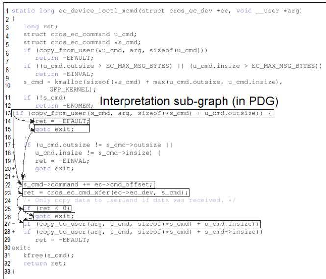  
Figure 2: Interpretation Sub-Graph for Figure 1

Regarding detection, the existing DL-based approaches [20, 37] do not fully exploit all the available information on the vulnerable code during training. For example, during training, we know that lines 23 and 27 are vulnerable/buggy, and other relevant statements via data/control dependencies provide contextual information for the vulnerable ones. However, the existing approaches [20, 37] do not consider the vulnerable statements and do not use the con textual code to help a model discriminate the vulnerable and non vulnerable ones. The entire method would be fed to a DL model.

## 2.2 Approach Overview and Key Ideas

We introduce IVDetect, an DL-based, interpretable vulnerability detection approach that goes beyond the decision of vulnerability by providing the fine-grained interpretation in term of the vulnerable statements. Specifically, as the method is deemed as vulnerable by IVDetect, it will provide a list of important statements as part of the program dependence graph (PDG) that are relevant to the detected vulnerability. For example, it provides the partial sub-graph of the PDG including the statements at the lines 13–15, 22–23, and 25– 27 in Figure 2 for the vulnerable code at line 23 and line 27. We use the PDG sub-graph including important statements for finegrained VD since they will give a developer the hints on the program dependencies relevant to the vulnerability for further investigation. Moreover, if our model determines the code as non-vulnerable, it can also produce the key sub-graph of the PDG with the key statements that are deemed to be safe.

IVDetect has two main modules (Figure 3): graph-based vul nerability detection model, and graph-based interpretation model. The input is the source code of all methods in a project. The output is the ranked list of methods with the detection result/score and the interpretation (PDG sub-graph). Let us explain our key ideas.

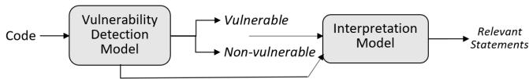  
Figure 3: Overview of IVDetect

2.2.1 Graph-Based Vulnerability Detection Model (Section 3). As seen in Section 2.1, a vulnerability is usually exhibited as multiple statements being exploited, thus, it is natural to capture the vulner able code as a sub-graph in the PDG with the data and control flows. This also helps developers further investigate the detected vulnerability with those flows. Toward that goal, we model the vulnerability detection via the Graph Convolutional Network (GCN) [17] as follows. The PDG of a method ?? is represented as a graph $G _ { N } = \left( V , E \right)$ in which ?? is a set of nodes representing the statements, and ?? is a set of edges representing the data/control dependencies. A feature description $x _ { V }$ is for every node ??, which represents a property of a node, e.g., variable name, etc. Features are summarized in a $N \times D$ feature matrix $X _ { M }$ (?? : number of nodes and ?? is the number of input features). Let ?? be a label function on the statements and methods $f : V  \{ 1 , . . . , C \}$ that maps a node in ?? and an entire method to one of the ?? classes. In IVDetect, ??=2 for vulnerable (V) and non-vulnerable (NV).

For training on (non-)vulnerable code in the training set, GCN performs similar operations as CNN where it learns the features with a small filter/window sliding over PDG sub-structure. Differing from image data with CNN, the neighbors of a node in GCN are unordered and variable in size. To predict if a method ?? is vulnerable, its PDG $G _ { M }$ with the associated feature set $X _ { M } = \{ x _ { j } | v _ { j } \in G _ { M } \}$ are built. GCN learns a conditional distribution $P ( Y | G _ { M } , X _ { M } )$ , where ?? is a random variable representing the labels $\{ 1 , . . . , C \}$ . That distribution indicates the probability of the graph $G _ { M }$ belonging to each of the classes $\{ 1 , . . . , C \}$ , i.e., ?? is vulnerable or not (Section 3).

2.2.2 Distinction between Vulnerable Statements and Surrounding Contexts. During training, for each vulnerable statement ?? in a method in the training dataset, we distinguish ?? and the surrounding contextual statements for ??. A context consists of the statements with data and/or control dependencies with ??. This is expected to help our model recognize better the vulnerable code appear ing in specific surrounding contexts, and discriminate better the vulnerable code from the benign one. For example, the existing approaches feed the entire PDG of the method in Figure 2 into a model. IVDetect distinguishes and learns the vector representation for the vulnerable statement at line 27 while considering as contexts the statements with data/control dependencies with line 27: the data-dependency context (lines 31, 22, 13, 10, and 6), and the control-dependency context (lines 29, 25, 23, and 13).

2.2.3 Graph-Based Interpretation Model for Vulnerability Detection (Section 4). After prediction, IVDetect performs fine-grained interpretation. It uses both the PDG $G _ { M }$ of the method ?? and the GCN model as the input to obtain the interpretation. To that end, we leverage the interpretable ML technique GNNExplainer [36]. Its goal is to take the GCN and a specific input graph $G _ { M } .$ , and produce the crucial sub-graph structures and features in $G _ { M }$ that affect the decision of the model. GNNExplainer’s idea is that $i f$ removing or altering a node/feature does affect the prediction outcome, the node/feature is considered as essential and thus must be included in the crucial set (let us call it the interpretation set). GNNExplainer searches for a sub-graph $\mathcal { G } _ { M }$ in $G _ { M }$ that minimizes the difference in the prediction scores between using the whole graph $G _ { M }$ and using the minimal graph $\mathcal { G } _ { M }$ (Section 4). Because without that subgraph $\mathcal { G } _ { M }$ in the input PDG $G _ { M } ,$ , GCN model would not decide $G _ { M }$ as vulnerable, $\mathcal { G } _ { M }$ is considered as crucial PDG sub-graph consisting of crucial statements and data/control dependencies relevant to the detected vulnerability (if the outcome is $\mathcal { N } ) .$ . If the outcome is non-vulnerability, $\mathcal { G } _ { M }$ can be considered as the safe statements in PDG for the model to decide the input method ?? as benign code.

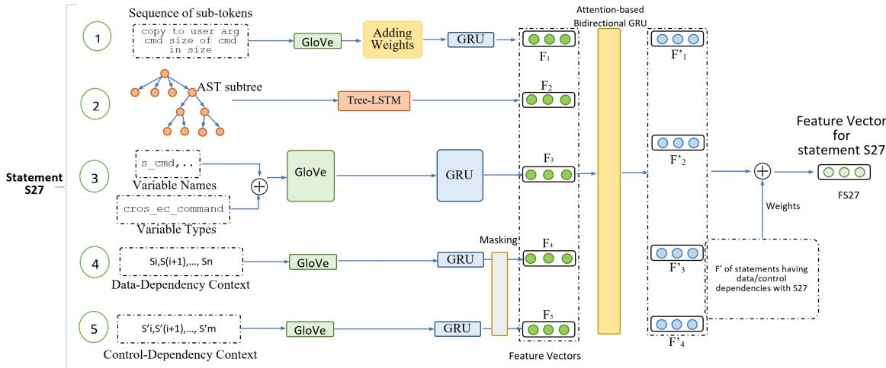  
Figure 4: Context-Aware Vulnerable Code Representation Learning for Statement S27 in Graph-based Vulnerability Detection

## 3 GRAPH-BASED VULNERABILITY DETECTION MODEL

This section describes our graph-based vulnerability detection model. We first explain how we build the context-aware repre sentation learning for vulnerable code, and then how we use such learned vectors for vulnerability detection using FA-GCN [30].

## 3.1 Context-Aware Representation Learning

Let us present how we build the vector representations for code features. For a statement, we extract the following types of features:

3.1.1 Sequence of Sub-tokens of a Statement. At the lexical level, we capture the content of a statement in term of the sequence of sub-tokens. We choose the sub-token granularity because the sub-tokens are more likely to be repeated than the entire lexical tokens in source code [24]. We tokenize each statement and keep only the variables, method and class names. The names are broken into sub-tokens using CamelCase or Hungarian convention. We remove the sub-tokens with one character to avoid the influence of noises. For example, in Figure 4, the tokens of $S _ { 2 7 }$ are collected and broken down into the sequence: copy, to, user, arg, etc. Then, we use GloVe [26], to build the vectors for tokens, together with

Gate Recurrent Unit (GRU) [12] to build the feature vector for the sequence of sub-tokens for $S _ { 2 7 }$ . GloVe is known to capture well semantic similarity among tokens. GRU is chosen to summarize the sequence of vectors into one feature vector for the next step.

3.1.2 Code Structure of a Statement. We capture code structure via the AST sub-tree. In Figure 4, the AST sub-tree for $S _ { 2 7 }$ is extracted and fed to Tree-LSTM [32] to capture the structure into a vector $F _ { 2 } .$

3.1.3 Variables and Types. For each node $( i . e . ,$ a statement), we collect the names of the variables and their static types at their locations, break them into the sub-tokens. For example, we collect the variable s\_cmd and its static type cross\_ec\_command. We use the same vector building techniques as for the sub-token sequences as in the feature 1, including GloVe and GRU, to apply on the sequences of the sub-tokens built from the variables’ names (e.g., s\_cmd) and those from the variables’ types (e.g., cross\_ec\_command).

3.1.4 Surrounding Contexts. During training, for a statement ??, we also encode the statements surrounding ??, which we refer to as context. We have two contexts. Data- and control-dependency contexts contain the statements having such dependencies with the current statement. For example, the data-dependency context for $S _ { 2 7 }$ includes the statements at the lines 31, 22, 13, 10, and 6. If the control dependencies are considered, the statements with control dependencies with $S _ { 2 7 }$ at the lines 29, 25, 23, and 13 are included. The vectors for the statements in the context are calculated via GloVe and GRU as described earlier. Because the number of dependencies could be different, the lengths of the GRU model inputs could be different. Thus, we apply zero padding with a masking layer, allowing the model to skip the zeros at the end of the sequence of sub-tokens. Those zeros will not be included in training.

3.1.5 Attention-Based Bidirectional GRU. After having all vectors for the features $F _ { 1 } , F _ { 2 } , . . . ,$ we use a bi-directional GRU and an attention layer to learn the weight vector $W _ { i }$ for each feature $F _ { i } ,$ based on the hidden states from that model. Then, we compute the weighted vector for each feature by multiplying the original vector for the feature by the weight, that is, we have $F _ { i } ^ { \prime } = W _ { i } . F _ { i }$

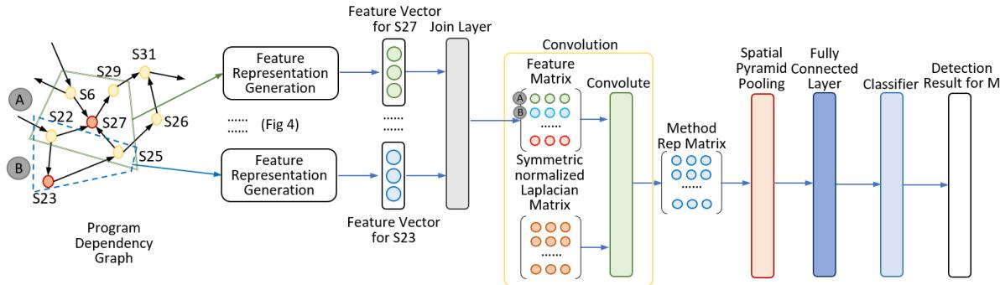  
Figure 5: Vulnerability Detection with FA-GCN

Finally, we need to consider the impacts from the dependent statements to the current statement in the PDG. The rationale is that those neighboring statements in the PDG must have the influence on the current statement if one of them is vulnerable. For example, the neighboring statements for $S _ { 2 7 }$ in the PDG include the statements at lines 6, 22, 25, and 29. Thus, we combine and summarize them into the final feature vector $F _ { S 2 7 }$ for the statement $S _ { 2 7 }$ as follows:

$$
F _ { S 2 7 } = \sum _ { i } W _ { i } C o n c a t ( h ( F _ { i } ^ { \prime } , j ) )\tag{1}
$$

$W _ { i }$ is the trainable weight for combination; ???????????? is the concatenate layer to link all values into one vector; ℎ is the hidden layer to summarize vector into a value; ?? = S6, S22, S25, S27, S29; ?? is feature index. $F _ { 2 7 }$ is used in the next step with GCN model for detection.

## 3.2 Vulnerability Detection with FA-GCN

Figure 5 presents how we use Feature-Attention GCN model (FA GCN) [30] for detection. The rationale is that FA-GCN can deal well with the graphs with sparse features (not all the statements share the same properties), and potentially noisy features in a PDG. First, we parse the method ?? into PDG. Similar to CNN using the filter on an image, FA-GCN performs sliding a small window along all the nodes (statements) of the PDG. For example, in Figure 5, the window marked with $\textcircled{4}$ for the node ??27 consists of itself and the neighboring statements/nodes ??6, ??22, ??25, and ??29. Another window (marked with $\textcircled{8}$ is for the node ??23, including itself and the neighboring nodes: ??22 and ??25. For each window, FA-GCN generates the feature representation matrix for the statement at the center. For example, for the window centered at ??27, it generates the feature vector $F _ { S 2 7 }$ for ??27, using the process explained in Figure 4. From the representation vectors for all statements, FA-GCN uses a join layer to link all these vectors into the Feature Matrix $\mathcal { F } _ { m }$ for method ??. A row in $\mathcal { F } _ { m }$ corresponds to a window in PDG.

Next, FA-GCN performs the convolution operation by first calcu lating the symmetric normalized Laplacian matrix ??˜ [17], and then calculating the convolution to generate the representation matrix $M _ { m }$ for the method ??. After that, we use the traditional steps as in a CNN model: using a spatial pyramid pooling layer (to normalize the method representation matrix into a uniform size, and reduce its total size), and connecting its output to a fully connected layer to transform the matrix into a vector $V _ { m }$ to represent ??. With $V _ { m } ,$ we perform classification by using two hidden layers (controlling the length of vectors and output) and a softmax function to produce a prediction score for ??. We use those scores as vulnerability scores to rank the methods in a project. The decision for ?? as V or $N P$ is done via a trainable threshold on the prediction score [18, 20].

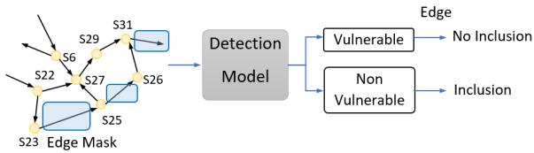  
Figure 6: Masking to Derive Interpretation Sub-Graphs

## 4 GRAPH-BASED INTERPRETATION MODEL

Let us explain how we use GNNExplainer [36] to build our graph based interpretation. The input includes the trained FA-GCN model, the PDG $( G _ { M } )$ of the method ??, and the detection result V or $N \mathcal { V } ,$ and prediction score. Figure 6 illustrates our process for the case of $_ \mathrm { c } { } _ { V }$ (Vulnerable) (the case of $_ { N }$ is done similarly).

To derive the interpretations, the key goal is to find a sub-graph $\mathcal { G } _ { M }$ in the PDG $G _ { M }$ of the method ?? that minimizes the difference in the prediction scores between using the entire graph $G _ { M }$ and using the minimal graph $\mathcal { G } _ { M }$ . To do so, we use GNNExplainer with the masking technique [36], which treats the searching for the minimal graph $\mathcal { G } _ { M }$ as a learning problem of the edge-mask set ???? of the edges. The idea is that learning ???? helps IVDetect derive the interpretation sub-graph $\mathcal { G } _ { M }$ by masking-out the edges in ???? from $G _ { M }$ (“masked-out” is denoted by Ç):

$$
g _ { M } = G _ { M } \bigodot E M\tag{2}
$$

Figure 6 illustrates GNNExplainer’s principle. As an edge-mask set is applied, GNNEXplainer checks if the FA-GCN model produces the same result (in this case the result is V). If yes, the edge in the edge-mask is not important and is not included in $\mathcal { G } _ { M }$ . Otherwise, the edge is important and included in $\mathcal { G } _ { M }$ . Because the numbers of possible sub-graphs and the edge-mask sets are untractable, GNNExplainer uses a learning approach for the edge-mask ????.

Let us formally explain how GNNEXplainer [36] works. It formulates the problem by maximizing the mutual information (MI)

between the minimal graph $\mathcal { G } _ { M }$ and the input PDG $G _ { M } ;$

$$
\operatorname* { m a x } _ { \mathcal { G } _ { M } } M I ( Y , { \mathcal { G } } _ { M } ) = H ( Y ) - H ( Y | G = { \mathcal { G } } _ { M } )\tag{3}
$$

?? is the outcome decision by the FA-GCN model. Thus, the entropy term $H ( Y )$ is constant for the trained FA-GCN model. Maximizing the ???? value for all $\mathcal { G } _ { M }$ is equivalent to minimizing conditional entropy $H ( Y | G = { \mathcal { G } } _ { M } )$ , which by definition of conditional entropy can be expressed as

$$
- \mathbb { E } _ { Y | \mathcal { G } _ { M } } [ l o g P _ { F A - G C N } ( Y | G = \mathcal { G } _ { M } ]\tag{4}
$$

The meaning of this conditional entropy formula is a measure of how much uncertainty remains about the outcome ?? when we know $G = { \mathcal { G } } _ { M }$ . GNNEXplainer also limits the size of $\mathcal { G } _ { M }$ by $K _ { M }$ $i . e . ,$ taking $K _ { M }$ edges that give the highest mutual information with the prediction outcome ?? . Direct optimization of the formula 4 is not tractable, thus, GNNExplainer treats $\mathcal { G } _ { M }$ as a random graph variable $\mathcal { G } .$ The objective in Equation 4 becomes:

$$
\operatorname* { m i n } _ { \mathcal { G } } \mathbb { E } _ { \mathcal { G } _ { M } \sim \mathcal { G } } H ( Y | G = \mathcal { G } _ { M } )\tag{5}
$$

$$
\operatorname* { m i n } _ { \mathcal { G } } H ( Y | G = \mathbb { E } _ { \mathcal { G } } [ \mathcal { G } _ { M } ] )\tag{6}
$$

From Equation 5, we obtain Equation 6 with Jensen’s inequality. The conditional entropy in Equation 6 can be optimized by replacing $\mathbb { E } _ { G } [ \mathcal { G } _ { M } ]$ to be optimized by masking with ???? on the input graph $G _ { M }$ . Now, we can reduce the problem to learning the mask ????. Details on training can be found in [36]. The resulting sub-graph $\mathcal { G } _ { M }$ is directly used as an interpretation. We can similarly produce the interpretations for the cases of non-vulnerability result.

## 5 EMPIRICAL EVALUATION

## 5.1 Research Questions

To evaluate IVDetect, we seek to answer the following questions: RQ1. Comparison on Method-Level Vulnerability Detection (VD). How well does IVDetect perform in comparison with the state-of-the-art method-level Deep Learning VD approaches?

RQ2. Comparison with other Interpretation Models for Finegrained VD Interpretation. How well does IVDetect perform in comparison with the state-of-the-art interpretation models for fine-grained VD interpretation to point out vulnerable statements?

RQ3. Vulnerable Code Patterns and Fixing Patterns. Is IVDetect useful in detecting vulnerable code patterns and fixes?

RQ4. Sensitivity Analysis for Internal Features. How do inter nal features affect the overall performance of IVDetect?

RQ5. Sensitivity Analysis on Training Data. How do different data splitting schemes affect IVDetect’s performance?

RQ6. Time Complexity. What is time complexity of IVDetect?

## 5.2 Datasets

To empirically evaluate IVDetect, we have conducted several experiments on three public vulnerability datasets including Fan et al.’s [13], Reveal [11], and FFMPeg+Qemu [37] (Table 1). Fan et al. [13] dataset covers the CWEs from 2002 to 2019 with 21 features for each vulnerability. At the method level, the dataset contains +10K vulnerable methods and fixed code. The Reveal dataset [11] contains +18K methods with 9.16% of them being vulnerable ones. The FFMPeg+Qemu dataset has been used in Devign study [37] with +22K methods, and 45.0% of the entries are vulnerable.

Table 1: Experimental Datasets
<table><tr><td>Dataset</td><td>Fan</td><td>Reveal</td><td>Devign</td></tr><tr><td>Vulnerabilities</td><td>10,547</td><td>1,664</td><td>10,067</td></tr><tr><td>Non-vulnerabilities</td><td>168752</td><td>16505</td><td>12,294</td></tr><tr><td>Ratio (Vul:Non-vul)</td><td>1:16</td><td>1:9.9</td><td>1:1.2</td></tr></table>

## 5.3 Experimental Methodology

## RQ1. Comparison on Method-Level DL-based VD Approaches.

Baselines. We compare IVDetect with the state-of-the-art DLbased vulnerability detection approaches: 1) VulDeePecker [20]: a DL-based approach using Bidirectional LSTM on the statements and their data/control dependencies. 2) Devign [37]: an DL-based approach that uses GGCN model with Gated Graph Recurrent Layers on the AST, CFG, DFG, and code sequences for graph classification. 3) SySeVR [19]: in addition to statements and program dependen cies, this approach also uses program slicing and leverages several DL models (LR, MLP, DBN, CNN, LSTM, etc.). 4) Russell et al. [28]: this DL approach encodes source code as matrices of code tokens and leverages convolution model with random forest (RF) via ensemble classifier. 5) Reveal [11]: this approach uses GGNN, MLP, and with Triplet Loss on graph representations of source code.

Procedure. A dataset contains a number of vulnerable and nonvulnerable methods. We randomly split all of its vulnerable methods into 80%, 10%, and 10% to be used for training, tuning, and testing, respectively. For training, we added to that 80% part the same number of non-vulnerable methods as the vulnerable ones to obtain a balanced training data. For tuning and testing, we also added the non-vulnerable methods but we used the real ratio between vulnerable and non-vulnerable methods in the original dataset to build the tuning/testing data. We used AutoML [21] on all models to automatically tune hyper-parameters on the tuning dataset.

We also performed the evaluation across the datasets. We first trained our model on the combination of two datasets Reveal and FFMPeg+Qemu, which has a balanced number of vulnerable methods and non-vulnerable ones. We then tested the model on Fan dataset, which has a more realistic ratio of vulnerable and non-vulnerable methods. To ensure the model suitable for cross-data evaluation, we also used 20% of Fan dataset for tuning the parameters and performed prediction on the remaining 80%.

Evaluation Metrics. We use the following evaluation metrics.

Mean Average Precision $M A P = { \frac { \sum _ { q = 1 } ^ { Q } A v g P ( q ) } { Q } }$ , with Average Precision $\begin{array} { r } { A v g P = \sum _ { k = 1 } ^ { n } P ( k ) r e l ( k ) } \end{array}$ , where ?? is the total number of results, ?? is the current rank in the list, ?????? (??) is an indicator function equaling to 1 if the item at rank ?? is actually vulnerable, and to zero otherwise. ?? is the total number of classification types. It is 1 because we only have two types including vulnerable and non-vulnerable classes, however, we rank all the methods based on their scores (1 indicates vulnerable, and 0 otherwise).

Normalized DCG at ??: $\begin{array} { r } { n D C G _ { k } = \frac { D C G _ { k } } { I D C G _ { k } } } \end{array}$ , with Discounted Cumulative Gain at rank ??, $\begin{array} { r } { D C G _ { k } = \ \sum _ { i = 1 } ^ { k } \frac { r _ { i } } { l o g _ { 2 } ( i + 1 ) } ; } \end{array}$ and Ideal DCG at ?? $\begin{array} { r } { I D C G _ { k } = \sum _ { i = 1 } ^ { | R _ { k } | } \frac { 2 ^ { r _ { i } } - 1 } { l o q _ { 2 } ( i + 1 ) } ; } \end{array}$ where $r _ { i }$ is the score of the result at position ??, and $R _ { k }$ the rank of the actual vulnerable methods (ordered by their scores) in the resulting list up to the position ??.

First Ranking (????) is the rank of the first correctly predicted vulnerable method. Average ranking (????) is the average rank of the correctly predicted vulnerable methods in the top-ranked list.

Accuracy under curve (AUC) is defined as $A U C = P ( d ( m _ { 1 } ) >$ $d ( m _ { 2 } ) )$ in which ?? is the probability, $d$ is the detection model (can be regarded as a binary classifier), $m _ { 1 }$ is a randomly chosen positive instance, and $m _ { 2 }$ is a randomly chosen negative instance.

Precision $( \mathrm { P } )$ is the ratio of relevant instances among the retrieved ones. It is calculated as ?????????????????? $\begin{array} { r } { { } = \frac { T P } { T P + F P } } \end{array}$ where $T P$ is the number of true positives and the ?? ?? is the number of false positives.

Recall (R) is the ratio of relevant instances that were retrieved. It is calculated as ?????? $\begin{array} { r } { { \imath } l l = \frac { T P } { T P + F N } } \end{array}$ where $T P$ is the number of true positives and the ?? ?? is the number of false negatives.

F-score (F) is the harmonic mean of precision and recall. It is calculated as ???????????? $\begin{array} { r } { = 2 \frac { P r e c i s i o n * R e c a l l } { P r e c i s i o n + R e c a l l } } \end{array}$

RQ2. Comparison with other Interpretation Models for Finegrained Interpretation.

Baselines. We compare IVDetect with the following interpreta tion models: 1) ATT [36]: this model is a graph attention network that uses the attention mechanism to evaluate the weights (impor tance degrees) of the edges in the input graph; 2) GRAD [36]: this approach uses a gradient-based method that computes the gradient of the GNN’s loss function w.r.t. the adjacency matrix.

Procedure. Our goal here is to evaluate how well IVDetect produces the fine-grained interpretations pointing to vulnerable statements. Thus, to train/test the interpretation model, we need to use the Fan dataset because it contains the vulnerable statements and respective fixes. The other two datasets contain only the vulner abilities at the method level and no fixes. Therefore, in this RQ2, for the vulnerability prediction part, we used the FA-GCN model that was trained on Reveal and FFMPeg+Qemu and predicted on the Fan dataset. For the methods that are vulnerable, but predicted as non-vulnerable, we considered those cases as incorrect because the resulting interpretations do not make sense for incorrect detection. For the methods that are actually non-vulnerable (regardless of the prediction results of vulnerable or non-vulnerable), we could not use them because the non-vulnerable methods do not have the fixed statements as the ground truth for measuring the correctness of interpretations. Thus, we use the set of methods that are vulner able and correctly detected as vulnerable for the evaluation of the interpretation model. Let us use ?? to denote this set.

For the interpretation, we randomly split ?? into 80%, 10%, and 10% for training, tuning, and testing. For training, we used the fixed statements as the labels for interpretation because those fixed statements were vulnerable. For testing, we compared the relevant statements from the interpretation model against the actual fixed statements. Each method in the testing set and the trained FA-GCN model are the input of the interpretation model in this RQ2.

Evaluation Metrics. Given an interpretation sub-graph G?? generated from the graph-based interpretation model, we evaluate the accuracy of the interpretation for a model as follows. For a method, if $\mathcal { G } _ { M }$ has an overlap with any statement in the code changes that fix the vulnerability, $\mathcal { G } _ { M }$ is considered as a correct interpretation, $i . e . ,$ relevant to that detected vulnerability. We then calculate Accuracy as the ratio between the number of correct interpretations over the total number of interpretations. Because code changes could include addition, deletion, and modification, we further define such overlap as follows.

If one of the statements ?? in the vulnerable version was deleted or modified for fixing, and if ${ \mathcal { G } } _ { M } \ni S ,$ then we consider the interpretation sub-graph $\mathcal { G } _ { M }$ as correct, otherwise as incorrect. If one of the statements $S ^ { \prime }$ was added to the vulnerable version for fixing, we check on the fixed version whether $\mathcal { G } _ { M }$ contains any statement with data or control dependencies with $S ^ { \prime } .$ If yes, we consider it as correct, otherwise, as incorrect. In Figure $2 , { \mathcal { G } } _ { M }$ contains the statement S23 having the data/control dependencies with one of the added lines from 17–21. Thus, $\mathcal { G } _ { M }$ is correct. The rationale is that if the interpretation sub-graph $\mathcal { G } _ { M }$ contains some statement relevant to the added statement to fix the vulnerability, that interpretation is useful in pointing out the code relevant to the vulnerability.

We also use Mean First Ranking (MFR), i.e., the mean of the rankings for the first statement that needs to be fixed in the interpretation statements, and Mean Average Ranking (MAR), i.e., the mean of the rankings for all statements to be fixed in the interpreta tion statements. If a statement to be fixed has not been selected as interpretation, we do not consider it when calculating MFR/MAR.

## RQ3. Vulnerable Code Patterns and Fixing Patterns.

Procedure. We use a mining algorithm on the set of interpretation sub-graphs to mine patterns of vulnerable code. We also mine fixing patterns for those vulnerabilities. See details in Section 6.3.

Evaluation Metrics. We counted the identified patterns.

## RQ4. Sensitivity Analysis for Features.

Procedure. We first built a base model with only the feature that represents the code as the sequence of tokens. We then built other variants of our model by gradually adding one more feature in Section 3.1 to the base model including the sequence of sub tokens, AST subtree, variable names, data dependencies, and control dependencies. We measured the accuracy for each variant. We used the Fan dataset and the same experiment setting as in RQ1.

Evaluation Metrics. We use the same metrics as in RQ1.

RQ5. Sensitivity Analysis on Training Data. We used different ratios in data splitting for training, tuning, and testing: (80%, 10%, 10%), (70%, 15%, 15%), (60%, 20%, 20%), and (50%, 25%, 25%). We used the Fan dataset and the same setting as in RQ1.

Evaluation Metrics. We use the same metrics as in RQ1.

RQ6. Time Complexity Analysis. We measure the actual training and predicting time.

## 6 EXPERIMENTAL RESULTS

## 6.1 RQ1. Comparison on Method-Level VD

In Table 2, among the top 10 prediction results, IVDetect has the most correct predictions (6 vulnerable methods). The vulnerable methods correctly detected by IVDetect are also pushed higher in the top-10 ranked list with 4 correct results out of top-5 results. All other baselines have only 0–1 correct detection in the top-5 list. Importantly, the first rank for IVDetect (i.e., the rank of the first correctly detected vulnerable methods) is $1 ^ { s t }$ , while those of the baselines are $4 ^ { t h } , 5 ^ { t h } , 5 ^ { t h } , 6 ^ { t h } , \mathrm { a n d } 7 ^ { t h }$ (the bold values in Table 2). Moreover, IVDetect can detect 14, 35, and 64 vulnerabilities among top-20, top-50, and top-100 prediction results.

Table 2: RQ1. Top-10 Vulnerability Detection Results on FFMPeg+Qemu Dataset. 0: incorrect, 1: correct
<table><tr><td rowspan=1 colspan=1>Top-10 Rank</td><td rowspan=1 colspan=1>1</td><td rowspan=1 colspan=1>2</td><td rowspan=1 colspan=1>3</td><td rowspan=1 colspan=1>4</td><td rowspan=1 colspan=1>5</td><td rowspan=1 colspan=1>6</td><td rowspan=1 colspan=1>7</td><td rowspan=1 colspan=1>8</td><td rowspan=1 colspan=1>9</td><td rowspan=1 colspan=1>10</td><td rowspan=1 colspan=1>Total</td></tr><tr><td rowspan=6 colspan=1>VulDeePeckerSySeVRRussell et al.DevignRevealIVDETECT</td><td rowspan=1 colspan=1>0</td><td rowspan=1 colspan=1>0</td><td rowspan=1 colspan=1>0</td><td rowspan=1 colspan=1>0</td><td rowspan=1 colspan=1>0</td><td rowspan=1 colspan=1>0</td><td rowspan=1 colspan=1>1</td><td rowspan=1 colspan=1>0</td><td rowspan=1 colspan=1>1</td><td rowspan=1 colspan=1>1</td><td rowspan=1 colspan=1>3</td></tr><tr><td rowspan=2 colspan=1>00</td><td rowspan=2 colspan=1>00</td><td rowspan=1 colspan=1>0</td><td rowspan=1 colspan=1>0</td><td rowspan=1 colspan=1>0</td><td rowspan=1 colspan=1>1</td><td rowspan=1 colspan=1>1</td><td rowspan=1 colspan=1>1</td><td rowspan=1 colspan=1>0</td><td rowspan=1 colspan=1>1</td><td rowspan=1 colspan=1>4</td></tr><tr><td rowspan=1 colspan=1>0</td><td rowspan=1 colspan=1>0</td><td rowspan=1 colspan=1>1</td><td rowspan=1 colspan=1>0</td><td rowspan=1 colspan=1>1</td><td rowspan=1 colspan=1>0</td><td rowspan=1 colspan=1>1</td><td rowspan=2 colspan=1>1o</td><td rowspan=3 colspan=1>445</td></tr><tr><td rowspan=1 colspan=1>0</td><td rowspan=1 colspan=1>0</td><td rowspan=1 colspan=1>0</td><td rowspan=1 colspan=1>0</td><td rowspan=1 colspan=1>1</td><td rowspan=1 colspan=1>0</td><td rowspan=1 colspan=1>1</td><td rowspan=1 colspan=1>1</td><td rowspan=1 colspan=1>1</td></tr><tr><td rowspan=1 colspan=1>0</td><td rowspan=1 colspan=1>0</td><td rowspan=1 colspan=1>0</td><td rowspan=1 colspan=1>1</td><td rowspan=1 colspan=1>0</td><td rowspan=1 colspan=1>1</td><td rowspan=1 colspan=1>0</td><td rowspan=1 colspan=1>1</td><td rowspan=1 colspan=1>1</td><td rowspan=1 colspan=1>1</td></tr><tr><td rowspan=1 colspan=1>1</td><td rowspan=1 colspan=1>0</td><td rowspan=1 colspan=1>1</td><td rowspan=1 colspan=1>1</td><td rowspan=1 colspan=1>1</td><td rowspan=1 colspan=1>0</td><td rowspan=1 colspan=1>1</td><td rowspan=1 colspan=1>1</td><td rowspan=1 colspan=1>0</td><td rowspan=1 colspan=1>0</td><td rowspan=1 colspan=1>6</td></tr></table>

Table 3: RQ1. Method-Level VD on FFMPeg+Qemu Dataset
<table><tr><td></td><td>VulDee- -Pecker</td><td>SySeVR</td><td>Russell et al.</td><td>Devign</td><td>Reveal</td><td>IVDETECT</td></tr><tr><td>nDCG@1</td><td>0</td><td>0</td><td>0</td><td>0</td><td>0</td><td>1</td></tr><tr><td>nDCG@3</td><td>0</td><td>0</td><td>0</td><td>0</td><td>0</td><td>0.63</td></tr><tr><td>nDCG@5</td><td>0</td><td>0</td><td>0.43</td><td>0.45</td><td>0.5</td><td>0.65</td></tr><tr><td>nDCG@10</td><td>0.37</td><td>0.44</td><td>0.45</td><td>0.46</td><td>0.5</td><td>0.68</td></tr><tr><td>nDCG@15</td><td>0.45</td><td>0.48</td><td>0.49</td><td>0.52</td><td>0.55</td><td>0.75</td></tr><tr><td>nDCG@20</td><td>0.48</td><td>0.51</td><td>0.54</td><td>0.56</td><td>0.6</td><td>0.82</td></tr><tr><td>MAP@1</td><td>0</td><td>0</td><td>0</td><td>0</td><td>0</td><td>1</td></tr><tr><td>MAP@3</td><td>0</td><td>0</td><td>0</td><td>0</td><td>0</td><td>0.83</td></tr><tr><td>MAP@5</td><td>0</td><td>0</td><td>0.20</td><td>0.20</td><td>0.25</td><td>0.80</td></tr><tr><td>MAP@10</td><td>0.22</td><td>0.31</td><td>0.30</td><td>0.32</td><td>0.38</td><td>0.78</td></tr><tr><td>MAP@15</td><td>0.29</td><td>0.33</td><td>0.34</td><td>0.37</td><td>0.41</td><td>0.72</td></tr><tr><td>MAP@20</td><td>0.32</td><td>0.35</td><td>0.37</td><td>0.42</td><td>0.45</td><td>0.69</td></tr><tr><td>FR@1</td><td>n/a</td><td>n/a</td><td>n/a</td><td>n/a</td><td>n/a</td><td>1</td></tr><tr><td>FR@3</td><td>n/a</td><td>n/a</td><td>n/a</td><td>n/a</td><td>n/a</td><td>1</td></tr><tr><td>FR@5</td><td>7</td><td>6</td><td>5</td><td>5</td><td>4</td><td>1</td></tr><tr><td>FR@10</td><td>7</td><td>6</td><td>5</td><td>5</td><td>4</td><td>1</td></tr><tr><td>FR@15</td><td>7</td><td>6</td><td>5</td><td>5</td><td>4</td><td>1</td></tr><tr><td>FR@20</td><td>7</td><td>6</td><td>5</td><td>5</td><td>4</td><td>1</td></tr><tr><td>AR@1</td><td>n/a</td><td>n/a</td><td>n/a</td><td>n/a</td><td>n/a</td><td>1</td></tr><tr><td>AR@3</td><td>n/a</td><td>n/a</td><td>n/a</td><td>n/a</td><td>n/a</td><td>2</td></tr><tr><td>AR@5</td><td>n/a</td><td>n/a</td><td>5</td><td>5</td><td>4</td><td>3.3</td></tr><tr><td>AR@10</td><td>8.7</td><td>7.8</td><td>7.8</td><td>7.4</td><td>7.4</td><td>4.7</td></tr><tr><td>AR@15</td><td>11.2</td><td>10</td><td>9.5</td><td>10</td><td>9.1</td><td>7.6</td></tr><tr><td>AR@20</td><td>13.3</td><td>12.1</td><td>12.6</td><td>12.1</td><td>12.4</td><td>10.3</td></tr><tr><td>AUC</td><td>0.68</td><td>0.72</td><td>0.79</td><td>0.77</td><td>0.79</td><td>0.84</td></tr></table>

Tables 3, 4, and 5 show the comparison among the approaches on three datasets. IVDetect consistently performs better in all the metrics (Table 3). For nDCG@{1,3}, all the baselines get zeros because they did not have correct detections in top-3 results. IVDe tect can improve nDCG@10 from 43%–84% and nDCG@20 from 37%–71% as compared to the baselines. Higher nDCG indicates that IVDetect achieves the ranking closer to the perfect ranking and the correct vulnerable methods appear higher in the top list.

For MAP scores, IVDetect relatively improves over the baselines from 105%–255% for top-10 and from 53%–116% for top-20 accuracy. With higher MAP, IVDetect has higher precision on average for all the top-ranked positions in the top list. That is, the top-ranked result is highly precise in detecting the vulnerable methods.

IVDetect also achieves better first ranking (FR) and average ranking (AR). While its best FR is 1, that of next best performer is 4. For AR@10, a correct vulnerable method is on average ranked by IVDetect 2.7–4.0 positions higher in the ranked list than by the baselines. Our tool also has relatively higher AUC from 6%–24%.

The comparative results on Fan and Reveal datasets are similar (Tables 4 and 5). In Fan dataset, IVDetect can improve the nDCG and MAP scores over the baselines by 26%–43%, 50%–170% for top 10, and 21%–475%, 40%–250% for top-20. IVDetect’s FRs and ARs are better from 2–6 positions and 0.7–2.7 positions for top 10, and 2–13 positions and 1.6–9.1 positions for top 20. In Reveal dataset, the improvements in nDCG, MAP, FR, and AR are 33%–73%, 42%– 209%, 2–7 positions, and 0–4 positions for top 10, and 19%–111%, 28%–236%, 2–12 positions, and 1.2–6.2 positions for top 20.

Table 4: RQ1. Method-Level VD on Fan Dataset
<table><tr><td></td><td>VulDee- -Pecker</td><td>SySeVR</td><td>Russell et al.</td><td>Devign</td><td>Reveal</td><td>IVDETECT</td></tr><tr><td>nDCG@1 nDCG@5</td><td>0</td><td>0</td><td>0</td><td>0</td><td>0</td><td>0</td></tr><tr><td>nDCG@10</td><td>0 0</td><td>0</td><td>0 0.30</td><td>0 0.33</td><td>0 0.34</td><td>0.5</td></tr><tr><td>nDCG@15</td><td>0</td><td>0 0</td><td>0.28</td><td>0.30</td><td>0.37</td><td>0.43 0.45</td></tr><tr><td>nDCG@20</td><td>0.08</td><td>0.23</td><td>0.31</td><td>0.32</td><td>0.38</td><td>0.46</td></tr><tr><td>MAP@1</td><td>0</td><td>0</td><td>0</td><td>0</td><td>0</td><td>0</td></tr><tr><td>MAP@5 MAP@10</td><td>0</td><td>0</td><td>0</td><td>0</td><td>0</td><td>0.25</td></tr><tr><td></td><td>0</td><td>0</td><td>0.1</td><td>0.13</td><td>0.18</td><td>0.27</td></tr><tr><td>MAP@15</td><td>0</td><td>0</td><td>0.12</td><td>0.14</td><td>0.21</td><td>0.28</td></tr><tr><td>MAP@20</td><td>0.08</td><td>0.24</td><td>0.14</td><td>0.15</td><td>0.20</td><td>0.28</td></tr><tr><td>FR@1 FR@5</td><td>n/a</td><td>n/a</td><td>n/a</td><td>n/a</td><td>n/a</td><td>n/a</td></tr><tr><td>FR@10</td><td>n/a</td><td>n/a</td><td>n/a</td><td>n/a</td><td>n/a</td><td>4</td></tr><tr><td></td><td>n/a</td><td>n/a</td><td>10</td><td>8</td><td>6</td><td>4</td></tr><tr><td>FR@15</td><td>n/a</td><td>n/a</td><td>10</td><td>8</td><td>6</td><td>4</td></tr><tr><td>FR@20</td><td>19</td><td>16</td><td>10</td><td>8</td><td>6</td><td>4</td></tr><tr><td>AR@1 AR@5</td><td>n/a n/a</td><td>n/a</td><td>n/a</td><td>n/a</td><td>n/a</td><td>n/a</td></tr><tr><td></td><td></td><td>n/a</td><td>n/a</td><td>n/a</td><td>n/a</td><td>4</td></tr><tr><td>AR@10</td><td>n/a</td><td>n/a</td><td>10</td><td>8</td><td>8</td><td>7.3</td></tr><tr><td>AR@15</td><td>n/a</td><td>n/a</td><td>12</td><td>10.5</td><td>9.3</td><td>8.5</td></tr><tr><td>AR@20</td><td>19.5</td><td>18</td><td>13.3</td><td>13.3</td><td>12</td><td>10.4</td></tr><tr><td>AUC</td><td>0.72</td><td>0.81</td><td>0.82</td><td>0.75</td><td>0.82</td><td>0.9</td></tr></table>

Table 5: RQ1. Method-Level VD on Reveal Dataset
<table><tr><td></td><td>VulDee- -Pecker</td><td>SySeVR</td><td>Russell et al.</td><td>Devign</td><td>Reveal</td><td>IVDETECT</td></tr><tr><td>nDCG@1</td><td>0</td><td>0</td><td>0</td><td>0</td><td>0</td><td>0</td></tr><tr><td>nDCG@3</td><td>0</td><td>0</td><td>0</td><td>0</td><td>0</td><td>0.63</td></tr><tr><td>nDCG@5</td><td>0</td><td>0</td><td>0</td><td>0</td><td>0.43</td><td>0.53</td></tr><tr><td>nDCG@10</td><td>0</td><td>0.30</td><td>0.32</td><td>0.34</td><td>0.39</td><td>0.52</td></tr><tr><td>nDCG@15</td><td>0.26</td><td>0.28</td><td>0.32</td><td>0.39</td><td>0.42</td><td>0.55</td></tr><tr><td>nDCG@20</td><td>0.27</td><td>0.33</td><td>0.35</td><td>0.43</td><td>0.48</td><td>0.57</td></tr><tr><td>MAP@1</td><td>0</td><td>0</td><td>0</td><td>0</td><td>0</td><td>0</td></tr><tr><td>MAP@3</td><td>0</td><td>0</td><td>0</td><td>0</td><td>0</td><td>0.33</td></tr><tr><td>MAP@5</td><td>0</td><td>0</td><td>0</td><td>0</td><td>0.2</td><td>0.37</td></tr><tr><td>MAP@10</td><td>0</td><td>0.11</td><td>0.11</td><td>0.18</td><td>0.24</td><td>0.34</td></tr><tr><td>MAP@15</td><td>0.07</td><td>0.12</td><td>0.16</td><td>0.23</td><td>0.25</td><td>0.36</td></tr><tr><td>MAP@20</td><td>0.11</td><td>0.15</td><td>0.18</td><td>0.36</td><td>0.29</td><td>0.37</td></tr><tr><td>FR@1</td><td>n/a</td><td>n/a</td><td>n/a</td><td>n/a</td><td>n/a</td><td>n/a</td></tr><tr><td>FR@3</td><td>n/a</td><td>n/a</td><td>n/a</td><td>n/a</td><td>n/a</td><td>3</td></tr><tr><td>FR@5</td><td>n/a</td><td>n/a</td><td>n/a</td><td>n/a</td><td>5</td><td>3</td></tr><tr><td>FR@10</td><td>n/a</td><td>10</td><td>9</td><td>7</td><td>5</td><td>3</td></tr><tr><td>FR@15</td><td>15</td><td>10</td><td>9</td><td>7</td><td>5</td><td>3</td></tr><tr><td>FR@20</td><td>15</td><td>10</td><td>9</td><td>7</td><td>5</td><td>3</td></tr><tr><td>AR@1</td><td>n/a</td><td>n/a</td><td>n/a</td><td>n/a</td><td>n/a</td><td>n/a</td></tr><tr><td>AR@3</td><td>n/a</td><td>n/a</td><td>n/a</td><td>n/a</td><td>n/a</td><td>3</td></tr><tr><td>AR@5</td><td>n/a</td><td>n/a</td><td>n/a</td><td>n/a</td><td>5</td><td>4</td></tr><tr><td>AR@10</td><td>n/a</td><td>10</td><td>9</td><td>8</td><td>6</td><td>6</td></tr><tr><td>AR@15</td><td>15</td><td>12.5</td><td>12</td><td>10.5</td><td>9.8</td><td>9.5</td></tr><tr><td>AR@20</td><td>18</td><td>15.5</td><td>13.3</td><td>12.7</td><td>13</td><td>11.8</td></tr><tr><td>AUC</td><td>0.65</td><td>0.76</td><td>0.75</td><td>0.72</td><td>0.74</td><td>0.81</td></tr></table>

The results on three datasets are different due to the ratio between the vulnerable and non-vulnerable methods. That ratio is 1:16 and 1:9.9 in Fan and Reveal datasets. That number is 1:1.2 in FFMPeg+Qemu dataset, thus, there are more vulnerable methods, and the results are consistently higher across all the models.

Table 6 shows the Precision and Recall results of IVDetect and the baselines. Specifically, IVDetect has higher precision than all the baselines across all three datasets. It can improve Precision by 2.6%-105%. For Recall, it is marginally worse than Reveal on Fan and

Table 6: RQ1. Precision and Recall Results of Method-Level VD on Three Datasets (P: Precision; R: Recall; F: F score)
<table><tr><td></td><td colspan="3">FFMPeg+Qemu</td><td colspan="3">Fan</td><td colspan="3">Reveal</td></tr><tr><td></td><td>P</td><td>R</td><td>F</td><td>P</td><td>R</td><td>F</td><td>P</td><td>R</td><td>F</td></tr><tr><td>VulDeePecker</td><td>0.49</td><td>0.27</td><td>0.35</td><td>0.12</td><td>0.49</td><td>0.19</td><td>0.19</td><td>0.14</td><td>0.17</td></tr><tr><td>SySeVR</td><td>0.50</td><td>0.66</td><td>0.56</td><td>0.15</td><td>0.74</td><td>0.27</td><td>0.24</td><td>0.42</td><td>0.31</td></tr><tr><td>Russell et al.</td><td>0.55</td><td>0.41</td><td>0.45</td><td>0.16</td><td>0.48</td><td>0.24</td><td>0.26</td><td>0.12</td><td>0.16</td></tr><tr><td>Devign</td><td>0.52</td><td>0.63</td><td>0.57</td><td>0.18</td><td>0.52</td><td>0.26</td><td>0.33</td><td>0.32</td><td>0.32</td></tr><tr><td> Reveal</td><td>0.55</td><td>0.73</td><td>0.62</td><td>0.19</td><td>0.74</td><td>0.30</td><td>0.31</td><td>0.58</td><td>0.40</td></tr><tr><td>IVDETECT</td><td>0.60</td><td>0.72</td><td>0.65</td><td>0.23</td><td>0.72</td><td>0.35</td><td>0.39</td><td>0.52</td><td>0.45</td></tr></table>

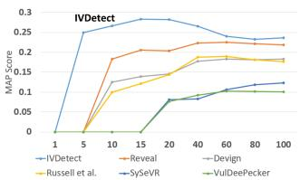  
(a) MAP Scores

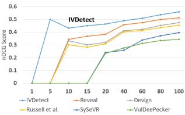  
(b) nDCG Scores  
Figure 7: Scores from Top 1 to Top 100 on Fan Dataset

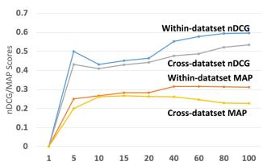  
(a) nDCG & MAP Scores

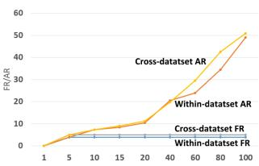  
(b) FR and AR  
Figure 8: RQ1. Cross-Dataset Validation: Training on Reveal and FFMPeg+Qemu Datasets, testing on Fan Dataset.

FFMPeg+Qemu datasets (1.4% and 2.7%), and worse than SySeVR on Fan dataset (2.7%). On the Reveal Dataset, IVDetect outperforms Reveal by 25.8% in terms of Precision, but has lower Recall by 10.3%. However, in terms of F-score, IVDetect can outperform the best performing baseline, Reveal, by 4.8% on FFMPeg+Qemu dataset, 16.7% on Fan dataset, and 12.5% on Reveal Dataset.

Figure 7 shows that IVDetect consistently has better MAP and nDCG scores when considering top-1 to top-100 ranked lists.

For cross-dataset validation, as seen in Figure 8, the results for MAP and nDCG in the within-dataset setting are better than those in the cross-dataset setting. This is expected because the model might see similar vulnerable code before in the same projects in the same dataset. The FR and AR values for the cross-dataset setting are one rank higher than those of the within-dataset setting.

Figure 9 shows our analysis on the overlapping results between IVDetect and the baselines on Fan dataset for top-100. As seen, IVDetect can detect 17, 13, 13, 11, and 10 vulnerable methods that VulDeePecker, SySeVR, Russell, Devign, and Reveal missed, respectively, while they can detect only 2,3, 4, 5, and 5 vulnerable methods that IVDetect missed. In summary, IVDetect can detect 15, 10, 9, 6, and 5 more vulnerable methods than the baselines.

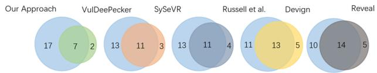  
Figure 9: Overlapping Analysis

Table 7: RQ2. Fine-grained VD Interpretation Comparison
<table><tr><td rowspan=2 colspan=1>Interp.Model</td><td rowspan=1 colspan=10>Accuracy</td><td rowspan=2 colspan=1>MFR MAR</td></tr><tr><td rowspan=1 colspan=1>N1</td><td rowspan=1 colspan=1>N2</td><td rowspan=1 colspan=1>N3</td><td rowspan=1 colspan=1>N4</td><td rowspan=1 colspan=1>N5</td><td rowspan=1 colspan=1>N6</td><td rowspan=1 colspan=1>N7</td><td rowspan=1 colspan=1>N8</td><td rowspan=1 colspan=1>N9</td><td rowspan=1 colspan=1>N10</td></tr><tr><td rowspan=1 colspan=1>ATTGRAD</td><td rowspan=1 colspan=1>0.010.01</td><td rowspan=1 colspan=1>0.160.19</td><td rowspan=1 colspan=1>0.410.43</td><td rowspan=1 colspan=1>0.540.54</td><td rowspan=1 colspan=1>0.590.59</td><td rowspan=1 colspan=1>0.600.62</td><td rowspan=1 colspan=1>0.620.63</td><td rowspan=1 colspan=1>0.630.65</td><td rowspan=1 colspan=1>0.640.66</td><td rowspan=1 colspan=1>0.650.67</td><td rowspan=1 colspan=1>4.86.34.25.6</td></tr><tr><td rowspan=1 colspan=1>GE</td><td rowspan=1 colspan=1>0.05</td><td rowspan=1 colspan=1>0.30</td><td rowspan=1 colspan=1>0.54</td><td rowspan=1 colspan=1>0.63</td><td rowspan=1 colspan=1>0.67</td><td rowspan=1 colspan=1>0.68</td><td rowspan=1 colspan=1>0.70</td><td rowspan=1 colspan=1>0.72</td><td rowspan=1 colspan=1>0.72</td><td rowspan=1 colspan=1>0.73</td><td rowspan=1 colspan=1>3.55.0</td></tr></table>

GE: GNNExplainer; Nx: x is the number of nodes in the interpretation

## 6.2 RQ2. Comparison with Interpretation Models for Fine-Grained VD Interpretation

Table 7 shows the accuracy of different interpretation models. As seen, using GNNExplainer improves over ATT and GRAD from 12.3%–400% and 9.0%–400% in accuracy, respectively, as we vary the size of interpretation sub-graphs (i.e., the number of statements) from 1–10. Higher accuracy indicates that IVDetect can provide better fine-grained vulnerability detection interpretation at the statement level. That is, in more cases, if IVDetect detects correctly vulnerable methods, it can point out more precisely the vulnerable statements relevant to the vulnerabilities. For ranking vulnerable statements, using GNNExplainer improves MFR by 0.7 and 1.3 ranks, and improves MAR by 0.6 and 1.3 ranks over ATT and GRAD.

ATT uses the edge attention in the Graph Attention Network to assign the weights for the edges, while GNNExplainer directly gives a score for the subgraph after masking. Thus, for the case in which there are more than one path from a node to another, the weight for an edge is the average weight of the weights through multiple paths, i.e., ATT might be less precise than GNNExplainer. GRAD computes the gradient of the loss function with respect to the input for computing the weight of an edge. However, such gradient-based approach may not perform well with respect to the discrete inputs (an input graph is represented as an adjacency matrix).

As the number of nodes in $\mathcal { G } _ { M }$ increases, the number of statements covered also increases, accuracy is higher. However, the computation time is higher and developers need to investigate more statements. As seen, when the number of statements is higher than 5, accuracy increases more slowly. Thus, we chose 5 as a default.

## 6.3 RQ3. Vulnerable Code Pattern Analysis

This section describes another experiment that we exploit IVDetect’s capability of providing the interpretation sub-graphs to mine the patterns of vulnerable code and fixes. A vulnerable code pattern is a fragment of vulnerable code that repeats frequently, i.e., more than a certain threshold. The detected vulnerability patterns and corresponding fixes are the good resources for developers to learn about the vulnerable code that others have frequently made, and learn to fix the vulnerable code in the same patterns.

From the results in RQ2, we first collected into a set G the interpretation sub-graphs G?? s with the correctly detected statements as relevant to the vulnerability in the methods. In total, we obtain +700 $\mathcal { G } _ { M } \mathbf { s } .$ . Note that $\mathcal { G } _ { M }$ is a sub-graph of PDG. For each $\mathcal { G } _ { M } :$ , we abstract out the variables’ names with a keyword VAR, and the literals with their data types. We then ran the sub-graph pattern mining algorithm [25] on $\mathcal { G }$ with different thresholds of frequen cies and collected different sizes of the sub-graph patterns. The outputs are the frequent isomorphic sub-graphs within $\mathcal { G } _ { M } \boldsymbol { s } ,$ which are considered as vulnerable code patterns because we chose $\mathcal { G } _ { M }$ that contains correct interpretation statements relevant to the correctly detected vulnerabilities. After manual verification, we obtain a number of correct patterns (Table 8). As seen, as the frequency threshold or the size of pattern is larger, the number of patterns decreases as expected. When they are both larger than 5, we found no pattern. Let us explain a few examples.

Table 8: RQ3. Numbers of Vulnerable Code Patterns
<table><tr><td></td><td>thresh=2</td><td>thresh=3</td><td>thresh=4</td><td>thresh=5</td></tr><tr><td>size=2</td><td>47</td><td>36</td><td>22</td><td>7</td></tr><tr><td>size=3</td><td>25</td><td>27</td><td>19</td><td>6</td></tr><tr><td>size=4</td><td>23</td><td>22</td><td>16</td><td>5</td></tr><tr><td>size=5</td><td>22</td><td>21</td><td>11</td><td>2</td></tr><tr><td>Total</td><td>117</td><td>102</td><td>68</td><td>21</td></tr></table>

```prolog
// PATTERN 1
2 if (is_link(STRINGLITERAL)) {
3 fprintf(stderr, "Error: invalid /etc/skel/.zshrc file\n"); //∉ patt
4 exit(INTLITERAL);
5 }
6 if (copy_file(STRINGLITERAL, VAR) == INTLITERAL) { .
// PATTERN 2
8 VAR = udf_get_filename(VAR, VAR, VAR, VAR);
9 if (VAR && ...) goto LABEL;
```  
Figure 10: Vulnerable Code Patterns

Figure 10 shows two examples of vulnerable code patterns. The first pattern (lines 2,4, and 6) shows an API misuse in the project firejail involving is\_link(...), exit, and copy\_file(...). The usage is to check the validity of a link, and if yes to copy the file, or otherwise to stop the execution. This pattern appeared three times with different string literals and was fixed by developers to replace the statements. An interesting observation is that IVDetect is able to eliminate the fprintf statement at line 2 from the interpretation sub-graph, thus, eliminating it from the pattern, even though the fprintf state ment appears with the other statements three times in the project. This shows a benefit of IVDetect because if a tool does not have statement-level VD interpretation and it mines pattern from the entire methods, it will incorrectly include fprintf in the pattern. The second pattern (lines 8–9) shows a pattern involving a vulnerable method call udf\_get\_filename, and the checking on its return value. The method was later fixed to add the $5 ^ { t h }$ parameter.

Another interesting finding is that IVDetect enables the discovery of not only vulnerable code patterns but also the fixing patterns for them. Figure 11 shows two fixing patterns for vulnerable code. The first vulnerability (from Linux kernel), lines 2–5, is about the method f16\_update\_dst(...). According to the commit log, to avoid an other thread changing a data record concurrently, developers need to provide mutual exclusion access and deferencing. This fixing pattern was repeated 3 times in the methods dccp\_v6\_send\_response, inet6\_csk\_route\_req, and net6\_csk\_route\_socket. This fixing pattern would be useful for a developer to learn the fix from one method and apply to the other two methods. The second pattern (lines 7–13) shows a fixing pattern to a vulnerability on buffer overflow with the malloc call in ParseDsdiffHeaderConfig method of WavPack 5.0. According to CVE-2018-7253, this problem “allows a remote attacker to cause a denial-of-service (heap-based buffer over-read) or possibly overwrite the heap via a maliciously crafted DSDIFF file”. This fixing pattern occurred three times in the same project.

```c
1 FIXING PATTERN 1
2 VAR = fl6_update_dst(VAR, VAR, VAR);
3 + rcu_read_lock();
4 + final_p = fl6_update_dst(VAR, rcu_dereference(VAR), VAR);
5 + rcu_read_unlock();
6 FIXING PATTERN 2 =
7 char VAR = malloc (VAR);
8 + char VAR;
9 + if (VAR < 0 || VAR > LITCONST) {
10 + error_line (STRINGLITERAL, VAR);
11 return LITCONST;
12 + }
13 + VAR = malloc (VAR);
```  
Figure 11: Fixing Patterns (-: removal, +: addition)

Table 9: RQ4. Evaluation for the Impact of Internal Features.
<table><tr><td></td><td>ST (A)</td><td>(A)+SST (B)</td><td>(B)+AST (C)</td><td>(C)+Var (D)</td><td>(D)+CD (E)</td><td>(E)+DD (F)</td></tr><tr><td>nDCG@15 nDCG@20</td><td>0.25 0.26</td><td>0.27 0.27</td><td>0.29 0.29</td><td>0.35 0.37</td><td>0.42 0.44</td><td>0.45 0.46</td></tr><tr><td>MAP@15</td><td>0.07</td><td>0.11</td><td>0.12</td><td>0.19</td><td>0.26</td><td>0.28</td></tr><tr><td>MAP@20</td><td>0.09</td><td>0.11</td><td>0.13</td><td>0.19</td><td>0.26</td><td>0.28</td></tr><tr><td>FR@15</td><td>14</td><td>12</td><td>11</td><td>7</td><td>5</td><td>4</td></tr><tr><td>FR@20</td><td>14</td><td>12</td><td>11</td><td>7</td><td>5</td><td>4</td></tr><tr><td>AR@15</td><td>14</td><td></td><td>11</td><td>10.3</td><td></td><td></td></tr><tr><td></td><td></td><td>13.5</td><td></td><td></td><td>9</td><td>8.5</td></tr><tr><td>AR@20</td><td>19.5</td><td>15</td><td>13.5</td><td>12.5</td><td>11.2</td><td>10.4</td></tr><tr><td>AUC</td><td>0.75</td><td>0.76</td><td>0.77</td><td>0.83</td><td>0.85</td><td>0.9</td></tr></table>

ST: sequence of tokens; SST: sequence of sub-tokens; AST: sub-AST; Var: variables; CD: control dependencies; DD: data dependencies; F = IVDetect

## 6.4 RQ4. Sensitivity Analysis for Features

Table 9 shows the changes to the metrics as we incrementally added each internal feature into our model in Figure 4. Generally, each internal feature contributes positively to the better performance of IVDetect, as both the score metrics (nDCG, MAP, and AUC) and the ranking metrics (FR and AR) are improved.

When IVDetect considers only the sequence of tokens (ST) in the code, the first correct detection (FR) is at the position 14, thus, nDCG@{1,5,10}=0 and MAP@{1,5,10}=0 (not shown). When consid ering the code as the sequence of sub-tokens (SST), IVDetect deals with the unique tokens better because the sub-tokens appear more frequently than the tokens [24]. At top-20, FR improves 2 positions, AR improves 4.5 positions, and nDCG and MAP relatively improve 3.8% and 22.2%. When AST is additionally considered, the model can distinguish vulnerable code structures and statements. At top-20, FR and AR improve 1 and 1.5 positions, and nDCG and MAP improve 7.4% and 18.1%. However, FR is still 11 and nDCG@{1,5,10}=0 and MAP@{1,5,10}=0 (not shown), because tokens and AST do not help much discriminate the vulnerable statements.

The feature on variables also helps improve FR and AR from 11 to 7 and 13.5 to 12.5, and nDCG and MAP relatively improve 27.6% and 46.2% at top 20. nDCG@10 and MAP@10 improve from 0 to 0.33 and to 0.18, respectively (not shown). This feature allows the model to detect similar incorrect variable usages. By additionally integrating control dependencies (CD), FR and AR improve from 7 down to 5 and 12.5 down to 11.2, and nDCG and MAP relatively improve 18.9% and 36.8%. By adding data dependencies (DD), FR and AR improve from 5 to 4 and 11.2 to 10.4. nDCG and MAP improve 4.5% and 7.7% for top 20. This result confirms that vulnerable code often involves the statements with control and/or data dependencies [11, 37].

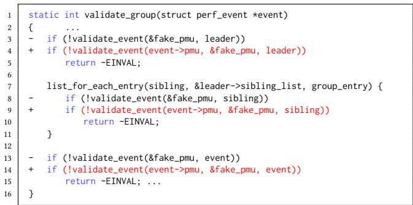  
Figure 12: A Detected Vulnerable Method in Android Kernel

Figure 12 shows a detected vulnerable method: validate\_event(...) was vulnerable and replaced with a new version with an additional parameter. We used the models (A)–(F) for detection, and observed that the rank for validate\_event(...) in the candidate list improves from 140 (A), to 121 (B), 99 (C), 71 (D), 48 (E), and 19 (F). While the features on tokens, sub-tokens, and AST are contributing, they do not help much because the model did not see them in vulnerable methods before. However, the variable/method names, especially control/data dependencies between the surrounding statements and validate\_event(...) help discriminate this vulnerability, and push it to the top-20 list. Control dependencies (e.g., between validate\_event(...) and return -EINVAL) help improve 29 ranks. Generally, the improvement in ranking shows the positive contributions of all the features.

This example also shows a fixing pattern appearing three times with different variables leader, sibling, and event.

## 6.5 RQ5. Sensitivity Analysis on Training Data

As seen in Table 10, with more training data, the performance is better as expected. Even with 60%/20%/20%, IVDetect still achieves nCDG of 0.43 and MAP of 0.25, which are still higher than those of the other baselines for top 20 (highest nDCG and MAP of the baselines are 0.38 and 0.20). With 20% less training data (60% vs 80%), IVDetect drops AUC only by 5.5%.

## 6.6 RQ6. Time Complexity

To generate the interpretation sub-graphs for all methods, it takes about 9 days, 2 days, and 3 days to finish on Fan, Reveal, and FFMPeg+Qemu datasets, respectively. It took 23, 7, 10 hours to train IVDetect on Fan, Reveal, and FFMPeg+Qemu datasets. For VD prediction, it takes only 1-2s per method.

Threats to Validity. We only tested on the vulnerabilities in C and C++ code. In principle, IVDetect can apply to other programming languages. We tried our best to tune the baselines on same dataset for fair comparisons. We focus only on DL-based VD models.

Table 10: RQ5. Sensitivity Analysis on Training Data
<table><tr><td rowspan=1 colspan=1>Train/Tune/Test</td><td rowspan=1 colspan=1>nDCG@20</td><td rowspan=1 colspan=1>MAP@20</td><td rowspan=1 colspan=1>FR@20</td><td rowspan=1 colspan=1>AR@20</td><td rowspan=1 colspan=1>AUC</td></tr><tr><td rowspan=5 colspan=1>40%/30%/30%50%/25%/25%60%/20%/20%70%/15%/15%80%/10%/10%</td><td rowspan=1 colspan=1>0.26</td><td rowspan=1 colspan=1>0.09</td><td rowspan=1 colspan=1>12</td><td rowspan=1 colspan=1>15.5</td><td rowspan=1 colspan=1>0.69</td></tr><tr><td rowspan=2 colspan=1>0.33</td><td rowspan=1 colspan=1>0.16</td><td rowspan=1 colspan=1>8</td><td rowspan=1 colspan=1>12.3</td><td rowspan=1 colspan=1>0.74</td></tr><tr><td rowspan=1 colspan=1></td><td rowspan=1 colspan=1>0.25</td><td rowspan=1 colspan=1>5</td><td rowspan=1 colspan=1>11.6</td><td rowspan=1 colspan=1>0.85</td></tr><tr><td rowspan=1 colspan=1>0.44</td><td rowspan=1 colspan=1>0.26</td><td rowspan=1 colspan=1>5</td><td rowspan=1 colspan=1>11.2</td><td rowspan=1 colspan=1>0.87</td></tr><tr><td rowspan=1 colspan=1>0.46</td><td rowspan=1 colspan=1>0.28</td><td rowspan=1 colspan=1>4</td><td rowspan=1 colspan=1>10.4</td><td rowspan=1 colspan=1>0.9</td></tr></table>

## 7 RELATED WORK

Various techniques have been developed to detect vulnerabilities. The rule-based approaches were developed to leverage known vulnerability patterns to discover possible vulnerable code, such as FlawFinder [7], RATS [9], ITS4 [33], Checkmarx [1], Fortify [8] and Coverity [2]. Typically, the patterns are manually defined by human experts. The state-of-the-art vulnerability detection tools using static analysis provide the rules for each vulnerability type.

Another type of VD approaches is machine learning (ML)-based or metrics-based. Typically, these approaches require human-crafted or summarized metrics as features to characterize vulnerabilities and train machine learning models on the defined features to pre dict whether a given code is vulnerable or not. Various ML-based approaches have been built on top of distinct metrics, such as terms and their occurrence frequencies [29], imports and func tion calls [23], complexity, code churn, and developer activity [31], dependency relation [22], API symbols and subtrees [34, 35].

Recently, deep learning (DL) has been applied to detect vulnerabilities. For example, some approaches train a DL model on different code representations to detect vulnerabilities, such as the lexical representations of functions in a synthetic codebase [14], code snip pets related to API calls to detect two types of vulnerabilities [20], syntax-based, semantics-based, and vector representations [19], graph-based representations [37]. None of them is designed to provide interpretations for a model in term of vulnerable statements.

## 8 CONCLUSION

We present IVDetect, a novel DL-based approach to provide sub graphs in PDG, that explains the prediction results of graph-based vulnerability detection. Our empirical evaluation on vulnerability databases shows that IVDetect outperforms the existing DL-based approaches by 64%–122% and 105%–255% in top-10 nDCG and MAP ranking scores. Our key limitations include 1) un-seen vulnerabilities, 2) the vulnerable statements incorrectly identified due to data/- control dependencies with vulnerable ones, 3) missed vulnerable statements due to multiple edges of data/control dependencies.

With IVDetect being a ML/DL-based vulnerability detection model, we aim to raise the level of ML/DL-based approaches, which are not able to point out the statements that caused the model to predict the vulnerability. Thus, we compared IVDetect with the detection approaches of the same category. In the future, we plan to compare IVDetect with static-analysis VD approaches.

## ACKNOWLEDGMENTS

This work was supported in part by the US National Science Foundation (NSF) grants CCF-1723215, CCF-1723432, TWC-1723198, CCF-1518897, and CNS-1513263.

## REFERENCES

[1] [n.d.]. Checkmarx. https://www.checkmarx.com/

[2] [n.d.]. Coverity. https://scan.coverity.com

[3] [n.d.]. CWE-120: Buffer Overflow. https://cwe.mitre.org/data/definitions/120.html [4] [n.d.]. CWE-290: Authentication Bypass by Spoofing. https://cwe.mitre.org/data/ definitions/290.html

[5] [n.d.]. CWE-79: Cross-site Scripting. http://cwe.mitre.org/data/definitions/79.html

[6] [n.d.]. CWE-89: SQL Injection. https://cwe.mitre.org/data/definitions/89.html

[7] [n.d.]. FlawFinder. http://www.dwheeler.com/FlawFinder

[8] [n.d.]. HP Fortify. https://www.hpfod.com/

[9] [n.d.]. RATS: Rough Audit Tool for Security. https://code.google.com/archive/p/ rough-auditing-tool-for-security/

[10] 2021. The GitHub Repository for This Study. https://github.com/ vulnerabilitydetection/VulnerabilityDetectionResearch

[11] Saikat Chakraborty, Rahul Krishna, Yangruibo Ding, and Baishakhi Ray. 2020. Deep Learning based Vulnerability Detection: Are We There Yet? arXiv preprint arXiv:2009.07235 (2020).

[12] Junyoung Chung, Caglar Gulcehre, KyungHyun Cho, and Yoshua Bengio. 2014. Empirical evaluation of gated recurrent neural networks on sequence modeling. arXiv preprint arXiv:1412.3555 (2014).

[13] Jiahao Fan, Yi Li, Shaohua Wang, and Tien Nguyen. 2020. A C/C++ Code Vulner ability Dataset with Code Changes and CVE Summaries. In The 2020 International Conference on Mining Software Repositories (MSR). IEEE.

[14] Jacob Harer, Onur Ozdemir, Tomo Lazovich, Christopher Reale, Rebecca Russell, Louis Kim, et al. 2018. Learning to repair software vulnerabilities with generative adversarial networks. In Advances in Neural Information Processing Systems. 7933– 7943.

[15] Jacob A Harer, Louis Y Kim, Rebecca L Russell, Onur Ozdemir, Leonard R Kosta, Akshay Rangamani, Lei H Hamilton, Gabriel I Centeno, Jonathan R Key, Paul M Ellingwood, et al. 2018. Automated software vulnerability detection with machine learning. arXiv preprint arXiv:1803.04497 (2018)

[16] Fabian Keller, Lars Grunske, Simon Heiden, Antonio Filieri, Andre van Hoorn, and David Lo. 2017. A critical evaluation of spectrum-based fault localization techniques on a large-scale software system. In 2017 IEEE International Conference on Software Quality, Reliability and Security (QRS). IEEE, 114–125.

[17] Thomas N. Kipf and Max Welling. 2016. Semi-Supervised Classification with Graph Convolutional Networks. CoRR abs/1609.02907 (2016). arXiv:1609.02907 http://arxiv.org/abs/1609.02907

[18] Yi Li, Shaohua Wang, Tien N Nguyen, and Son Van Nguyen. 2019. Improving bug detection via context-based code representation learning and attention-based neural networks. Proceedings of the ACM on Programming Languages 3, OOPSLA (2019), 1–30.

[19] Zhen Li, Deqing Zou, Shouhuai Xu, Hai Jin, Yawei Zhu, and Zhaoxuan Chen. 2018. Sysevr: A framework for using deep learning to detect software vulnerabilities. arXiv preprint arXiv:1807.06756 (2018).

[20] Zhen Li, Deqing Zou, Shouhuai Xu, Xinyu Ou, Hai Jin, Sujuan Wang, Zhijun Deng, and Yuyi Zhong. 2018. Vuldeepecker: A deep learning-based system for vulnerability detection. arXiv preprint arXiv:1801.01681 (2018).

[21] Microsoft. [n.d.]. Neural Network Intelligence. https://github.com/microsoft/nni. Last Accessed August 28th, 2020.

[22] Stephan Neuhaus and Thomas Zimmermann. 2009. The Beauty and the Beast: Vulnerabilities in Red Hat’s Packages.. In USENIX Annual Technical Conference.

[23] Stephan Neuhaus, Thomas Zimmermann, Christian Holler, and Andreas Zeller. 2007. Predicting vulnerable software components. In Proceedings of the 14th ACM

conference on Computer and communications security. 529–540.

[24] Son Nguyen, Hung Dang Phan, Trinh Le, and Tien N. Nguyen. 2020. Suggesting Natural Method Names to Check Name Consistencies. In Proceedings of the 42nd International Conference on Software Engineering (ICSE ’20). ACM Press, 12 pages.

[25] Tung Thanh Nguyen, Hoan Anh Nguyen, Nam H. Pham, Jafar M. Al-Kofahi, and Tien N. Nguyen. 2009. Graph-Based Mining of Multiple Object Usage Patterns. In Proceedings of the 7th Joint Meeting of the European Software Engineering Conference and the ACM SIGSOFT Symposium on The Foundations of Software Engineering (Amsterdam, The Netherlands) (ESEC/FSE ’09). Association for Computing Machinery, New York, NY, USA, 383–392. https://doi.org/10.1145/1595696.1595767

[26] Jeffrey Pennington, Richard Socher, and Christopher D. Manning. 2014. GloVe: Global Vectors for Word Representation. In Empirical Methods in Natural Language Processing (EMNLP). 1532–1543. http://www.aclweb.org/anthology/D14- 1162

[27] Nam H. Pham, Tung Thanh Nguyen, Hoan Anh Nguyen, and Tien N. Nguyen. 2010. Detection of recurring software vulnerabilities. In Proceedings of the IEEE/ACM international conference on Automated software engineering. 447–456.

[28] Rebecca Russell, Louis Kim, Lei Hamilton, Tomo Lazovich, Jacob Harer, Onur Ozdemir, Paul Ellingwood, and Marc McConley. 2018. Automated vulnerability detection in source code using deep representation learning. In 2018 17th IEEE International Conference on Machine Learning and Applications (ICMLA). IEEE, 757–762.

[29] Riccardo Scandariato, James Walden, Aram Hovsepyan, and Wouter Joosen. 2014. Predicting vulnerable software components via text mining. IEEE Transactions on Software Engineering 40, 10 (2014), 993–1006.

[30] Min Shi, Yufei Tang, Xingquan Zhu, and Jianxun Liu. 2019. Feature-attention graph convolutional networks for noise resilient learning. arXiv preprint arXiv:1912.11755 (2019).

[31] Yonghee Shin, Andrew Meneely, Laurie Williams, and Jason A Osborne. 2010. Evaluating complexity, code churn, and developer activity metrics as indicators of software vulnerabilities. IEEE transactions on software engineering 37, 6 (2010), 772–787.

[32] Kai Sheng Tai, Richard Socher, and Christopher D Manning. 2015. Improved semantic representations from tree-structured long short-term memory networks. arXiv preprint arXiv:1503.00075 (2015).

[33] John Viega, Jon-Thomas Bloch, Yoshi Kohno, and Gary McGraw. 2000. ITS4: A static vulnerability scanner for C and C++ code. In Proceedings 16th Annual Computer Security Applications Conference (ACSAC’00). IEEE, 257–267.

[34] Fabian Yamaguchi, Felix Lindner, and Konrad Rieck. 2011. Vulnerability extrapola tion: Assisted discovery of vulnerabilities using machine learning. In Proceedings of the 5th USENIX conference on Offensive technologies. 13–13.

[35] Fabian Yamaguchi, Markus Lottmann, and Konrad Rieck. 2012. Generalized vulnerability extrapolation using abstract syntax trees. In Proceedings of the 28th Annual Computer Security Applications Conference. 359–368.

[36] Zhitao Ying, Dylan Bourgeois, Jiaxuan You, Marinka Zitnik, and Jure Leskovec. 2019. GNNExplainer: Generating Explanations for Graph Neural Networks. In Advances in Neural Information Processing Systems 32, H. Wallach, H. Larochelle, A. Beygelzimer, F. d'Alché-Buc, E. Fox, and R. Garnett (Eds.). Curran Associates, Inc., 9244–9255.

[37] Yaqin Zhou, Shangqing Liu, Jingkai Siow, Xiaoning Du, and Yang Liu. 2019. Devign: Effective vulnerability identification by learning comprehensive program semantics via graph neural networks. In Advances in Neural Information Processing Systems. 10197–10207.