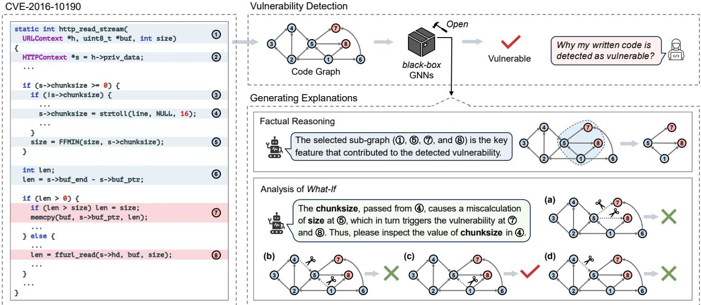
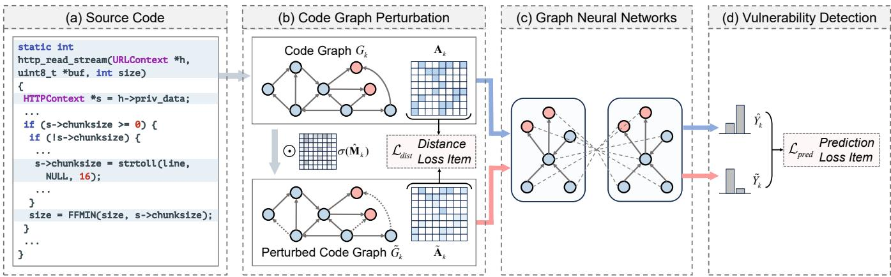
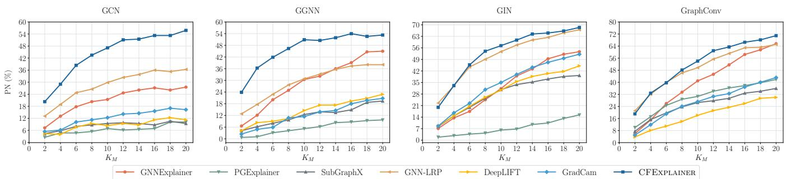
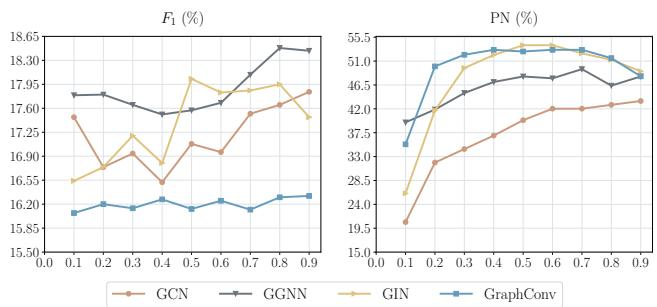
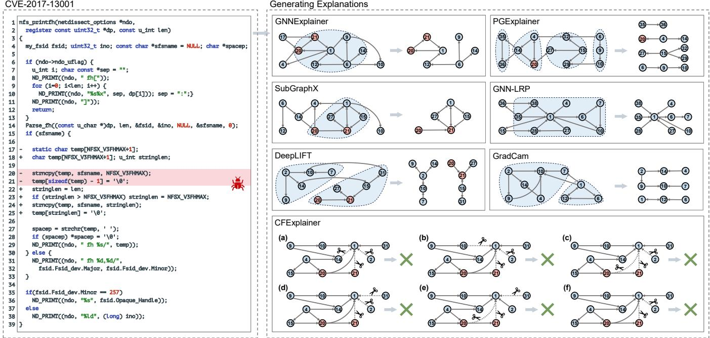

# Graph Neural Networks for Vulnerability Detection: A Counterfactual Explanation

Zhaoyang Chu∗ School of Computer Science and Technology, Huazhong University of Science and Technology, China chuzhaoyang@hust.edu.cn

Yang Wu∗ School of Computer Science and Technology, Huazhong University of Science and Technology, China wuyang\_emily@hust.edu.cn

Yao Wan∗† School of Computer Science and Technology, Huazhong University of Science and Technology, China wanyao@hust.edu.cn

Hongyu Zhang   
School of Big Data and Software   
Engineering, Chongqing University,   
China   
hyzhang@cqu.edu.cn   
Guandong Xu   
School of Computer Science,   
University of Technology Sydney,   
Australia   
guandong.xu@uts.edu.au

Qian Li School of Electrical Engineering, Computing and Mathematical Sciences, Curtin University, Australia qli@curtin.edu.au

Yulei Sui School of Computer Science and Engineering, University of New South Wales, Australia y.sui@unsw.edu.au

Hai Jin∗ School of Computer Science and Technology, Huazhong University of Science and Technology, China hjin@hust.edu.cn

## Abstract

Vulnerability detection is crucial for ensuring the security and relia bility of software systems. Recently, Graph Neural Networks (GNNs) have emerged as a prominent code embedding approach for vulner ability detection, owing to their ability to capture the underlying semantic structure of source code. However, GNNs face significant challenges in explainability due to their inherently black-box nature. To this end, several factual reasoning-based explainers have been proposed. These explainers provide explanations for the predic tions made by GNNs by analyzing the key features that contribute to the outcomes. We argue that these factual reasoning-based ex planations cannot answer critical what-if questions: “What would happen to the GNN’s decision if we were to alter the code graph into alternative structures?” Inspired by advancements of counterfactual reasoning in artificial intelligence, we propose CFExplainer, a novel counterfactual explainer for GNN-based vulnerability detec tion. Unlike factual reasoning-based explainers, CFExplainer seeks the minimal perturbation to the input code graph that leads to a change in the prediction, thereby addressing the what-if questions

for vulnerability detection. We term this perturbation a counterfac tual explanation, which can pinpoint the root causes of the detected vulnerability and furnish valuable insights for developers to undertake appropriate actions for fixing the vulnerability. Extensive experiments on four GNN-based vulnerability detection models demonstrate the effectiveness of CFExplainer over existing state of-the-art factual reasoning-based explainers.

## CCS Concepts

• Software and its engineering → Software reliability.

## Keywords

Vulnerability detection, graph neural networks, model explainabil ity, counterfactual reasoning, what-if analysis.

## ACM Reference Format:

Zhaoyang Chu, Yao Wan, Qian Li, Yang Wu, Hongyu Zhang, Yulei Sui, Guandong Xu, and Hai Jin. 2024. Graph Neural Networks for Vulnerability Detection: A Counterfactual Explanation. In Proceedings of the 33rd ACM SIGSOFT International Symposium on Software Testing and Analysis (ISSTA ’24), September 16–20, 2024, Vienna, Austria. ACM, New York, NY, USA, 13 pages. https://doi.org/10.1145/3650212.3652136

## 1 Introduction

Software vulnerabilities, which expose weaknesses in a program, present a significant risk to data integrity, user privacy, and overall cybersecurity [29, 31, 66]. As of now, the Common Vulnerabilities and Exposures (CVE) [18] has reported tens of thousands of software vulnerabilities annually. Thus, vulnerability detection, which aims to automatically identify potentially vulnerable code, plays a pivotal role in ensuring the security and reliability of software.

Existing efforts on vulnerability detection primarily fall within two main categories: static analysis-based approaches [16, 45, 49] and deep learning-based approaches [20, 30, 31, 66]. Traditional static analysis-based approaches (e.g., SVF [45] and Infer [1]) rely on human experts to manually define specific rules for detecting vul nerabilities. Recently, deep learning-based approaches, exemplified by pioneering works such as VulDeePecker [31] and Devign [66], have made remarkable strides, largely attributed to their capacity to learn comprehensive code representations, thereby enhancing the detection capabilities across diverse vulnerabilities. Among these approaches, Graph Neural Networks (GNNs) [6, 7, 20, 29, 66] have recently attracted substantial attention, owing to their capacity to capture intricate structural information of code, e.g., syntax trees, control flows, and data flows.

  
Figure 1: Illustration of factual reasoning-based explanation (right middle) and what-if analysis (right bottom).

Despite the significant progress made by GNNs in vulnerability detection, existing detection systems suffer from the explainability issues due to the black-box and complicated nature of deep neural networks. Given a predicted result, developers are often confused by the following question: “Why my code is detected as vulnerable?” From our investigation, existing studies [15, 21, 29] on explainable vulnerability detection are typically factual reasoning-based explain ers. The core idea of these explainers is to identify key features in the input data (e.g., sub-graphs in the code graph) that contribute to the final predictions. The selected features are commonly regarded as factual explanations, as they derive from empirical input data and serve as factual evidence for particular outcomes.

Here, we contend that those factual reasoning-based explana tions, which merely delineate the features or sub-graphs contribut ing to the identified vulnerability, are not convincing enough. One reason is that developers remain uncertain about the actual in fluence of the code segments, which constitute the explanation sub-graph, on the detection result. In other words, the factual reasoning-based explanations cannot answer “What would happen to the detection system’s decision if we were to alter these code segments into alternative structures?” This perspective of what-if is often associated with a human cognitive activity that imagines other possible scenarios for events that have already happened [39]. This motivates us to develop a novel paradigm for analyzing detected vulnerabilities in source code - what-if analysis. In our cases, whatif analysis explores hypothetical code instances with alternative structures. This approach aims to identify potential changes that would fix the vulnerability, thereby providing a better explanation of the root causes and factors contributing to its existence.

Why What-If Analysis? A Motivating Example. We use Figure 1 as an example to illustrate the advantage of analyzing what-if in explaining vulnerability detection compared to factual reasoningbased explanations. This example involves a heap-based buffer overflow vulnerability in the FFmpeg project1, reported by CVE 2016-101902, which allows remote Web servers to execute arbitrary code via a negative chunk size in an HTTP response. Specifically, this vulnerability arises from misuse of the strtoll function for parsing chunksize from HTTP responses into int64\_t format, without properly validating for negative values (○4 ). Then, a negative chunksize can result in an erroneous calculation in the FFMIN function, producing a negative size for buffer operations (○5 ). This negative size potentially triggers out-of-bounds write operations, ultimately leading to a heap buffer overflow (○7 and ○8 ). In this example, the vulnerability detection system parses the code snippet into a semantic code graph (e.g., Abstract Syntax Tree (AST), Control Flow Graph (CFG), Data Flow Graph (DFG), or Program Dependency Graph (PDG)). Here, without loss of generality, we consider the parsed code graph as a DFG for better illustration.

The vulnerability detection systems employ GNNs to model the DFG and yield a prediction outcome that classifies the input code snippet as vulnerable. To explain the prediction of “vulnerable”, the factual reasoning-based explanation identifies a compact subgraph in the code graph (○1 , ○5 , ○7 , and ○8 ) as the key feature that contributes to the detected vulnerability. This allows develop ers to recognize segments ○7 and ○8 , which involve buffer write operations (○1 and ○5 are not involved), as potentially vulnerable blocks. However, the explanation provided is inadequate for guiding code rectification to alter the detection system’s decision, leaving developers to manually check variables such as len, size, and chunksize to identify the actual cause of the vulnerability.

In contrast, to investigate the context of vulnerability occurrences, what-if analysis proactively and iteratively explores di verse hypothetical code structures (e.g., (a), (b), (c), and (d)), by inputting each into the detection system to observe varied predic tion outcomes. Taking structure (a) as an example, it is evident that removing the data-flow dependencies $\textcircled{5}  \textcircled{7}$ and ○5 →○8 , while retaining $\textcircled{6}  \textcircled { 7 }$ , leads to a prediction of “non-vulnerable”. It suggests that calculating size at ○5 may be a vulnerability source, while the computation of len at ○6 does not contribute to the vulnerability. Through iterative exploration for subsequent structures (b), (c), and (d), what-if analysis functions as an “optimization” pro cess, eventually “converging” to a minimal change that alters the detection system’s decision, i.e., only removing $\textcircled{4} \textcircled{4}$ in structure (d). The minimal change highlights the data flow $\textcircled{4} \textcircled { 4} \textcircled { 5 }$ as the root cause, which passes potentially incorrect chunksize, result ing in a miscalculation of size at ○5 and in turn triggering the buffer overflow at ○7 and ○8 . Consequently, developers receive an actionable insight, i.e., directly inspecting the value of chunksize at ○4 for potential errors. Overall, we can conclude that the what-if analysis essentially simulates the interactions between developers and the vulnerability detection system during debugging, methodi cally identifying the root causes of the detected vulnerabilities and guiding developers to effective solutions.

Our Solution and Contributions. Recent advances of counterfactual reasoning in artificial intelligence [3, 26, 27, 33, 47, 48, 54, 60] shed light on the possibility of applying what-if analysis for GNNbased vulnerability detection. A counterfactual instance represents an instance that, while closely similar to the original instance, is classified by the black-box model in a different class. Thus, counter factual reasoning aims to identify minimal changes in input features that can alter outcomes, thereby addressing the what-if questions.

Building upon this motivation, we propose CFExplainer, the first explainer to introduce counterfactual reasoning for enhanc ing the explainability of GNNs in vulnerability detection. Given a code instance, CFExplainer aims to identify a minimal perturba tion to the code graph input that can flip the detection system’s prediction from “vulnerable” to “non-vulnerable”. CFExplainer formulates the search problem for counterfactual perturbations as an edge mask learning task, which learns a differentiable edge mask to represent the perturbation. Based on the differentiable edge mask, CFExplainer builds a counterfactual reasoning framework to generate insightful counterfactual explanations for the detection results. Extensive experiments on four representative GNNs for vulnerability detection (i.e., GCN, GGNN, GIN, and GraphConv) validate the effectiveness of our proposed CFExplainer, both in terms of vulnerability-oriented and model-oriented metrics.

The key contributions of this paper are as follows.

• To the best of our knowledge, we are the first to discuss the what-if question and introduce the perspective of counterfactual reasoning for GNN-based vulnerability detection.

• We propose a counterfactual reasoning-based explainer, named CFExplainer, to generate explanations for the decisions made by the GNN-based vulnerability detection systems, which can help developers discover the vulnerability causes.

• We conduct extensive experiments on four GNN-based vulnerability detection systems to validate the effectiveness of CFEx plainer. Our results demonstrate that CFExplainer outperforms the state-of-the-art factual reasoning-based explainers.

## 2 Background

In this section, we begin by introducing essential preliminary knowledge necessary for a better understanding of our model. Subsequently, we present a mathematical formulation of the problem under study in this paper.

## 2.1 GNN-Based Vulnerability Detection Model

Suppose that we have a set of ?? code snippets $\mathcal { D } = \{ C _ { 1 } , C _ { 2 } , . . . , C _ { N } \}$ and each code snippet $C _ { k }$ is associated with a ground-truth label $Y _ { k } \in \{ 0 , 1 \}$ , which categorizes the code snippet as either nonvulnerable (0) or vulnerable (1). The goal of vulnerability detection is to learn a mapping function $f ( \cdot )$ that assigns a code snippet to either a non-vulnerable or vulnerable label.

Current deep learning-based approaches follow a fundamental pipeline wherein the semantics of the source code are embedded into a hidden vector, which is then fed into a classifier. Recently, GNNs have been designed to capture the semantic structures of source code, e.g., ASTs, CFGs, DFGs, and PDGs. Given a code graph $G _ { k }$ of $\dot { C } _ { k }$ , GNN typically follows a two-step message-passing scheme $( \mathrm { i . e . , }$ aggregate and update) at each layer ?? to learn node representations for $G _ { k }$

Firstly, GNN generates an intermediate representation $\mathbf { m } _ { i } ^ { l }$ for each node ?? in $G _ { k }$ by aggregating information from its neighbor nodes, denoted by $N ( i )$ , using an aggregation function:

$$
\mathbf { m } _ { i } ^ { l } = \mathrm { A g g r e g a t i o n } ( \{ \mathbf { h } _ { j } ^ { l - 1 } \mid j \in N ( i ) \} ) ,\tag{1}
$$

where $\mathbf { h } _ { j } ^ { l - 1 }$ denotes the representation of node ?? in the previous layer. Subsequently, the GNN updates the intermediate representation m?? for each node ?? via an update function:

$$
\mathbf h _ { i } ^ { l } = \mathrm { U p d a t e } ( \mathbf m _ { i } ^ { l } , \mathbf h _ { i } ^ { l - 1 } ) .\tag{2}
$$

For a ??-layer GNN, the final representation of the node ?? is $\mathbf { h } _ { i } ^ { L }$ . To obtain a graph representation ${ \bf h } _ { k }$ for the code graph $G _ { k }$ , a readout function (e.g., graph mean pooling) is applied to integrate all the node representations of $G _ { k }$

$$
\mathbf { h } _ { k } = \operatorname { R e a d o u t } ( \{ \mathbf { h } _ { i } ^ { L } \} ) .\tag{3}
$$

Finally, the graph representation ${ \bf h } _ { k }$ is fed into a classifier $( \mathrm { e . g . }$ Multi-Layer Perception (MLP)) followed by a Softmax function to calculate the probability distribution of non-vulnerable and vulnerable classes, as follows:

$$
P ( c \mid G _ { k } ) = \operatorname { S o f t m a x } ( \operatorname { M L P } ( \mathbf { h } _ { k } ) ) ,\tag{4}
$$

where $\textstyle P ( c \mid G _ { k } )$ is the predicted probability of the code snippet $C _ { k }$ that belongs to each class in {0, 1}, i.e., $C _ { k }$ is vulnerable or not.

The GNN model can be optimized by minimizing the binary cross entropy loss between the predicted probabilities and the ground truth labels, allowing it to learn from both non-vulnerable and vulnerable code instances in the training set.

As the model trained, in the testing phase, when presented with a code snippet $C _ { K }$ accompanied by its code graph $G _ { k }$ , the trained GNN model $f ( \cdot )$ is employed to compute the predicted probability $P ( c \mid G _ { k } )$ for each class. The resulting estimated label $\hat { Y } _ { k }$ for $C _ { k }$ is determined by selecting the class with the highest probability:

$$
{ \hat { Y } } _ { k } = \operatorname * { a r g m a x } _ { c \in \{ 0 , 1 \} } P ( c \mid G _ { k } ) .\tag{5}
$$

Investigated GNNs for Vulnerability Detection. In this study, we investigate four widely used GNNs for vulnerability detection. These GNNs employ various implementations of the Aggregation(·) and Update(·) functions to capture structural code information for vulnerability detection.

⊲ Graph Convolutional Network (GCN) [25] generalizes the idea of convolutional neural networks to graphs. It aggregates neighbor node representations by summing them and utilizes an MLP to update the aggregated node representations.

⊲ Gated Graph Neural Network (GGNN) [28] utilizes a Gated Recurrent Unit [8] to control information flow through edges when updating the aggregated node representations.

⊲ Graph Isomorphism Network (GIN) [56] introduces the concept of graph isomorphism to ensure permutation invariance. It employs a graph isomorphism operator to update the aggregated node representations.

⊲ GraphConv [36] incorporates higher-order graph structures at multiple scales to enhance GNN’s expressive power.

## 2.2 Model Explainability: The Problem

Suppose that we have a trained GNN model ?? (·) and its prediction $\hat { Y } _ { k }$ on the target code $C _ { k }$ represented by a code graph $G _ { k }$ . In this paper, we explore the explainability of GNNs within a black-box setting, recognized as a more challenging context for exploring model interpretability, where access to model parameters, training data, and gradients of each layer is unavailable. In the black-box setting, we constrain the explainer to derive the prediction probability $\textstyle P ( c \mid G _ { k } )$ exclusively by querying the model $f ( \cdot )$ with the code graph $G _ { k }$ as the input.

Under the aforementioned scenario, the factual reasoning-based explainers provide explainability by identifying key features that contribute to the model’s prediction. For example, Li et al. [29] propose to seek a compact sub-graph $G _ { k } ^ { S }$ that maintains the same prediction result as using the whole code graph $G _ { k }$ . They optimize the explainer by maximizing the probability of predicting the original estimated label $\hat { Y } _ { k }$ when the input graph is limited to the sub-graph $G _ { k } ^ { S }$ , defined as:

$$
\operatorname* { m a x } _ { G _ { k } ^ { S } } P ( \hat { Y } _ { k } \mid G _ { k } ^ { S } ) .\tag{6}
$$

On the contrary, counterfactual reasoning provides explainability by generating counterfactual instances to address what-if questions. For the given code graph $G _ { k } ,$ , we generate its counterfactual instance by introducing a subtle perturbation to it, resulting in a new graph $\tilde { G } _ { k }$ . The perturbed graph $\tilde { G } _ { k }$ differs minimally from the original $G _ { k }$ but is classified in a different class, i.e., $f ( { \tilde { G } } _ { k } ) \neq f ( G _ { k } )$ As a result, counterfactual reasoning aims to identify a minimal perturbation to $G _ { k }$ that alters the decision of the detection system. We mathematically formulate the counterfactual reasoning problem as follows:

$$
\begin{array} { r } { \underset { \tilde { G } _ { k } } { \mathrm { m i n } } d ( \tilde { G } _ { k } , G _ { k } ) , \ } \\ { \mathrm { s . t . , ~ } \underset { c \in \{ 0 , 1 \} } { \mathrm { a r g } \mathrm { m a x } } P ( c \mid \tilde { G } _ { k } ) \neq \hat { Y } _ { k } , } \end{array}\tag{7}
$$

where $d ( \cdot , \cdot )$ represents a distance metric that quantifies the differences between $\tilde { G } _ { k }$ and $G _ { k } , \mathbf { e . g . }$ ., the number of edges removed by the perturbation.

## 3 Proposed CFExplainer

In this section, we propose a counterfactual reasoning-based explainer, named CFExplainer, for GNN-based vulnerability detection. CFExplainer comprises several key components: (1) Code Graph Perturbation. CFExplainer employs a differentiable edge mask to represent the perturbation to the code graph, which transforms the discrete search task for counterfactual perturbations into a continuous learning task for edge masks. (2) Counterfactual Reasoning Framework. Based on the differentiable edge mask, CFExplainer constructs a counterfactual reasoning framework and designs a differentiable loss function to make this framework optimizable, as illustrated in Figure 2. (3) Counterfactual Explanation Generation. After optimization for the counterfactual reasoning framework, CFExplainer generates counterfactual explanations for the detection system’s predictions. We will elaborate on each component of CFExplainer in the following.

## 3.1 Code Graph Perturbation

In our scenario, vulnerabilities often arise from incorrect or inconsistent structural relations in the source code, such as control and data flow flaws. Thus, for the given code graph $G _ { k } ,$ , we focus on perturbing its graph structures (i.e., edges), represented by the adjacency matrix $\mathbf { A } _ { k } \in \{ 0 , 1 \} ^ { n \times n }$ , rather than perturbing the node features $\mathbf { X } _ { k } \in \mathbb { R } ^ { n \times d }$ , where ?? is the number of nodes in $G _ { k }$ and ?? represents the feature dimension. Note that the code graph $G _ { k }$ is a directed graph, hence, $\mathbf { A } _ { k }$ is unsymmetrical.

One straightforward approach for generating counterfactual per turbations is through greedy search, which iteratively edits the code graph by removing or re-adding edges. However, its practicality is limited by the vast size of the search space, leading to ineffi ciency [3]. Although heuristic strategies can potentially explore the search space more efficiently, identifying the optimal counter factual instance with precision is challenging. Specifically, there is no guarantee that the counterfactual perturbation identified is the minimal one necessary.

Edge Mask-Based Perturbation. To overcome these limitations, inspired by prior work [29, 33, 58], we adopt the edge masking technique. This technique treats the searching for counterfactual perturbations as an edge mask learning task. The idea is that a perturbed graph $\tilde { G } _ { k }$ can be derived by masking out edges from the original code graph $G _ { k }$ , as follows:

$$
\tilde { \mathbf { A } } _ { k } = \mathbf { A } _ { k } \odot \mathbf { M } _ { k } ,\tag{8}
$$

  
Figure 2: An overview of our proposed counterfactual reasoning framework.

where $\tilde { \mathbf { A } } _ { k }$ is the perturbed version of $\mathbf { A } _ { k } , \mathbf { M } _ { k } \in \left\{ 0 , 1 \right\} ^ { n \times n }$ is a binary edge mask matrix, and ⊙ denotes element-wise multiplication. If an element ${ \mathbf { M } } _ { k , i j } = 0 ;$ , it indicates the edge (??, ?? ) is masked out in $\mathbf { A } _ { k } .$ . As directly learning the binary edge mask matrix ${ \bf M } _ { k }$ is not differentiable, we relax ${ \bf M } _ { k }$ to continuous real values, which is $\hat { \mathbf { M } } _ { k } \in \mathbb { R } ^ { n \times n }$ . Then, as illustrated in Figure 2(b), the perturbed adjacency matrix is generated by:

$$
\begin{array} { r } { \tilde { \bf A } _ { k } = { \bf A } _ { k } \odot \sigma ( \hat { \bf M } _ { k } ) , } \end{array}\tag{9}
$$

where ?? (·) represents the sigmoid function that maps the edge mask into the range [0, 1], allowing a smooth transition between the presence and absence of edges. As a result, starting from a randomly initialized edge mask matrix, $\hat { \mathbf { M } } _ { k }$ can be optimized via gradient descent. This approach enables a quicker and more precise deter mination of the minimal counterfactual perturbation compared to search-based strategies.

## 3.2 Counterfactual Reasoning Framework

We build a counterfactual reasoning framework to generate expla nations for the predictions made by the GNN-based vulnerability detection system. The core idea of our proposed framework is to identify a minimal perturbation to the code graph that flips the detection system’s prediction. This is achieved by addressing a counterfactual optimization problem, which will be formulated in the following.

Suppose that we have a trained GNN model (whose weight parameter W is fixed and inaccessible) and the code graph $G _ { k }$ for the target code snippet $C _ { k }$ . We first apply the edge mask $\hat { \mathbf { M } } _ { k }$ on the code graph $G _ { k }$ to generate a perturbed graph, i.e., $\tilde { G } _ { k }$ . Subsequently, as shown in Figure 2, we feed the original and perturbed code graphs into the GNN model to produce respective estimated labels:

$$
\begin{array} { r } { \hat { Y } _ { k } = \mathrm { G N N } ( \mathbf { A } _ { k } , \mathbf { X } _ { k } \mid \mathbf { W } ) , } \\ { \tilde { Y } _ { k } = \mathrm { G N N } ( \tilde { \mathbf { A } } _ { k } , \mathbf { X } _ { k } \mid \mathbf { W } ) . } \end{array}\tag{10}
$$

where ${ \bf X } _ { k }$ denotes the features of the nodes in $G _ { k }$ . To identify a minimal counterfactual perturbation, we learn the edge mask $\hat { \mathbf { M } } _ { k }$ based on the optimization objective of the counterfactual reasoning problem. Specifically, we reformulate Eq. (7) as follows:

$$
\operatorname * { m i n } _ { \hat { { \mathbf { M } } } _ { k } } d ( \tilde { { \mathbf { A } } } _ { k } , { \mathbf { A } } _ { k } ) , \ { \mathrm { s . t . } } , \ \tilde { Y } _ { k } \neq \hat { Y } _ { k } .\tag{11}
$$

Here, the constraint part aims to ensure that the new prediction $\tilde { Y } _ { k }$ is different from the original prediction $\hat { Y } _ { k }$ , while the objective part aims to encourage that the perturbed adjacency matrix $\tilde { \mathbf { A } } _ { k }$ is as close as possible to the original adjacency matrix $\mathbf { A } _ { k }$

Direct optimization of Eq. (11) is challenging since both its ob jective and constraint parts are non-differentiable. To address this, we design two differentiable loss function items to make the two parts optimizable, respectively.

Prediction Loss Item. To satisfy the constraint condition in Eq. (11), we design a prediction loss item $\mathcal { L } _ { p r e d }$ to encourage the detection system towards producing a different prediction when the original code graph $G _ { k }$ is perturbed into $\tilde { G } _ { k }$ , as follows:

$$
\mathcal { L } _ { p r e d } = P ( \hat { Y } _ { k } \mid \tilde { \mathbf { A } } _ { k } , \mathbf { X } _ { k } ) .\tag{12}
$$

This loss item aims to minimize the likelihood that the perturbed graph $\tilde { G } _ { k }$ will maintain the original prediction ${ \hat { Y } } _ { k } ,$ thereby maximizing the chances of achieving an altered prediction outcome.

Distance Loss Item. To address the objective part in Eq. (11), we utilize binary cross entropy as a differentiable distance function to quantify the divergence between the original and perturbed adjacency matrixes, which is formulated as follows:

$$
\begin{array} { r } { \mathcal { L } _ { d i s t } = \mathrm { B i n a r y C r o s s E n t r o p y } ( \tilde { \mathbf { A } } _ { k } , \mathbf { A } _ { k } ) . } \end{array}\tag{13}
$$

This distance function is chosen for its efficacy in measuring the difference between two probability distributions. In our case, we consider the presence and absence of edges in the graph as binary classes, thus conceptualizing $\tilde { \mathbf { A } } _ { k }$ as the estimated distribution of edges and $\mathbf { A } _ { k }$ as the actual distribution. During optimization, $\mathcal { L } _ { d i s t }$ ensures that $\tilde { \mathbf { A } } _ { k }$ remains as close as possible to $\mathbf { A } _ { k } ,$ thus determining a minimal counterfactual perturbation to the code graph $G _ { k }$

Overall Loss Function. We integrate the above two loss items into an overall loss function to optimize them collaboratively:

$$
\mathcal { L } = \alpha \cdot \mathcal { L } _ { p r e d } + \left( 1 - \alpha \right) \cdot \mathcal { L } _ { d i s t } ,\tag{14}
$$

where ?? is a hyper-parameter that regulates the trade-off between the prediction loss item and the distance loss item. Higher ?? prioritizes changing the prediction outcome, potentially at the expense of a larger perturbation, whereas lower ?? focuses more on minimizing the perturbation. Based on the overall loss function, we optimize the counterfactual reasoning framework using the gradient descent algorithm and the Adam optimizer [24]. Note that our framework operates in the black-box setting, indicating that the process of counterfactual reasoning focuses solely on updating the edge mask $\hat { \mathbf { M } } _ { k }$ to find the optimal perturbation while holding the underlying GNN model’s parameters fixed.

## 3.3 Counterfactual Explanation Generation

Utilizing an optimized counterfactual reasoning framework, we generate counterfactual explanations to explain the predictions made by the vulnerability detection systems.

Generating Optimal Counterfatual Explanation. After opti mization, we obtain the optimal edge mask $\hat { \mathbf { M } } _ { k } ^ { * }$ . In this mask ma trix, higher values indicate their corresponding edges should be preserved while lower values indicate their corresponding edges should be removed to reverse the detection system’s decision. To form the final explanation, we employ a hyper-parameter $K _ { M }$ to control the number of edges to be perturbed, i.e., taking the $K _ { M }$ edges with the lowest mask values. Then, we obtain the optimal counterfactual perturbed graph $\tilde { G } _ { k } ^ { * }$ by removing the $K _ { M }$ selected edges and derive a sub-graph:

$$
G _ { k } ^ { S * } = G _ { k } - \tilde { G } _ { k } ^ { * } .\tag{15}
$$

As a result, the optimal counterfactual explanation takes the following form: the derived sub-graph $G _ { k } ^ { S * }$ is the most critical factor on the detection result, that if removed, then the code would not be predicted as vulnerable.

Deriving Diverse Counterfactual Explanations. In real-world scenarios, developers may need diverse counterfactual explanations to explore and understand the context of the detected vulnerability. To achieve this, we build a narrowed search space based on the sub-graph $G _ { k } ^ { S * }$ . Within this space, we employ exhaustive search to methodically explore and filter various edge combinations in $G _ { k } ^ { S * }$ whose removal would alter the detection system’s prediction. This process generates a set of diverse counterfactual explanations, each offering insights into the detected vulnerability from different perspectives. Moreover, such diversity provides developers with multiple actionable options to address the detected vulnerability.

## 4 Experimental Setup

In this section, we begin by presenting the dataset, the baseline explainers for comparison, and the implementation details. Subse quently, we introduce two types of evaluation metrics to quantitatively evaluate the effectiveness of our proposed CFExplainer.

## 4.1 Dataset

Aligning with previous studies [14, 20, 21, 29], we conduct our ex periments on the widely-used vulnerability dataset, Big-Vul [13]. Linked to the public CVE database [18], Big-Vul comprises extensive source code vulnerabilities extracted from 348 open-source C/C++ GitHub projects, spanning from 2002 to 2019. It encompasses a total of 188,636 C/C++ functions, including 10,900 vulnerable ones, covering 91 various vulnerability types. Unlike other existing vul nerability datasets (i.e., Devign [66] and Reveal [6]) which only provide vulnerability labels at the function level, Big-Vul offers more detailed, statement-level code changes derived from original git commits. These code changes for fixing vulnerabilities are crucial in our study. They enable us to build ground-truth labels for quantitatively evaluating the quality of the generated explanations (see Section 4.4).

To enhance the dataset’s quality, we follow the cleaning procedure proposed by Hin et al. [20]. Specifically, we remove comment lines from the code and ignore purely cosmetic code changes (e.g., changes to whitespace). We also exclude improperly truncated or unparsable code snippets. Additionally, following the practices of previous research [14, 20], we perform random undersampling for non-vulnerable code snippets to obtain a balanced dataset. In this work, we employ an open-source code analysis tool, Joern [2, 57], to parse each code snippet into a PDG, which serves as the input for the GNN-based detection model. PDG is a commonly used graph representation for code in vulnerability detection research [14, 20, 21, 29], which takes code statements as nodes and control-flow or data-flow dependencies as edges. Finally, the dataset is randomly divided into training, validation, and testing sets with a ratio of 8:1:1. Note that the explainers only generate explanations for the detection model’s predictions on the test set.

## 4.2 Baselines

To provide a comparative analysis, we investigate six prominent factual reasoning-based GNN explainers as our baselines:

• GNNExplainer [33] seeks a crucial sub-graph by maximizing the mutual information between the original GNN’s prediction and the sub-graph distribution.

• PGExplainer [34] learns an edge mask predictor based on the mutual information loss used in [33]. It accesses the training set to train the edge mask predictor.

• SubgraphX [63] employs the Monte Carlo tree search algorithm [44] to efficiently identify important sub-graphs with a node pruning strategy.

• GNN-LRP [40] decomposes the GNN’s prediction scores into the importance of various graph walks using a higher-order Taylor decomposition and returns a set of most important graph walks as an explanation.

• DeepLIFT [43] is another decomposition-based explainer but originally designed for image classification. A previous work [62] extends it to explain GNN models, denoted as DeepLIFT-Graph.

• GradCam [41] is a popular gradient-based explainer for image classification. It backpropagates the prediction scores to compute the gradients, which are then used to approximate the input importance. The previous work [62] adapts it for explaining GNN models, denoted as GradCam-Graph.

For the hyper-parameters of these baseline explainers, we adopt the implementation provided by previous research [21, 62]. Note that PGExplainer, GNN-LRP, DeepLIFT-Graph, and GradCam-Graph do not operate in the black-box setting, as they require access to model parameters, training data, and gradient information of GNNs.

## 4.3 Implementation Details

Our implementation comprises two main components: training GNN-based vulnerability detection models and generating explanations for the detection model’s predictions.

Table 1: The performance of the reimplemented GNN-based vulnerability detection models.
<table><tr><td>GNN Core</td><td>Acc (%)</td><td>Pr (%)</td><td>Re (%)</td><td>F1 (%)</td></tr><tr><td>GCN</td><td>72.05</td><td>60.39</td><td>44.81</td><td>51.44</td></tr><tr><td>GGNN</td><td>71.89</td><td>59.43</td><td>47.08</td><td>52.54</td></tr><tr><td>GIN</td><td>72.16</td><td>58.71</td><td>53.08</td><td>55.75</td></tr><tr><td>GraphConv</td><td>70.98</td><td>56.61</td><td>52.11</td><td>54.27</td></tr></table>

4.3.1 GNN-Based Vulnerability Detection. In our experiments, we reimplement four vulnerability detection models employing dif ferent GNN cores (i.e., GCN, GGNN, GIN, and GraphConv). Each detection model adopts a two-layer GNN architecture with a hid den dimension of 256, followed by graph mean pooling to derive graph-level representations. The graph-level representations are then input to a two-layer MLP classifier for vulnerability detection. In the model, we utilize GraphCodeBERT’s token embedding layer [19] to initialize node features for the input code graph. ReLU activation functions are used after each layer, except for the final one, to introduce non-linearity. Based on the binary cross-entropy loss, we train each detection model using the Adam optimizer [24] for 50 epochs, with a learning rate of 0.005 and a batch size of 64. As shown in Tabel 1, following prior research [7, 29, 31], we evaluate the performance of the reimplemented detection models using Accuracy, Precision, Recall, and $F _ { 1 }$ score. The results show that all four detection models achieve an Accuracy over 70%, a Precision over 55%, a Recall over 40%, and an $F _ { 1 }$ score over 50%. Among them, GCN excels in Precision, while GIN leads in Accuracy, Recall, and $F _ { 1 }$ score. Overall, these models exhibit similar performance with high Precision and relatively low Recall.

4.3.2 Explanation Generation. For the implementation of our pro posed CFExplainer, we train it using Adam to minimize the loss function described in Section 3.2 for 800 epochs at a learning rate of 0.05. Note that, for each code snippet sample, CFExplainer is trained individually to explain the detection model’s prediction. We set the hyper-parameter $K _ { M }$ to 8 by default and use the same $K _ { M }$ value to control the size of the explanation sub-graphs generated by the factual reasoning-based explainers for fair comparison. In addition, in Section 5.3, we conduct a parameter analysis on the hyper-parameter ??, exploring values from 0.1 to 0.9 to understand its influence on CFExplainer’s performance. It should be noted that the explainers aim to provide explanations by identifying the critical factors that contribute to the detected vulnerability. Thus, it is meaningless to explain the non-vulnerable code snippets and unfair to explain the code snippets that are incorrectly detected as vulnerable. As a result, we only consider explaining vulnerable code snippets that are correctly detected.

## 4.4 Evaluating the Explainability

In this section, we introduce two types of metrics to evaluate the quality of the generated explanations quantitatively.

4.4.1 Vulnerability-Oriented Evaluation Metric. Evaluating counterfactual explanations in code is challenging due to the difficulty in obtaining standardized ground truth. Previous research [10] has relied on manual labeling for evaluation, which is costly, not easily scalable, and lacks standardization. Fortunately, the Big-Vul dataset mitigates this issue by providing detailed statement-level fixes within git commits, which accurately reflect the changes addressing vulnerabilities. We utilize these commits to construct standardized ground-truth labels for our generated counterfactual explanations.

In the vulnerability-oriented evaluation, following methodolo gies established in vulnerability detection research [13, 20, 21, 29], we adopt the statements that are deleted or modified in the commit (marked with $^ { 6 6 } - { } ^ { 5 5 }$ signs) as ground-truth labels. Specifically, we extract all the statements from the vulnerable version of the code to build a binary ground-truth vector, denoted as $S = [ s _ { 1 } , s _ { 2 } , . . . , s _ { r } ]$ where $s _ { i } = 1$ indicates the ??-th statement is deleted or modified in the fixed version, and $s _ { i } = 0$ otherwise. Correspondingly, we construct a binary explanation vector $\Delta = [ \delta _ { 0 } , \delta _ { 1 } , . . . , \delta _ { r } ]$ , where non-zero values in Δ represent the corresponding statements included in the generated explanation sub-graph. The comparison of Δ with the ground-truth vector ?? allows for a quantitative evaluation of how accurately the generated explanations identify critical statements associated with the vulnerability.

Consider a given set of ?? vulnerable code snippets denoted as $\{ C _ { 1 } , C _ { 2 } , \dots , C _ { M } \}$ for evaluation. For each code snippet, an explanation is deemed correct if it encompasses the deleted or altered statements. Consequently, we compute the Accuracy score by determining the percentage of accurate explanations among all generated explanations. Moreover, we calculate the Precision and Recall scores for each code snippet by comparing the explanation vector Δ and the ground-truth vector ??:

$$
{ \mathrm { P r e c i s i o n } } = { \frac { \sum _ { i = 1 } ^ { r } s _ { i } \cdot \delta _ { i } } { \sum _ { i = 1 } ^ { r } \delta _ { i } } } , { \mathrm { R e c a l l } } = { \frac { \sum _ { i = 1 } ^ { r } s _ { i } \cdot \delta _ { i } } { \sum _ { i = 1 } ^ { r } s _ { i } } } .\tag{16}
$$

In our scenario, Precision measures the proportion of statements in the explanation that are relevant and accurately pertain to the vulnerability. On the other hand, Recall measures the proportion of ground-truth statements that are accurately included in the explanation. Additionally, we compute $F _ { 1 }$ as the harmonic mean of the two scores to evaluate the overall performance. The formula for F1 is given as follows:

$$
F _ { 1 } = \frac { 2 \cdot \mathrm { P r e c i s i o n } \cdot \mathrm { R e c a l l } } { \mathrm { P r e c i s i o n } + \mathrm { R e c a l l } } .\tag{17}
$$

Finally, we calculate the average scores of Precision, Recall, and $F _ { 1 }$ across all code snippets.

4.4.2 Model-Oriented Evaluation Metric. The vulnerability-oriented evaluation metrics primarily focus on assessing the consistency between the generated explanations and the root causes of the detected vulnerabilities. However, these metrics cannot quantify to what extent the generated explanations really influence the detection system’s decisions. Thus, inspired by previous research [47, 48], our model-oriented evaluation borrows insights from causal inference theory and introduces Probability of Necessity (PN) [17] to fill this gap. Intuitively, for an explanation ?? that is generated to explain prediction ??, if ?? does not happen then ?? will not happen, we say ?? is a necessary explanation for supporting the prediction ??. The core idea of PN is that: if we imagine a counterfactual world where the explanation sub-graph $G _ { k } ^ { S }$ did not exist in the original code graph $G _ { k }$ , then whether the corresponding code snippet $C _ { k }$ would not be detected as vulnerable? This is critical for understanding the causal impact of the explanations on the prediction outcomes. Following this idea, we define PN as the proportion of the generated sub-graph explanations that are necessary to influence the detection system’s predictions, as follows:

Table 2: Comparison for the vulnerability-oriented evaluation results of explainers.
<table><tr><td rowspan="2">Explainer</td><td colspan="4">GCN</td><td colspan="4">GGNN</td><td colspan="4">GIN</td><td colspan="4">GraphConv</td></tr><tr><td>|Acc (%) Pr (%) Re (%)</td><td></td><td></td><td> $F _ { 1 }$  (%) |</td><td>  Acc (%) Pr (%) Re (%)</td><td></td><td> $F _ { 1 }$ </td><td></td><td></td><td>(%) Acc (%) Pr (%) Re (%)</td><td></td><td> $F _ { 1 }$ </td><td></td><td>(%)Acc (%) Pr (%) Re (%) F1 (%)</td><td></td><td></td></tr><tr><td>GNNExplainer</td><td>59.06</td><td>13.68</td><td>41.26</td><td>17.29</td><td>61.25</td><td>13.94</td><td>45.54</td><td>18.76</td><td>53.37</td><td>12.14</td><td>34.42</td><td>15.09</td><td>53.12</td><td>12.81</td><td>37.54</td><td>16.31</td></tr><tr><td>PGExplainer</td><td>42.39</td><td>11.70</td><td>26.41</td><td>13.71</td><td>53.98</td><td>13.78</td><td>38.12</td><td>17.31</td><td>44.79</td><td>11.20</td><td>30.08</td><td>13.93</td><td>46.25</td><td>12.42</td><td>31.98</td><td>15.17</td></tr><tr><td>SubGraphX</td><td>43.12</td><td>12.44</td><td>27.29</td><td>13.77</td><td>41.52</td><td>12.53</td><td>27.60</td><td>14.48</td><td>36.81</td><td>11.29</td><td>23.14</td><td>12.59</td><td>42.50</td><td>12.64</td><td>26.60</td><td>14.09</td></tr><tr><td>GNN-LRP</td><td>56.00</td><td>13.31</td><td>38.52</td><td>16.49</td><td>59.86</td><td>13.32</td><td>44.19</td><td>17.83</td><td>54.94</td><td>14.20</td><td>39.54</td><td>17.54</td><td>48.74</td><td>12.51</td><td>34.85</td><td>15.52</td></tr><tr><td>DeepLIFT-Graph</td><td>50.00</td><td>12.88</td><td>33.14</td><td>15.61</td><td>55.36</td><td>14.39</td><td>39.83</td><td>17.84</td><td>47.24</td><td>12.89</td><td>32.84</td><td>15.58</td><td>49.69</td><td>12.48</td><td>34.85</td><td>15.43</td></tr><tr><td>GradCam-Graph</td><td>44.93</td><td>12.93</td><td>27.69</td><td>14.54</td><td>56.06</td><td>13.22</td><td>41.04</td><td>17.23</td><td>44.17</td><td>13.62</td><td>30.03</td><td>15.64</td><td>41.88</td><td>11.73</td><td>28.91</td><td>13.96</td></tr><tr><td>CFEXPLAINER</td><td>61.23</td><td>13.84 42.84 17.84</td><td></td><td></td><td>61.25</td><td>14.13</td><td>44.30</td><td>18.48</td><td>60.12</td><td></td><td>14.36 42.29</td><td>18.03</td><td>53.75</td><td>12.77</td><td>38.36 16.32</td><td></td></tr></table>

Note: We highlight the best score in bold and the second best score in underlined in each column.

$$
\mathrm { P N } = \frac { 1 } { M } \sum _ { k } ^ { M } p n _ { k } , \mathrm { w h e r e } p n _ { k } = \left\{ \begin{array} { l l } { { 1 , } } & { { \mathrm { i f } \hat { Y } _ { k } ^ { \prime } \ne \hat { Y } _ { k } , } } \\ { { 0 , } } & { { \mathrm { e l s e } , } } \end{array} \right.\tag{18}
$$

where $\hat { Y } _ { k } ^ { \prime } = \arg \operatorname* { m a x } _ { c \in \{ 0 , 1 \} } P ( c \mid G _ { k } - G _ { k } ^ { S } )$ represents the prediction result for the code snippet $C _ { k }$ when the explanation sub-graph $G _ { k } ^ { S }$ is removed from the original code graph $G _ { k } .$ . If removing $G _ { k } ^ { S }$ changes the prediction $\hat { Y } _ { k }$ , the explanation is considered necessary.

## 5 Experimental Results

To evaluate the performance of our counterfactual reasoning approach, we address the following Research Questions (RQs):

• RQ1: Vulnerability-Oriented Evaluation. How well does CF-Explainer perform in comparison with state-of-the-art factual reasoning-based explainers in identifying the root causes of the detected vulnerabilities?

• RQ2: Model-Oriented Evaluation. How well does CFExplainer perform in comparison with state-of-the-art factual reasoningbased explainers in generating explanations that really influence the detection model’s decision?

• RQ3: Influence of Hyper-parameter ??. How do different settings of the trade-off hyper-parameter ?? impact the performance of CFExplainer ?

## 5.1 RQ1: Vulnerability-Oriented Evaluation

One of the key objectives of explainers in our context is to accurately identify the root causes of detected vulnerabilities. The effec tiveness of our proposed CFExplainer, in comparison to factual reasoning-based explainers, is quantitatively showcased in Table 2, which reports the vulnerability-oriented evaluation results on four GNN-based detection models: GCN, GGNN, GIN, and GraphConv. These results reveal that CFExplainer outperforms the baseline explainers in most scenarios, demonstrating the effectiveness of our counterfactual reasoning approach. Across the four GNN-based detection models, CFExplainer achieves average improvements of 24.32%, 12.03%, 28.22%, and 14.29% in Accuracy, 7.93%, 4.43%,

14.36%, and 2.72% in Precision, 32.28%, 12.47%, 33.51%, and 18.19% in Recall, 17.10%, 7.18%, 19.71%, and 8.22% in $F _ { 1 }$ score over the factual reasoning-based explainers.

Among all baseline explainers, the perturbation-based GNNExplainer exhibits relatively good performance by directly searching for a crucial sub-graph that significantly contributes to the vulnerability detected by GNNs. Besides, the decomposition-based methods (i.e., GNN-LRP and DeepLIFT-Graph) directly decompose the detec tion model’s predictions into the importance of edges in the code graph and select the most important edges as an explanation, resulting in slightly inferior performance compared to GNNExplainer. However, the other two perturbation-based methods (i.e., PGExplainer and SubGraphX) and the gradient-based GradCam-Graph method perform relatively poorly. This is because PGExplainer’s mask predictor may suffer from the distribution shift between the training and test sets, while SubGraphX’s node pruning strategy may be not compatible with our scenario of perturbing edges in the code graph. GradCam-Graph utilizes gradient values to measure the edge importance, leading to an explanation sub-graph that correlates with the detection model’s hidden information rather than the actual vulnerabilities. In contrast to these factual reasoning based explainers, CFExplainer aims to address what-if questions by seeking a minimal perturbation to the code graph that alters the detection model’s prediction from “vulnerable” to “non-vulnerable”. Through this exploration, CFExplainer delves deeply into the context where the vulnerability occurs, revealing causal relationships between code structures and detection outcomes, thereby discovering the root causes of the detected vulnerabilities.

Answer to RQ1: CFExplainer exhibits superior effectiveness in vulnerability-oriented evaluation, outperforming state-of-the-art factual reasoning-based explainers.

## 5.2 RQ2: Model-Oriented Evaluation

Compared to vulnerability-oriented evaluation, model-oriented evaluation focuses on assessing the necessity of the generated ex planations for supporting the detection model’s predictions. As illustrated in Figure 3, CFExplainer demonstrates superior per formance over state-of-the-art factual reasoning-based explainers across four GNN-based detection models. Notably, the PN curve for CFExplainer consistently encompasses those of the baseline explainers under various $K _ { M }$ settings, visually indicating its effec tiveness. Unlike factual reasoning-based explainers that identify crucial sub-graphs but fall short in determining their actual in fluence on detection outcomes, CFExplainer targets a minimal change to the code graph that alters the prediction. This approach ensures the identification of edges that are truly necessary for the prediction outcome. This distinction is crucial in understanding CFExplainer’s ability to provide more accurate and essential expla nations. Moreover, we can observe that as the value of ???? increases, the PN scores of all explainers generally show improvement. This improvement can be attributed to that with a higher ???? value, more crucial edges necessary for supporting the detection result are identified and included in the generated explanation sub-graph.

  
Figure 3: Comparison for the model-oriented evaluation results of explainers.

  
Figure 4: A parameter analysis on the hyper-parameter ??.

Answer to RQ2: CFExplainer demonstrates superior performance in model-oriented evaluation, outperforming state-of-the-art factual reasoning-based explainers.

## 5.3 RQ3: Influence of Hyper-parameter ??

Understanding the impact of the trade-off hyper-parameter ?? is crucial for optimizing CFExplainer’s performance in generating counterfactual explanations. The hyper-parameter ?? plays a pivotal role in balancing the emphasis between the prediction loss item and the distance loss item. We conduct the parameter analysis on CFExplainer by varying ?? from 0.1 to 0.9 while keeping other hyper-parameters fixed.

As shown in Figure 4, ?? significantly influences the effectiveness of the counterfactual explanation generated by CFExplainer. We can see that with the increase in ??, the differences between the predictions using the perturbed graph and the original graph are more encouraged, thereby pushing the explanation to be more counterfactual, which leads to dramatic performance improvements. However, after ?? reaches its optimal value, the performance begins to decline because CFExplainer tends to generate a counterfactual larger perturbation to the code graph that may fail to identify the most critical factor influencing the detection system’s prediction. Based on our parameter analysis, we set $\alpha = 0 . 9$ for GCN and GraphConv, ?? = 0.8 for GGNN, and ?? = 0.5 for GIN. These values are chosen to ensure optimal performance across different models, accommodating their unique characteristics and sensitivities to the balance between prediction and distance loss.

Answer to RQ3: The trade-off hyper-parameter ?? has a significant impact on CFExplainer’s performance. Optimal settings vary across models, with ?? = 0.9 for GCN and GraphConv, ?? = 0.8 for GGNN, and ?? = 0.5 for GIN.

## 5.4 Case Study

We conduct a case study to qualitatively assess the effectiveness of CFExplainer compared to factual reasoning-based explainers, as shown in Figure 5. This case study involves a specific code commit of the nfs\_printfh function in the print-nfs.c file from the tcpdump project3. The added lines are indicated with a “+” sign, while the deleted lines are marked with a “-” sign. This commit addresses a buffer over-read vulnerability of the NFS parser, reported by CVE-2017-130014. This vulnerability arises from the original code failing to ensure that the source string sfsname is shorter than the destination buffer temp ( 20 ). As a result, strncpy could copy more characters than temp can safely contain, without nullterminating it immediately after the last copied character $\textcircled{2 1 }$ . This leads to potential buffer over-reads when temp is later accessed as a string. To address this vulnerability, the code should copy no more than temp can hold and must explicitly null-terminate the buffer after the last character copied from sfsname. The fix introduced in the commit ensures that the length of the data copied does not exceed NFSX\_V3FHMAX ( 23 ) and that temp is correctly null-terminated after the copy ( 25 ), preventing any over-read.

  
Figure 5: A case study on the CVE-2017-13001 vulnerability in the tcpdump project.

In this case study, we observe that factual reasoning-based ex plainers like GNN-LRP and GradCam fail to identify the vulnerability cause ( 20 and 21 ) in their generated explanation sub-graphs. While other factual reasoning-based explainers effectively point out 20 or 21 , their generated explanations also contain a few code statements unrelated to the vulnerability. This dilutes the clarity of the explanations, leaving developers to manually check the code to find out the actual vulnerability cause. Conversely, CFExplainer excels by generating a set of diverse counterfactual explanations to help developers understand the context of the detected vulnerability. For example, in structure (c), CFExplainer identifies that removing the program dependencies ○2 →○1 , 20 →○1 , and 21 →○1 alters the detection result. This directly leads developers to the critical statements 20 and 21 , which involve buffer operations (○1 and ○2 are not involved), and identifies them as potential areas of the vulnerability. Further, through the analysis of the minimal counterfactual perturbation as in structure (f), CFExplainer offers an actionable insight, i.e., inspecting the null-terminating operation at 21 for potential errors.

## 6 Threats to Validity

The threats to the validity of our work are discussed as follows.

On the GNN Performance. The effectiveness of the counterfactual explainer is heavily influenced by the detection performance of the GNN model. Since our explainer generates explanations by perturbing the code graph instance, it relies on a reliable detection model to determine whether the perturbed instance is vulnerable or not. If the detection model has learned biased patterns and fails to produce the correct detection result for the perturbed instance, it can undermine the effectiveness of the explainer. Thus, to ensure the optimal performance of the explainer, we recommend using it in conjunction with GNN-based detection models that exhibit ideal detection performance. By combining the counterfactual explainer with high-performing detection models, we can enhance the overall effectiveness and reliability of the explanation process.

On the Perturbation of Code Graphs. Our current counterfac tual explainer is mainly based on graph theory principles and does not specifically consider the unique features of vulnerabilities. In our future work, we plan to enhance our explainer by incorporating perturbation algorithms specifically tailored to the vulnerabilities in code graphs. This will enable us to achieve a more specialized counterfactual explainer, which can better capture the underlying characteristics of vulnerabilities and provide more accurate insights into the behavior of GNN-based vulnerability detection models.

## 7 Related Work

In this section, we review the related literature about vulnerability detection and localization, explainability in software engineering, and counterfactual reasoning in GNNs.

## 7.1 Vulnerability Detection and Localization

Vulnerability detection plays a crucial role in ensuring the security and reliability of software systems. Existing efforts in vulnerability detection can be generally divided into two main approaches: static analysis-based [16, 45, 49] and deep learning-based [6, 7, 31, 66] approaches. Traditional static analysis-based approaches require human experts to manually define specific rules, which suffers from efficiency issues. On the other hand, deep learning-based approaches have gained increasing interest in vulnerability detection, due to their strong capability in representing the semantics of source code. However, compared with static analysis-based approaches, the deep learning-based approaches cannot provide a fine-grained analysis of which lines of the code may cause the detected vulnerabilities.

Although fault localization techniques like spectrum-based meth ods [11, 23] and delta debugging [64, 65] could be employed to locate vulnerable code statements, their effectiveness relies on either the availability of extensive test suites or numerous time-consuming testing executions. Recently, several deep learning-based line-level detection methods [12, 14, 20, 30, 67] have been proposed to pre dict which statements in the code are vulnerable. However, these methods not only require large training samples to train the deep learning models but also lack explainability in why certain statements are predicted as vulnerable. Consequently, explainable ap proaches have attracted increasing attention in vulnerability detection. Existing explainable approaches are mainly based on factual reasoning, which aims to find the input features that play a crucial role in the detection model’s prediction [15, 21, 29, 68]. However, these approaches are limited in their ability to provide further insights on how to alter the detection model’s prediction, especially when the code is predicted as vulnerable. In contrast to the previous work, CFExplainer introduces counterfactual reasoning to identify what input features to change would result in a different prediction, thereby providing actionable guidance for developers to address the detected vulnerabilities.

## 7.2 Explainability in Software Engineering

Explainability poses a challenging issue in software engineering, especially due to the increasing dependence of developers on using the predictions provided by deep learning models to optimize their codes. Recently, many efforts have been made to improve the explainability of deep learning models in software engineer ing [5, 9, 10, 38, 42, 46, 51]. For instance, Cito et al. [9] focused on global explainability, which aims to find specific input data types on which the model exhibits poor performance. Sharma et al. [42] introduced a neuron-level explainability technique to iden tify important neurons within the neural network and eliminate redundant ones. Wan et al. [50] addressed the structural information of source code under a multi-modal neural network equipped with an attention mechanism for better explainability. Wan et al. [51] investigated the explainability of pre-trained language models of code (e.g., CodeBERT and GraphCodeBERT), which conducts a structural analysis to explore what kind of information these models capture. Furthermore, several factual reasoning approaches have been proposed recently. For example, AutoFocus [5] employed attention mechanisms to rate and visualize the importance of code elements. Zou et al. [68] proposed an explainable approach based on heuristic searching, aiming to identify the code tokens contributing to the vulnerability detector’s prediction. In addition, two previous studies [38, 46] proposed model-agnostic explainers based on pro gram simplification techniques, which aims to simplify the input code while preserving the model’s prediction results, inspired by the delta debugging algorithms [64, 65]. Counterfactual reasoning has also been explored by a recent work [10], similar to our work.

However, this work focused on perturbing the plain text input of code to generate counterfactual explanations, in contrast to our work focusing on perturbing the graph input of code.

## 7.3 Counterfactual Reasoning in GNNs

Recently, several studies have explored the use of counterfactual reasoning to provide explanations for GNNs [3, 4, 22, 32, 33, 35, 37, 47, 52, 53, 55, 59, 61]. For example, Lucic et al. [33] generated counterfactual explanations by identifying a minimal perturbation to a node’s neighborhood sub-graph that would change the GNN’s prediction on this node. Lin et al. [32] employed Granger causality for counterfactual reasoning to learn explanations based on an autoencoder model via supervised learning. Bajaj et al. [4] identified robust edge subsets whose removal would alter the GNN’s predic tions by learning the implicit decision regions in the graph. Ma et al. [35] utilized a graph variational autoencoder for the optimization and generalization of counterfactual reasoning on graphs. Tan et al. [47] incorporated both counterfactual and factual reasoning perspectives from causal inference theory. Huang et al. [22] explored global counterfactual reasoning for GNNs’ global explainability. Furthermore, counterfactual reasoning has been applied in domain specific graph scenarios, such as molecular graphs [37, 55] and brain networks [3]. While the idea of counterfactual reasoning in these studies is similar to our work, we are the first to investigate counterfactual reasoning on code graphs and provide counterfactual explanations for the vulnerability detection task.

## 8 Conclusion

In this paper, we propose CFExplainer, a novel counterfactual reasoning-based explainer for explaining the predictions made by GNN-based vulnerability detection models. CFExplainer generates counterfactual explanations by identifying the minimal perturba tion to the code graph that can alter the detection system’s predic tion, thus addressing what-if questions for vulnerability detection. The counterfactual explanations can identify the root causes of the detected vulnerabilities and provide actionable insights for developers to fix them. Our extensive experiments on four GNN-based vulnerability detection models show that CFExplainer outperforms the existing state-of-the-art factual reasoning-based explainers.

The application of counterfactual reasoning in software engi neering, particularly in the domain of vulnerability detection, is still in its early stages, offering substantial opportunities for further exploration. The success of CFExplainer encourages us to explore its application in broader tasks, including but not limited to bug de tection, code search, and code clone detection. We believe that the principles of counterfactual reasoning can be effectively adapted to these areas, potentially transforming the way developers interact with and understand software systems.

Data Availability. All the experimental data and code used in this paper are available at https://github.com/CGCL-codes/naturalcc/ tree/main/examples/counterfactual-vulnerability-detection.

## Acknowledgment

This work is supported by the Major Program (JD) of Hubei Province (Grant No. 2023BAA024). We would like to thank all the anonymous reviewers for their insightful comments.

## References

[1] 2021. Facebook Infer: a tool to detect bugs in Java and C/C++/Objective-C code. https://fbinfer.com/.

[2] 2021. Joern - The Bug Hunter’s Workbench. https://joern.io/.

[3] Carlo Abrate and Francesco Bonchi. 2021. Counterfactual Graphs for Explainable Classification of Brain Networks. In Proceedings of the 27th ACM SIGKDD Conference on Knowledge Discovery & Data Mining (Virtual Event, Singapore) (KDD ’21). Association for Computing Machinery, New York, NY, USA, 2495–2504.

[4] Mohit Bajaj, Lingyang Chu, Zi Yu Xue, Jian Pei, Lanjun Wang, Peter Cho-Ho Lam, and Yong Zhang. 2021. Robust Counterfactual Explanations on Graph Neural Networks. In Proceedings of Advances in Neural Information Processing Systems 34: Annual Conference on Neural Information Processing Systems 2021, NeurIPS 2021, December 6-14, 2021, virtual. 5644–5655.

[5] Nghi D. Q. Bui, Yijun Yu, and Lingxiao Jiang. 2019. AutoFocus: Interpreting Attention-Based Neural Networks by Code Perturbation. In Proceedings of the 34th IEEE/ACM International Conference on Automated Software Engineering (ASE). 38–41.

[6] Saikat Chakraborty, Rahul Krishna, Yangruibo Ding, and Baishakhi Ray. 2022. Deep Learning Based Vulnerability Detection: Are We There Yet? IEEE Transactions on Software Engineering 48, 9 (2022), 3280–3296.

[7] Xiao Cheng, Haoyu Wang, Jiayi Hua, Guoai Xu, and Yulei Sui. 2021. DeepWukong: Statically Detecting Software Vulnerabilities Using Deep Graph Neural Network. ACM Trans. Softw. Eng. Methodol. 30, 3, Article 38 (apr 2021), 33 pages.

[8] Kyunghyun Cho, Bart van Merriënboer, Caglar Gulcehre, Dzmitry Bahdanau, Fethi Bougares, Holger Schwenk, and Yoshua Bengio. 2014. Learning Phrase Representations using RNN Encoder–Decoder for Statistical Machine Translation. In Proceedings of the 2014 Conference on Empirical Methods in Natural Language Processing (EMNLP). Association for Computational Linguistics, Doha, Qatar, 1724–1734.

[9] Jürgen Cito, Isil Dillig, Seohyun Kim, Vijayaraghavan Murali, and Satish Chan dra. 2021. Explaining Mispredictions of Machine Learning Models Using Rule Induction. In Proceedings of the 29th ACM Joint Meeting on European Software Engineering Conference and Symposium on the Foundations of Software Engineering (Athens, Greece) (ESEC/FSE 2021). Association for Computing Machinery, New York, NY, USA, 716–727.

[10] Jürgen Cito, Isil Dillig, Vijayaraghavan Murali, and Satish Chandra. 2022. Coun terfactual Explanations for Models of Code. In Proceedings of the 44th International Conference on Software Engineering: Software Engineering in Practice (Pittsburgh, Pennsylvania) (ICSE-SEIP ’22). Association for Computing Machinery, New York, NY, USA, 125–134.

[11] Higor A. de Souza, Marcos L. Chaim, and Fabio Kon. 2016. Spectrum-based software fault localization: A survey of techniques, advances, and challenges. arXiv preprint arXiv:1607.04347 (2016).

[12] Yangruibo Ding, Sahil Suneja, Yunhui Zheng, Jim Laredo, Alessandro Morari, Gail Kaiser, and Baishakhi Ray. 2022. VELVET: a noVel Ensemble Learning approach to automatically locate VulnErable sTatements. In Proceedings of 2022 IEEE International Conference on Software Analysis, Evolution and Reengineering (SANER). 959–970.

[13] Jiahao Fan, Yi Li, Shaohua Wang, and Tien N. Nguyen. 2020. A C/C++ Code Vulnerability Dataset with Code Changes and CVE Summaries. In Proceedings of the 17th International Conference on Mining Software Repositories (Seoul, Republic of Korea) (MSR ’20). Association for Computing Machinery, New York, NY, USA, 508–512.

[14] Michael Fu and Chakkrit Tantithamthavorn. 2022. LineVul: A Transformer based Line-Level Vulnerability Prediction. In Proceedings of 2022 IEEE/ACM 19th International Conference on Mining Software Repositories (MSR). 608–620.

[15] Tom Ganz, Martin Härterich, Alexander Warnecke, and Konrad Rieck. 2021. Explaining Graph Neural Networks for Vulnerability Discovery. In Proceedings of the 14th ACM Workshop on Artificial Intelligence and Security (Virtual Event, Republic of Korea) (AISec ’21). Association for Computing Machinery, New York, NY, USA, 145–156.

[16] Qing Gao, Sen Ma, Sihao Shao, Yulei Sui, Guoliang Zhao, Luyao Ma, Xiao Ma, Fuyao Duan, Xiao Deng, Shikun Zhang, and Xianglong Chen. 2018. CoBOT: Static C/C++ Bug Detection in the Presence of Incomplete Code. In Proceedings of the 26th IEEE/ACM International Conference on Program Comprehension (ICPC). 385–3853.

[17] Madelyn Glymour, Judea Pearl, and Nicholas P. Jewell. 2016. Causal Inference in Statistics: A Primer. John Wiley & Sons.

[18] Mianxue Gu, Hantao Feng, Hongyu Sun, Peng Liu, Qiuling Yue, Jinglu Hu, Chun jie Cao, and Yuqing Zhang. 2022. Hierarchical Attention Network for Inter pretable and Fine-Grained Vulnerability Detection. In Proceedings of the IEEE INFOCOM 2022 - IEEE Conference on Computer Communications Workshops (IN-FOCOM WKSHPS). 1–6.

[19] Daya Guo, Shuo Ren, Shuai Lu, Zhangyin Feng, Duyu Tang, Shujie Liu, Long Zhou, Nan Duan, Alexey Svyatkovskiy, Shengyu Fu, Michele Tufano, Shao Kun Deng, Colin B. Clement, Dawn Drain, Neel Sundaresan, Jian Yin, Daxin Jiang, and Ming Zhou. 2021. GraphCodeBERT: Pre-training Code Representations with Data Flow. In Proceedings of the 9th International Conference on Learning

Representations, ICLR 2021, Virtual Event, Austria, May 3-7, 2021.

[20] David Hin, Andrey Kan, Huaming Chen, and M. Ali Babar. 2022. LineVD: Statement-Level Vulnerability Detection Using Graph Neural Networks. In Proceedings of the 19th International Conference on Mining Software Repositories (Pittsburgh, Pennsylvania) (MSR ’22). Association for Computing Machinery, New York, NY, USA, 596–607.

[21] Yutao Hu, Suyuan Wang, Wenke Li, Junru Peng, Yueming Wu, Deqing Zou, and Hai Jin. 2023. Interpreters for GNN-Based Vulnerability Detection: Are We There Yet?. In Proceedings of the 32nd International Symposium on Software Testing and Analysis, ISSTA 2023, Seattle, Washington, United States, July 18-20, 2023.

[22] Zexi Huang, Mert Kosan, Sourav Medya, Sayan Ranu, and Ambuj Singh. 2023. Global Counterfactual Explainer for Graph Neural Networks. In Proceedings of the Sixteenth ACM International Conference on Web Search and Data Mining (Singapore, Singapore) (WSDM ’23). Association for Computing Machinery, New York, NY, USA, 141–149.

[23] Fabian Keller, Lars Grunske, Simon Heiden, Antonio Filieri, Andre van Hoorn, and David Lo. 2017. A Critical Evaluation of Spectrum-Based Fault Localization Techniques on a Large-Scale Software System. In Proceedings of 2017 IEEE International Conference on Software Quality, Reliability and Security (QRS). 114–125.

[24] Diederick P. Kingma and Jimmy Ba. 2015. Adam: A method for stochastic optimization. In Proceedings of the International Conference on Learning Representations (ICLR).

[25] Thomas N. Kipf and Max Welling. 2017. Semi-Supervised Classification with Graph Convolutional Networks. In Proceedings of the 5th International Conference on Learning Representations, ICLR 2017, Toulon, France, April 24-26, 2017, Conference Track Proceedings. OpenReview.net.

[26] Qian Li, Xiangmeng Wang, Zhichao Wang, and Guandong Xu. 2023. Be causal: De-biasing social network confounding in recommendation. ACM Transactions on Knowledge Discovery from Data 17, 1 (2023), 1–23.

[27] Qian Li, Zhichao Wang, Shaowu Liu, Gang Li, and Guandong Xu. 2021. Causal optimal transport for treatment effect estimation. IEEE transactions on neural networks and learning systems 34, 8 (2021), 4083–4095.

[28] Yujia Li, Daniel Tarlow, Marc Brockschmidt, and Richard S. Zemel. 2016. Gated Graph Sequence Neural Networks. In Proceedings of the 4th International Conference on Learning Representations, ICLR 2016, San Juan, Puerto Rico, May 2-4, 2016, Conference Track Proceedings.

[29] Yi Li, Shaohua Wang, and Tien N. Nguyen. 2021. Vulnerability Detection with Fine-Grained Interpretations. In Proceedings of the 29th ACM Joint Meeting on European Software Engineering Conference and Symposium on the Foundations of Software Engineering (Athens, Greece) (ESEC/FSE 2021). Association for Computing Machinery, New York, NY, USA, 292–303.

[30] Zhen Li, Deqing Zou, Shouhuai Xu, Zhaoxuan Chen, Yawei Zhu, and Hai Jin. 2022. VulDeeLocator: A Deep Learning-Based Fine-Grained Vulnerability Detector. IEEE Transactions on Dependable and Secure Computing 19, 4 (2022), 2821–2837.

[31] Zhen Li, Deqing Zou, Shouhuai Xu, Xinyu Ou, Hai Jin, Sujuan Wang, Zhijun Deng, and Yuyi Zhong. 2018. VulDeePecker: A Deep Learning-Based System for Vulnerability Detection. In Proceedings of the 25th Annual Network and Distributed System Security Symposium, NDSS 2018, San Diego, California, USA, February 18-21, 2018. The Internet Society.

[32] Wanyu Lin, Hao Lan, and Baochun Li. 2021. Generative causal explanations for graph neural networks. In Proceedings of the International Conference on Machine Learning. PMLR, 6666–6679.

[33] Ana Lucic, Maartje A. Ter Hoeve, Gabriele Tolomei, Maarten De Rijke, and Fabrizio Silvestri. 2022. CF-GNNExplainer: Counterfactual Explanations for Graph Neural Networks. In Proceedings of The 25th International Conference on Artificial Intelligence and Statistics (Proceedings of Machine Learning Research, Vol. 151). PMLR, 4499–4511.

[34] Dongsheng Luo, Wei Cheng, Dongkuan Xu, Wenchao Yu, Bo Zong, Haifeng Chen, and Xiang Zhang. 2020. Parameterized Explainer for Graph Neural Network. In Proceedings of the 34th International Conference on Neural Information Processing Systems (Vancouver, BC, Canada) (NIPS’20). Curran Associates Inc., Red Hook, NY, USA, Article 1646, 12 pages.

[35] Jing Ma, Ruocheng Guo, Saumitra Mishra, Aidong Zhang, and Jundong Li. 2022. CLEAR: Generative Counterfactual Explanations on Graphs. In Proceedings of the Advances in Neural Information Processing Systems.

[36] Christopher Morris, Martin Ritzert, Matthias Fey, William L. Hamilton, Jan Eric Lenssen, Gaurav Rattan, and Martin Grohe. 2019. Weisfeiler and Leman Go Neural: Higher-Order Graph Neural Networks. In Proceedings of the Thirty-Third AAAI Conference on Artificial Intelligence and Thirty-First Innovative Applications of Artificial Intelligence Conference and Ninth AAAI Symposium on Educational Advances in Artificial Intelligence (Honolulu, Hawaii, USA) (AAAI’19/IAAI’19/EAAI’19). AAAI Press, Article 565, 8 pages.

[37] Danilo Numeroso and Davide Bacciu. 2021. Meg: Generating molecular counterfactual explanations for deep graph networks. In Proceedings of 2021 International Joint Conference on Neural Networks (IJCNN). IEEE, 1–8.

[38] Md Rafiqul Islam Rabin, Vincent J. Hellendoorn, and Mohammad Amin Alipour. 2021. Understanding Neural Code Intelligence through Program Simplification. In Proceedings of the 29th ACM Joint Meeting on European Software Engineering

Conference and Symposium on the Foundations of Software Engineering (Athens, Greece) (ESEC/FSE 2021). Association for Computing Machinery, New York, NY, USA, 441–452.

[39] Neal J. Roese. 1997. Counterfactual thinking. Psychological Bulletin 121, 1 (1997), 133.

[40] Thomas Schnake, Oliver Eberle, Jonas Lederer, Shinichi Nakajima, Kristof T. Schütt, Klaus-Robert Müller, and Grégoire Montavon. 2022. Higher-Order Ex planations of Graph Neural Networks via Relevant Walks. IEEE Transactions on Pattern Analysis and Machine Intelligence 44, 11 (2022), 7581–7596.

[41] Ramprasaath R. Selvaraju, Michael Cogswell, Abhishek Das, Ramakrishna Vedan tam, Devi Parikh, and Dhruv Batra. 2017. Grad-CAM: Visual Explanations from Deep Networks via Gradient-Based Localization. In Proceedings of 2017 IEEE International Conference on Computer Vision (ICCV). 618–626.

[42] Arushi Sharma, Zefu Hu, Christopher Quinn, and Ali Jannesari. 2023. Interpreting Pretrained Source-code Models using Neuron Redundancy Analyses. arXiv preprint arXiv:2305.00875 (2023).

[43] Avanti Shrikumar, Peyton Greenside, and Anshul Kundaje. 2017. Learning Important Features through Propagating Activation Differences. In Proceedings of the 34th International Conference on Machine Learning - Volume 70 (Sydney, NSW, Australia) (ICML’17). JMLR.org, 3145–3153.

[44] David Silver, Julian Schrittwieser, Karen Simonyan, Ioannis Antonoglou, Aja Huang, Arthur Guez, Thomas Hubert, Lucas Baker, Matthew Lai, Adrian Bolton, Yutian Chen, Timothy P. Lillicrap, Fan Hui, Laurent Sifre, George van den Driess che, Thore Graepel, and Demis Hassabis. 2017. Mastering the game of Go without human knowledge. Nat. 550, 7676 (2017), 354–359.

[45] Yulei Sui and Jingling Xue. 2016. SVF: Interprocedural Static Value-Flow Analysis in LLVM. In Proceedings of the 25th International Conference on Compiler Construction (Barcelona, Spain) (CC 2016). Association for Computing Machinery, New York, NY, USA, 265–266.

[46] Sahil Suneja, Yunhui Zheng, Yufan Zhuang, Jim A. Laredo, and Alessandro Morari. 2021. Probing Model Signal-Awareness via Prediction-Preserving Input Mini mization. In Proceedings of the 29th ACM Joint Meeting on European Software Engineering Conference and Symposium on the Foundations of Software Engineering (Athens, Greece) (ESEC/FSE 2021). Association for Computing Machinery, New York, NY, USA, 945–955.

[47] Juntao Tan, Shijie Geng, Zuohui Fu, Yingqiang Ge, Shuyuan Xu, Yunqi Li, and Yongfeng Zhang. 2022. Learning and Evaluating Graph Neural Network Expla nations Based on Counterfactual and Factual Reasoning. In Proceedings of the ACM Web Conference 2022 (Virtual Event, Lyon, France) (WWW ’22). Association for Computing Machinery, New York, NY, USA, 1018–1027.

[48] Juntao Tan, Shuyuan Xu, Yingqiang Ge, Yunqi Li, Xu Chen, and Yongfeng Zhang. 2021. Counterfactual Explainable Recommendation. In Proceedings of the 30th ACM International Conference on Information & Knowledge Management (Virtual Event, Queensland, Australia) (CIKM ’21). Association for Computing Machinery, New York, NY, USA, 1784–1793.

[49] John Viega, J.T. Bloch, Yoshi Kohno, and Gary McGraw. 2000. ITS4: A static vulnerability scanner for C and C++ code. In Proceedings of the 16th Annual Computer Security Applications Conference. IEEE Computer Society, 257–267.

[50] Yao Wan, Jingdong Shu, Yulei Sui, Guandong Xu, Zhou Zhao, Jian Wu, and Philip S. Yu. 2020. Multi-modal attention network learning for semantic source code retrieval. In Proceedings of the 34th IEEE/ACM International Conference on Automated Software Engineering (San Diego, California) (ASE ’19). IEEE Press, 13–25.

[51] Yao Wan, Wei Zhao, Hongyu Zhang, Yulei Sui, Guandong Xu, and Hai Jin. 2022. What do they capture? a structural analysis of pre-trained language models for source code. In Proceedings of the 44th International Conference on Software Engineering (Pittsburgh, Pennsylvania) (ICSE ’22). Association for Computing Machinery, New York, NY, USA, 2377–2388.

[52] Xiangmeng Wang, Qian Li, Dianer Yu, Qing Li, and Guandong Xu. 2024. Re inforced path reasoning for counterfactual explainable recommendation. IEEE

Transactions on Knowledge and Data Engineering (2024).

[53] Xiangmeng Wang, Qian Li, Dianer Yu, Zhichao Wang, Hongxu Chen, and Guandong Xu. 2022. Mgpolicy: Meta graph enhanced off-policy learning for recom mendations. In Proceedings of the 45th International ACM SIGIR Conference on Research and Development in Information Retrieval. 1369–1378.

[54] Yue Wang, Yao Wan, Chenwei Zhang, Lu Bai, Lixin Cui, and Philip Yu. 2019. Competitive Multi-agent Deep Reinforcement Learning with Counterfactual Thinking. In 2019 IEEE International Conference on Data Mining (ICDM). 1366– 1371.

[55] Geemi P. Wellawatte, Aditi Seshadri, and Andrew D. White. 2022. Model agnostic generation of counterfactual explanations for molecules. Chem. Sci. 13 (2022), 3697–3705. Issue 13.

[56] Keyulu Xu, Weihua Hu, Jure Leskovec, and Stefanie Jegelka. 2019. How Powerful are Graph Neural Networks?. In Proceedings of the 7th International Conference on Learning Representations, ICLR 2019, New Orleans, LA, USA, May 6-9, 2019. OpenReview.net.

[57] Fabian Yamaguchi, Nico Golde, Daniel Arp, and Konrad Rieck. 2014. Modeling and Discovering Vulnerabilities with Code Property Graphs. In Proceedings of 2014 IEEE Symposium on Security and Privacy. 590–604.

[58] Zhitao Ying, Dylan Bourgeois, Jiaxuan You, Marinka Zitnik, and Jure Leskovec. 2019. GNNExplainer: Generating Explanations for Graph Neural Networks. In Proceedings of the Advances in Neural Information Processing Systems 32: Annual Conference on Neural Information Processing Systems 2019, NeurIPS 2019, December 8-14, 2019, Vancouver, BC, Canada. 9240–9251.

[59] Dianer Yu, Qian Li, Xiangmeng Wang, Qing Li, and Guandong Xu. 2023. Coun terfactual explainable conversational recommendation. IEEE Transactions on Knowledge and Data Engineering (2023).

[60] Dianer Yu, Qian Li, Xiangmeng Wang, and Guandong Xu. 2023. Deconfounded recommendation via causal intervention. Neurocomputing 529 (2023), 128–139.

[61] Dianer Yu, Qian Li, Hongzhi Yin, and Guandong Xu. 2023. Causality-guided graph learning for session-based recommendation. In Proceedings of the 32nd ACM International Conference on Information and Knowledge Management. 3083–3093.

[62] Hao Yuan, Haiyang Yu, Shurui Gui, and Shuiwang Ji. 2023. Explainability in Graph Neural Networks: A Taxonomic Survey. IEEE Transactions on Pattern Analysis and Machine Intelligence 45, 5 (2023), 5782–5799.

[63] Hao Yuan, Haiyang Yu, Jie Wang, Kang Li, and Shuiwang Ji. 2021. On Explain ability of Graph Neural Networks via Subgraph Explorations. In Proceedings of the 38th International Conference on Machine Learning, ICML 2021, 18-24 July 2021, Virtual Event (Proceedings of Machine Learning Research, Vol. 139). PMLR, 12241–12252.

[64] Andreas Zeller. 2002. Isolating cause-effect chains from computer programs. In Proceedings of the 10th ACM SIGSOFT Symposium on Foundations of Software Engineering (Charleston, South Carolina, USA) (SIGSOFT ’02/FSE-10). Association for Computing Machinery, New York, NY, USA, 1–10.

[65] A. Zeller and R. Hildebrandt. 2002. Simplifying and isolating failure-inducing input. IEEE Transactions on Software Engineering 28, 2 (2002), 183–200.

[66] Yaqin Zhou, Shangqing Liu, Jingkai Siow, Xiaoning Du, and Yang Liu. 2019. Devign: Effective Vulnerability Identification by Learning Comprehensive Program Semantics via Graph Neural Networks. In Proceedings of the Advances in Neural Information Processing Systems, Vol. 32. Curran Associates, Inc.

[67] Deqing Zou, Yutao Hu, Wenke Li, Yueming Wu, Haojun Zhao, and Hai Jin. 2022. mVulPreter: A Multi-Granularity Vulnerability Detection System With Interpretations. IEEE Transactions on Dependable and Secure Computing (2022), 1–12.

[68] Deqing Zou, Yawei Zhu, Shouhuai Xu, Zhen Li, Hai Jin, and Hengkai Ye. 2021. Interpreting Deep Learning-Based Vulnerability Detector Predictions Based on Heuristic Searching. ACM Trans. Softw. Eng. Methodol. 30, 2, Article 23 (mar 2021), 31 pages.

Received 16-DEC-2023; accepted 2024-03-02